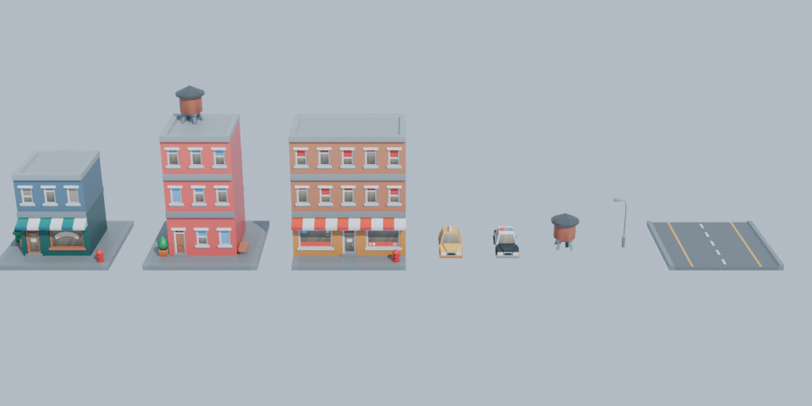
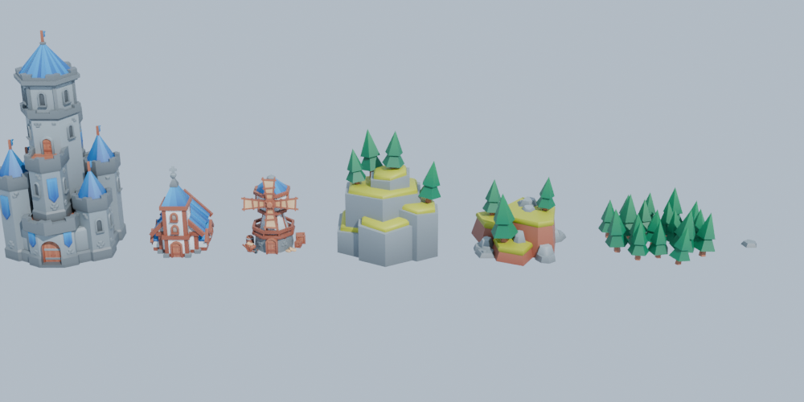

# 3d-asset-atlas

One index of free 3D models, scene generators and Blender tools for making 3D reels, with a
command-line tool that downloads what a scene needs and turns it into a Blender asset library.

It does **not** copy other people's models into this repo. It stores where each thing lives,
what licence it has, and how to fetch it. Downloads go to `assets/` (git-ignored) and every
download is logged with its licence so the caption credits are never a guess.




## Use it

```bash
python3 scripts/atlas.py find train            # who has trains?
python3 scripts/atlas.py find king queen       # humans / royalty
python3 scripts/atlas.py find hill rock        # terrain
python3 scripts/atlas.py fetch kaykit-medieval # castle, church, hills, mountains, trees (CC0)
python3 scripts/atlas.py fetch polygonal-mind --set tomb-chaser-1   # Egyptian pyramid set (CC0)
python3 scripts/atlas.py fetch nasa --path "3D Models/Astronaut"      # one folder of a big repo
python3 scripts/atlas.py polyhaven search rock # photoreal scanned rocks (CC0)
python3 scripts/atlas.py polyhaven get <id> --res 2k
python3 scripts/atlas.py polyhaven search sky --type hdris

# folder of models -> one .blend where every model is a named, browsable asset
blender -b -P scripts/blender_import.py -- --src assets/kaykit-medieval --out library/kaykit-medieval.blend

python3 scripts/atlas.py credits               # lines to paste under the reel
```

Needs Python 3.9+, `git`, and Blender 4.2+ for the import step. No pip packages.

## What is in the catalog

43 sources in `catalog/sources.json` (edit `catalog/build_catalog.py`, re-run it).

| Kind | Count | Examples |
|---|---|---|
| Asset packs on GitHub (one-command fetch) | 16 | 10 KayKit packs, Polygonal Mind (991 GLBs), NASA, Z-Anatomy, glTF samples |
| Libraries with an API | 3 | Poly Haven, 3dassets.dev, Objaverse |
| Libraries you download by hand | 4 | Kenney, Quaternius, Sketchfab CC0 heritage, Smithsonian |
| In-Blender library | 1 | BlenderKit |
| Generators | 13 | MPFB2 humans, Infinigen worlds, Blosm real cities, BlenderGIS terrain, trees, buildings, molecules |
| Pipeline tools | 3 | Blender MCP, Geometry Script, BlenderProc |
| Other indexes | 3 | awesome-blender, 3d-resources, awesome-cc0 |

Subject-by-subject lookup (trains, humans, kings, temples, hills...): **[SUBJECTS.md](SUBJECTS.md)**.
Licence rules for a monetised channel: **[LICENSES.md](LICENSES.md)**.
Instructions for Claude: **[SKILL.md](SKILL.md)**.

## Where it lives

This folder ships inside the cgi-shorts skill (`skillvideo` repo), so it is installed whenever the skill is. Run the commands from `asset-atlas/`.

## What was checked, and what was not

- Every GitHub repo in the catalog was probed over git on 2026-11-16: it exists, and its licence
  file was read. Entries marked `web search` (Kenney, Quaternius, Sketchfab) were not machine-checked.
- `fetch` for GitHub packs and the Polygonal Mind registry was run end to end, and
  `blender_import.py` was run on four packs with Blender 5.3 (the images above are the result).
- The `polyhaven` and `3dassets` commands were written from those projects' own API code and
  docs but could not be run where this repo was built (network blocked). Run one search on your
  machine first; if a field name changed, the fix is in `cmd_polyhaven` / `cmd_3dassets`.
