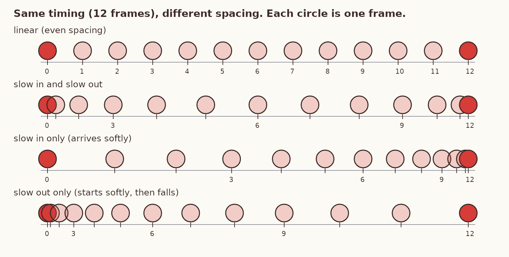
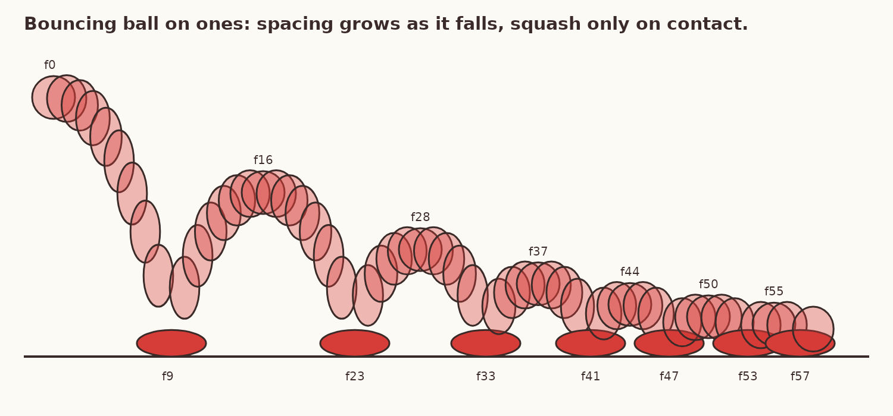
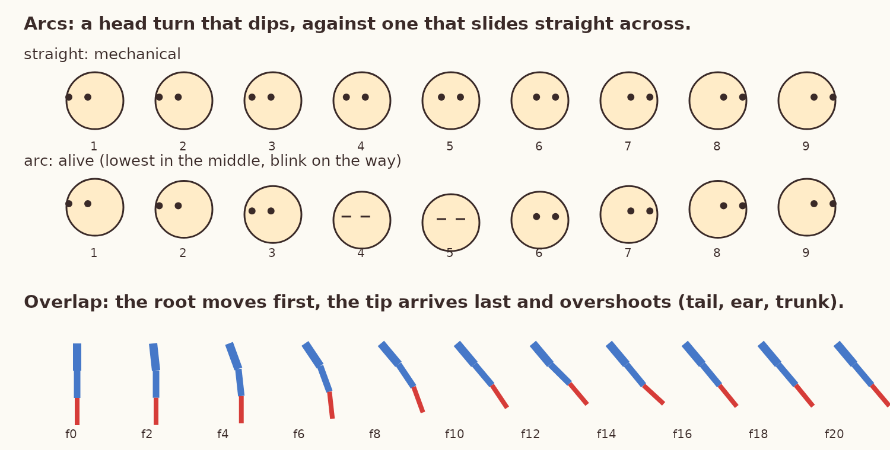
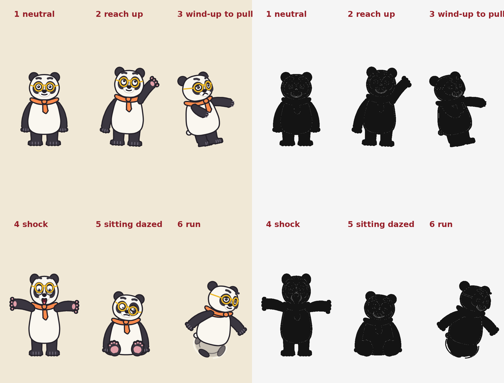
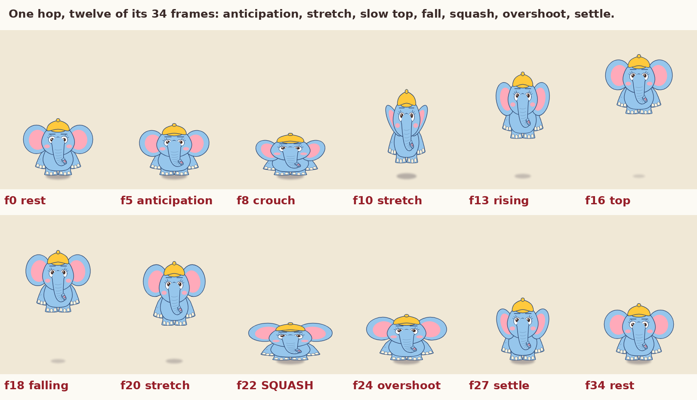

# Animation Fundamentals

**Knowledge base document 1 of the master mission (Phase 1).**
Version 1.1, 2026-11-11. Written for the Bheemu and Gaju series, usable for any 2D cartoon.

This document covers the basics every later document depends on: frames and exposure, keys and in-betweens, timing and spacing, the twelve principles, weight, posing, and five worked frame-by-frame demonstrations with real numbers. It ends with a ladder of exercises, a mistakes table, and a checklist.

## 0. How to read this document

### 0.1 Labels on every claim

| Label | Meaning |
|---|---|
| **[V]** | Verified: I read it in a source this session. The source is in section 14. |
| **[C]** | Craft convention: taught widely and attributed to a named book, but I could not open the book itself (it is under copyright), so I am relying on secondary sources. |
| **[R]** | My recommendation or estimate. A starting value to test, not a fact. |
| **[M]** | Measured in our own project (a script output or a rendered frame I looked at). |

Frame counts in this document are almost all **[R]**. They are starting points. The only way to confirm a timing is to play it.

### 0.2 What the figures are, and are not

The five figures in `figures/` are **stills and frame strips**. They are teaching diagrams. They are not animation and they do not prove that any motion works. Every table of numbers was printed by `figures/make_figures.py`, so the numbers and the pictures match **[M]**.

### 0.3 What I can and cannot do here

- I can compute spacing, render frames with our engine, lay them out as contact sheets, and inspect the stills.
- I cannot draw freehand. Our engine moves and deforms pre-built shapes (a puppet). Several principles below (solid drawing, strong lines of action) need either new engine features or a human with a drawing tool. Section 12 says which.
- I cannot hear audio.
- I have not opened *The Illusion of Life* or *The Animator's Survival Kit*. Where I describe what they teach, the label is **[C]** and the secondary source is listed.

---

## 1. What animation is

A film shows still pictures fast enough that the eye joins them into motion. Cinema film runs at **24 frames per second**; PAL television uses 25 **[V: Toon Boom]**. Our series is 24 fps.

A **frame** is one slot of time (1/24 s). A **drawing** is one picture. They are not the same thing: one drawing can be held for several frames. How many frames a drawing is held for is its **exposure** **[V: Toon Boom]**.

| Name | Each drawing held for | Drawings per second at 24 fps | Use it for |
|---|---|---|---|
| On ones | 1 frame | 24 | Very fast action, camera moves, anything that would strobe on twos **[V: Wikipedia, Inbetweening]** |
| On twos | 2 frames | 12 | Most character animation. This is how most hand-drawn animation is done **[V: Brian Lemay; Wikipedia]** |
| On threes or more | 3+ frames | 8 or fewer | Slow, limited or stylised motion; holds **[C]** |

About 12 drawings per second is the usual floor for motion that reads as smooth **[V: Toon Boom]**.

**Why it matters.** Exposure is a choice per moment, not per film. A classic chase cartoon mixes them: twos for acting, ones for the zip and the hit, a single drawing held for 8 to 20 frames for a reaction **[R]**.

**Common mistake.** Treating "24 fps" as "24 different pictures every second, all evenly eased". That is what our ten episodes did: the computer in-betweens every move with the same kind of ease, so everything floats. Even spacing on ones is the look of a slideshow tween, not of a cartoon **[M: episode review]**.

**Digital implementation.**
- *Our engine:* **corrected 2026-11-11.** Characters have a `twos` setting that is on by default (`Actor.twos` in `toon.py`): on every second frame a character keeps its previous pose unless it has moved more than 26 px, so slow acting is held on twos and fast moves switch to ones **[M]**. Version 1.0 of this document wrongly said the engine had no such option. The line boil redraws every third frame.
- *OpenToonz:* the New Level dialog has a **Step** value that sets how many frames each drawing is exposed for in the Xsheet **[V: OpenToonz manual]**. Step 2 is twos.
- *Krita:* frame-by-frame raster animation; a drawing stays on screen until the next keyframe on the timeline, and, as far as I know, a drawing stays on screen until the next keyframe, so leaving one empty cell between drawings gives twos **[V for the timeline docker; the hold behaviour is my understanding and was not confirmed in the manual this session, R]**.

---

## 2. The drawings: keys, breakdowns, in-betweens

### 2.1 The three kinds of drawing

| Drawing | What it is | Who made it in a studio | Marked on a chart as |
|---|---|---|---|
| **Key** (also "extreme") | The storytelling poses: where the action changes direction or meaning | The animator | A circled number **[V: Animation Mentor]** |
| **Breakdown** | The main pose between two keys. It decides *how* the character gets from one to the other (which part leads, what arc) | Animator or assistant | An underlined number **[V: Animation Mentor]** |
| **In-between** | The remaining drawings that fill the gaps | The in-betweener **[V: Wikipedia]** | A plain number |

The breakdown is where the character lives. Two keys ("arm down", "arm up") say what happens. The breakdown says whether the elbow leads, whether the wrist drags, whether the body dips. A computer tween replaces the breakdown with a straight average, which is why tweened motion looks mechanical **[R]**.

### 2.2 The timing chart

A timing chart is a small ladder drawn beside a key. It tells the in-betweener where each drawing sits between two keys **[V: Brian Lemay; Animation Mentor]**.

```
 (1)──┬──  key (circled)            Reading it:
      │                             drawing 9 is the breakdown, placed halfway.
  3 ──┤                             3, 5, 7 crowd toward key 1  -> slow OUT of key 1.
  5 ──┤                             11, 13, 15 crowd toward 17  -> slow IN to key 17.
  7 ──┤                             Odd numbers only: the shot is on twos.
      │
  9 ══╪══  breakdown (underlined)
      │
 11 ──┤
 13 ──┤
 15 ──┤
(17)──┴──  key (circled)
```

Rule for placing a tick: a tick halfway between two others is a "half". A tick halfway between that half and a key is a "third-ish favour" toward the key. Most classic charts are built only from repeated halves, because a half is the easiest drawing to make accurately **[C]**.

### 2.3 The exposure sheet (x-sheet, dope sheet)

A table with one row per frame and one column per level (character, prop, background, camera, sound). It records which drawing is on screen on which frame **[V: Toon Boom]**. Our template is `templates/xsheet.csv`.

Example, the first 12 frames of a head turn on twos:

| Frame | Action note | Bheemu drawing | Camera |
|---|---|---|---|
| 1 | looks left (key) | B1 | static |
| 2 | | B1 | |
| 3 | starts to turn | B2 | |
| 4 | | B2 | |
| 5 | | B3 | |
| 6 | | B3 | |
| 7 | eyes close | B4 | |
| 8 | | B4 | |
| 9 | lowest point (breakdown) | B5 | |
| 10 | | B5 | |
| 11 | eyes open | B6 | |
| 12 | | B6 | |

### 2.4 Two ways to work

| Method | How | Good for | Risk |
|---|---|---|---|
| **Pose to pose** | Draw the keys first, then breakdowns, then in-betweens | Acting, anything that must hit a mark or a beat of music | Can look stiff if breakdowns are just averages |
| **Straight ahead** | Draw frame 1, then 2, then 3, with no plan for the end | Fire, water, smoke, wild scrambles | Character drifts in size and never lands where needed |

Professionals mix both: pose to pose for the body, straight ahead for the tail, ears, cloth and effects on top **[C: this is principle 4 in the Thomas and Johnston list]**.

**Digital implementation.** OpenToonz's manual describes exactly this order: key drawings, then breakdowns, then in-betweens, flipped in the viewer to check **[V]**. Our engine is pose to pose only: `actor.move(f0, f1, ease, **pose)` and `actor.set(f, **pose)` **[M]**.

---

## 3. Timing and spacing

These are two different things and most beginner problems come from mixing them up.

- **Timing** is how many frames an action takes **[V: Ms Robbins vocabulary page]**.
- **Spacing** is where the drawings sit inside that time: close together means slow, far apart means fast.

Same timing, different spacing, completely different motion. A ball crosses 240 px in 12 frames four ways **[M]**:



| Frame | Even (linear) | Slow out and slow in | Slow in only (arrives softly) | Slow out only (starts softly) |
|---|---|---|---|---|
| 0 | 0 | 0 | 0 | 0 |
| 1 | 20 | 5 | 38 | 2 |
| 2 | 40 | 18 | 73 | 7 |
| 3 | 60 | 38 | 105 | 15 |
| 4 | 80 | 62 | 133 | 27 |
| 5 | 100 | 90 | 158 | 42 |
| 6 | 120 | 120 | 180 | 60 |
| 7 | 140 | 150 | 198 | 82 |
| 8 | 160 | 178 | 213 | 107 |
| 9 | 180 | 202 | 225 | 135 |
| 10 | 200 | 222 | 233 | 167 |
| 11 | 220 | 235 | 238 | 202 |
| 12 | 240 | 240 | 240 | 240 |

**How to read it.** Subtract each row from the next to get the gap. Linear: every gap is 20. Slow out and slow in: gaps go 5, 13, 20, 24, 28, 30, 30, 28, 24, 20, 13, 5. Small gaps at the ends, large in the middle.

**What each one feels like [R].**
- Even spacing: a machine, a conveyor belt, a camera pan. Almost never a living thing.
- Slow out and slow in: a calm, deliberate move. A hand reaching for a cup.
- Slow in only: something thrown or pushed that settles. Fast start, soft landing. A cartoon "snap to pose".
- Slow out only: something released that accelerates. A fall, a punch that ends in a hit with no cushion.

### 3.1 A naming trap

Traditional animators say **slow in** for "the drawings bunch up as it arrives" and **slow out** for "the drawings bunch up as it leaves" **[C]**. Software often uses "ease in" for the opposite end. Do not rely on the word. Look at where the drawings bunch.

In our engine **[M, from `toon.py`]**:

| Engine ease | Formula | Traditional name | Use |
|---|---|---|---|
| `lin` | t | even | machines, camera drift |
| `in` | t³ | slow out (starts slow, ends fast) | falls, a release |
| `out` | 1 − (1 − t)³ | slow in (starts fast, lands soft) | rises, arrivals |
| `io` | t²(3 − 2t) | slow out and slow in | calm acting |
| `snap` | 1 − (1 − t)⁵ | very strong slow in | cartoon snap to a pose |
| `over` | overshoots then returns | overshoot and settle | takes, stops |
| `elastic` | damped wobble | settle with wobble | jelly, ears, belly |
| `antic` | pulls back 16% first, then goes | built-in anticipation | quick starts |
| `step` | holds, pops on the last frame | a held drawing | pops, blinks |

### 3.2 Rules

1. Decide the timing first (how many frames, on the beat grid), then the spacing **[R]**.
2. Living things accelerate and decelerate. Even spacing is only for machines and for the middle of a long run **[C]**.
3. A hit has **no** slow in. The object is at full speed on the frame before contact **[C]**.
4. If a move looks floaty, do not change its length first. Move the breakdown toward one key (favour it) and look again **[R]**.

---

## 4. The bouncing ball

The first exercise in every animation course, because it contains timing, spacing, arcs, squash and stretch, and weight in the simplest possible object **[C]**.



A ball dropped from 400 px, each bounce reaching 60% of the last, first fall taking 9 frames **[M; the 60% and 9 frames are my design choices, R]**:

| Frame | Height (px) | Shape (height × width) | Note |
|---|---|---|---|
| 0 | 400 | 1.00 × 1.00 | top: round |
| 1 | 395 | 1.09 × 0.92 | gap 5 |
| 2 | 380 | 1.18 × 0.85 | gap 15 |
| 3 | 356 | 1.27 × 0.79 | gap 24 |
| 4 | 321 | 1.36 × 0.74 | gap 35 |
| 5 | 277 | 1.45 × 0.69 | gap 44 |
| 6 | 222 | 1.45 × 0.69 | gap 55 |
| 7 | 158 | 1.45 × 0.69 | gap 64 |
| 8 | 84 | 1.45 × 0.69 | gap 74, stretched, **not touching** |
| **9** | **0** | **0.62 × 1.61** | **contact: squash, one frame only** |
| 10 | 64 | 1.45 × 0.69 | leaves stretched |
| 11 | 118 | 1.45 × 0.69 | |
| 12 | 162 | 1.36 × 0.74 | |
| 13 | 196 | 1.27 × 0.79 | |
| 14 | 220 | 1.18 × 0.85 | |
| 15 | 235 | 1.09 × 0.92 | |
| 16 | 240 | 1.00 × 1.00 | top: round again |

Later contacts fall on frames 23, 33, 41, 47, 53, 57. Later tops: 144 px at f28, 86 at f37, 52 at f44, 31 at f50, 19 at f55.

**What to learn from the table.**

1. **The gaps grow on the way down** (5, 15, 24, 35 …) and shrink on the way up. The ball spends half its air time in the top quarter of the arc. That bunching at the top is what reads as gravity.
2. **Squash happens on contact only, for one frame.** The frame before contact is the *longest* drawing, not a half-squashed one.
3. **Volume stays the same.** 0.62 tall × 1.61 wide ≈ 1.0. If it gets wider it must get shorter **[V: University of Washington principles notes]**.
4. **Stretch follows the path of travel**, not the vertical. In this figure the ball moves mostly up and down so the stretch is drawn vertically; a ball flying sideways stretches sideways **[C]**.
5. **Each bounce is lower and shorter in time.** The contacts get closer together: 14, 10, 8, 6, 6, 4 frames apart.
6. **The path is a chain of arcs**, never zigzag lines.

### 4.1 Weight is told by the bounce

Starting values to test **[R]**:

| Object | Rebound height | Squash at contact | Frames on the ground | Bounces |
|---|---|---|---|---|
| Balloon | drifts, barely bounces | none | 3 to 4 (settles) | 0 to 1, with a slow fall on twos |
| Ping-pong ball | 75% | almost none | 1 | many, fast |
| Rubber ball | 60% | 0.62 × 1.61 | 1 | 6 to 7 |
| Mango | 15% | slight, stays dented | 2 | 1, then rolls |
| Bowling ball, or Bheemu | 5% or none | none in the ball; the *floor* shakes | 2 to 3 | 0; camera shake instead |

A heavy thing shows its weight by what it does to everything else: the floor shakes, dust jumps, a light character nearby is thrown into the air.

**Common mistakes and how to detect them.**

| Mistake | How it looks | How to detect | Correction |
|---|---|---|---|
| Even spacing in the fall | Ball slides down like a lift | Print the gaps; they are equal | Make each gap larger than the last |
| Squash before contact | Ball flattens in mid-air | Step frame by frame; the squashed drawing is above the floor line | Squash only on the contact frame |
| Squash held too long | Ball looks like clay | Count frames on the floor: more than 1 or 2 | One frame for rubber |
| Volume not kept | Ball grows and shrinks | Multiply height × width on each frame; it drifts away from 1.0 | Set width = 1 / height |
| V-shaped path | Bounces look like a pinball | Plot the centre positions; you see straight lines | Slow the horizontal a little at the top and keep the top drawings close |
| Every bounce the same | Ball never loses energy | Measure tops; they are equal | Multiply each top by a constant under 1 |

---

## 5. The twelve principles

The twelve principles were set down by Disney animators Frank Thomas and Ollie Johnston in *The Illusion of Life* (1981) **[V: the animators' site; C for the book text]**. Each entry below uses the same eight fields.

### 5.1 Squash and stretch

- **Means.** A soft form flattens under force and lengthens with speed, keeping the same volume.
- **Why.** It is how the eye tells rubber from stone, and a living body from a cut-out. The original authors note it also drives facial expression and dialogue, not only bouncing objects **[V: frankanollie.com]**.
- **How professionals use it.** Mostly small: a cheek bulging in a chew, a belly settling after a stop. The big rubber-ball squash is saved for hits.
- **Drawing example.** Draw a flour sack standing. Now draw it dropped: wide at the bottom, corners flopped out. Now draw it lifted by its top corners: long, thin, bottom corners dangling. All three should look like they hold the same amount of flour.
- **Frame demonstration.** Section 4 table, frames 8, 9, 10: 1.45 × 0.69, then 0.62 × 1.61, then 1.45 × 0.69.
- **Common mistake.** Scaling the whole character like a balloon, including the eyes and hat, so the face deforms.
- **Detect and correct.** Check height × width ≈ 1.0. Check that hard things (glasses, cap brim, teeth) did not change shape. Squash the body and the cheeks; keep the skull and props rigid.
- **Digital.** Our engine: `sx`, `sy` on the body; `head_sx`, `head_sy` separately **[M]**. The figure uses `sy=0.66, sx=1.3` on contact, which is volume 0.86: slightly under. Use `sx = 1/sy` going forward **[M, R]**.

### 5.2 Anticipation

- **Means.** A smaller move in the opposite direction before the main move.
- **Why.** It tells the audience where to look and what is about to happen, so a fast action can be read. The authors' own examples are a pitcher's wind-up and a golfer's backswing **[V: frankanollie.com]**.
- **How professionals use it.** The faster and bigger the action, the longer and bigger the anticipation. A surprise gag deliberately removes it.
- **Drawing example.** Before a jump: knees bent, body low, arms back, eyes on the target. Before a grab: hand pulls back and fingers spread.
- **Frame demonstration.** The hop in section 8.1: frames 2 to 8 are a crouch (6 frames) for a jump whose launch takes 2 frames.
- **Common mistake.** Skipping it, so the character teleports. Or giving every tiny move the same big wind-up, which looks rubbery and slow.
- **Detect and correct.** Step through the 6 frames before each main action: does anything move the opposite way? If not, add 3 to 8 frames of pull-back **[R]**. If the anticipation is longer than the action and the action is small, cut it down.
- **Digital.** Engine ease `antic` gives a quick 16% pull-back **[M]**; for anything important, key the anticipation pose by hand.

### 5.3 Staging

- **Means.** Presenting one idea so clearly that it cannot be missed: pose, placement, camera, and nothing competing.
- **Why.** The audience has one pair of eyes and about half a second to find the point of a shot.
- **How professionals use it.** One thing moves at a time. The important action is in clear space, in silhouette, not in front of a busy background or behind another character.
- **Drawing example.** Fill the pose in solid black. If you can still tell what the character is doing, it is staged. See figure 5.
- **Frame demonstration.** Not a frame matter; check one still per beat on a contact sheet.
- **Common mistake.** The key prop is hidden behind a body (our milk-test cat was behind the pot **[M]**). Two characters act at the same moment. The action happens at the frame edge.
- **Detect and correct.** Contact sheet at each beat; black-fill test; squint test. Move the actor, turn them to profile, or hold the second character still.
- **Digital.** `python3 episode.py sheet <frames> check.png` **[M]**.

### 5.4 Straight ahead and pose to pose

Covered in section 2.4. **Mistake:** using computer tweening as if it were pose to pose, with no breakdowns. **Correction:** every move longer than about 6 frames gets at least one hand-set breakdown that is *not* the average of its keys **[R]**.

### 5.5 Follow-through and overlapping action

- **Means.** *Follow-through:* loose parts keep moving after the body stops. *Overlap:* parts start and stop at different times. One part leads and the rest follow; hips lead the legs, eyes lead the head **[V: University of Washington notes]**.
- **Why.** If everything starts and stops on the same frame the character is a statue being slid around.
- **How professionals use it.** They work in layers: body first, then head, then arms, then tail, ears, hair and cloth, each offset 1 to 4 frames later than the part it hangs from **[R for the numbers]**.
- **Drawing example.** Draw a dog stopping: body already upright, ears still swung forward, tail still behind.
- **Frame demonstration.** Section 8.3, the three-segment table: root reaches 40° at frame 8, middle at frame 10, tip at frame 12, and the tip overshoots to 47° at frame 14.
- **Common mistake.** All parameters keyed on the same two frames. Our episodes do this almost everywhere **[M]**.
- **Detect and correct.** List the first and last frame of motion for body, head, limbs and appendages. If they are identical, offset them. Give every soft appendage an overshoot.
- **Digital.** In our engine, issue separate `move` calls with later start frames for `ear`, `tail`, `trunk` and use `over` or `elastic` for the last one **[M]**.

### 5.6 Slow in and slow out

Covered in section 3. **Mistake:** the same ease on every move. **Correction:** choose per move from the table in 3.1; hits get no slow in.

### 5.7 Arcs

- **Means.** Natural motion travels on curves, because limbs swing from joints.
- **Why.** Straight-line paths look robotic.
- **How professionals use it.** They track one point (nose, wrist, a ball) through all the drawings and make the dots form a smooth curve.
- **Drawing example.** A head turn is not a slide across; the nose dips in the middle.
- **Frame demonstration.** Section 8.2: the head drops 26 px at the middle drawing.
- **Common mistake.** Interpolating x and y linearly between two poses gives a straight line. This is the default of every tween.
- **Detect and correct.** Plot one point across frames (onion skin). Add a breakdown off the straight line.
- **Digital.** Krita's Onion Skins docker shows neighbouring frames tinted **[V: Krita manual]**; OpenToonz has onion-skin handles on the frame strip **[V: forum answers; check the manual for your version]**. In our engine, add a middle key with a `y` or `head_dy` offset.



### 5.8 Secondary action

- **Means.** A smaller action that supports the main one: a tail flick while sneaking, a gulp while staring.
- **Why.** It adds character and tells us what the character feels.
- **How professionals use it.** It must not compete. It happens before or after the main beat, not on it.
- **Drawing example.** Main: Gaju reaches for a laddu. Secondary: his ears lift and his tail curls.
- **Common mistake.** Secondary action louder than the main action, or none at all.
- **Detect and correct.** Cover the secondary part with your hand; the shot should still tell its story. Uncover: it should be richer, not confusing.

### 5.9 Timing

- **Means.** The number of frames an action takes, and so its weight and mood.
- **Why.** The same two drawings with 2 frames between them are a slap; with 12 they are a stroke.
- **How professionals use it.** They act it out, count it against a beat, and write it on the x-sheet before drawing **[C]**.
- **Starting values at 24 fps [R]:**

| Action | Frames |
|---|---|
| Blink | 4 to 6 (close 2, shut 1 to 2, open 2) |
| Zip off screen | 2 to 5, with 6 to 10 of anticipation first |
| Take (surprise) | antic 4 to 6, pop 2 to 3, hold 8 to 16, settle 6 |
| Head turn | 8 to 18 |
| Natural walk, one step | 12 **[C: Williams, via lecture notes]** |
| Cartoon walk or slow run, one step | 8 **[C: same]** |
| Run, one step | 6 **[C: same]** |
| Hold so the audience can read a pose | at least 8; a gag pose 12 to 24 |
| Pause before the big hit | 6 to 12 of near stillness |

- **Common mistake.** Everything the same length (our episodes sit on a 12-frame grid and too many moves fill the whole 12 **[M]**).
- **Detect and correct.** Write down the length of every move in a shot. If they are all alike, make the fast ones faster and the holds longer. Contrast is the point.

### 5.10 Exaggeration

- **Means.** Pushing a pose or a timing past real life so the idea reads at a glance.
- **Why.** Real-life amounts look weak in drawings.
- **How professionals use it.** Draw the pose, then push it further than feels comfortable, then pull back a little **[C]**.
- **Common mistake.** Exaggerating everything equally, so nothing stands out; or exaggerating size but not timing.
- **Detect and correct.** Compare the key pose to the rest pose. If the silhouette changed by less than about a fifth of the character's height or width, it is probably too mild for a gag **[R]**.

### 5.11 Solid drawing

- **Means.** The character is built from forms with volume and can be turned in space; weight and balance are respected; left and right are not mirror copies ("twins").
- **Why.** Flat symbols cannot overlap, turn or lean.
- **How professionals use it.** Construction: sphere for the skull, a bean or pear for the body, cylinders for limbs, a centre line and an eye line that wrap around the form (section 7).
- **Common mistake.** Twins; flat front view only; parts that slide over each other with no overlap. Lesson 1 scored our poses 7 of 12 partly for this **[M]**.
- **Detect and correct.** Flip the drawing left to right; twins become obvious. Offset one arm, tilt the shoulders against the hips.
- **Digital.** This is the principle our puppet engine handles worst. See section 12.

### 5.12 Appeal

- **Means.** A design and a performance the audience wants to watch: clear shapes, readable face, a personality. It applies to villains as well as heroes.
- **How professionals use it.** Simple big shapes, contrast between characters (big round calm Bheemu against small pointed quick Gaju), and asymmetry.
- **Common mistake.** Detail in place of design.
- **Detect and correct.** Shrink the frame to thumbnail size. Can you still tell the two leads apart and read the expression?

---

## 6. Weight, balance and force

**Weight** is shown in four places **[R, built from the principles above]**:

1. **Timing.** Heavy things take longer to start and longer to stop. Bheemu needs 6 to 8 frames to get moving; Gaju 2 to 3.
2. **Anticipation and recovery.** Heavy needs a deeper crouch before and a deeper sink after.
3. **Effect on the world.** The floor shakes, the table tips, the light character bounces.
4. **Pose.** The supporting leg is under the centre of mass. When weight shifts to one leg, that hip rises and the shoulder on the same side drops.

**Balance test.** Drop a vertical line from the middle of the chest. If it lands between the feet, the character is balanced. If it lands outside, the character is falling, which is right for a run and wrong for a stand.

**Force travels through the body.** A push starts at the feet, goes through the hips, the spine, the shoulder, the elbow, the wrist. Each joint leads the next by a frame or two. This is called "successive breaking of joints" in course material **[V: University of Washington assignment pages]**.

**Lift demonstration [R].** Bheemu lifts a heavy pot, 44 frames:

| Frames | Pose |
|---|---|
| 1 to 8 | Looks at pot, bends knees, hands take hold. Back curves over it. |
| 9 to 14 | Anticipation: sinks 5% lower, shoulders rise, cheeks puff. |
| 15 to 18 | Strain, nothing moves. The pot stays on the ground for 4 frames. This hold *is* the weight. |
| 19 to 30 | Legs straighten first; pot leaves the ground late (frame 22); arms stay straight; back leans away from the pot to balance it. |
| 31 to 36 | Pot arrives at the belly; body overshoots backward 3 to 4% and steps back one foot. |
| 37 to 44 | Settles; knees stay slightly bent; shoulders low. |

Light version of the same lift: 10 frames, no strain hold, the body does not lean back, the arm does the work alone.

---

## 7. Posing and construction

### 7.1 Line of action

One imaginary curve through the body, from head through spine to the supporting leg. Strong poses have a clear C or S curve. A straight vertical line is a rest pose and nothing else **[C: Preston Blair's books teach this]**.

How to draw it: draw the line first, alone, in one stroke. Then hang the head, chest and hips on it. If the line needs a kink, the pose is two ideas; pick one.

### 7.2 Silhouette

Fill the pose black. Hands, the prop, and the nose or trunk must sit outside the body shape, in clear space.



This is our own failed attempt **[M]**, kept as the example. "Sitting" reads as a short standing bear because the legs are hidden inside the body shape. "Run" has no stride. "Shock" is mirrored.

### 7.3 Twins

Both arms, or both legs, doing the same thing at the same angle. It looks stiff and symmetrical. Fix it by offsetting one side in angle, height or timing **[V: several animation teaching pages; listed in section 14]**.

### 7.4 Straights against curves, and contrast

A stretched side of a limb is a straight; the compressed side is a curve. A pose with only curves is mushy; only straights is stiff. Tilt shoulders against hips. Make one side of the pose open and the other closed **[C]**.

### 7.5 Construction drawing, step by step

For any character, in this order **[C: Blair; R for the steps as I have written them]**:

1. **Line of action.** One stroke.
2. **Head as a sphere.** Draw a centre line down the face and an eye line across it, both curving around the ball. They show where the head is turned and tilted.
3. **Body as a bean or pear.** A bean can bend and twist: pinched on one side, stretched on the other. This is what our rigid torso cannot do yet.
4. **Limbs as tapered cylinders**, with a visible elbow and knee. Draw the far-side limb as well, partly hidden.
5. **Hands and feet as simple wedges** first, then fingers and toes.
6. **Details last:** eyes on the eye line, glasses, scarf, cap.

**The flour sack.** A half-filled sack of flour with four corners, no face and no limbs. Draw it happy, sad, sneaking, tired. If a sack can act, the acting is in the body line and weight, which is exactly what our characters lack **[C]**.

---

## 8. Frame-by-frame demonstrations

### 8.1 A hop (anticipation, stretch, slow top, squash, overshoot, settle)



Rendered from our engine with these keys **[M]**:

| Frames | What | Engine values | Principle |
|---|---|---|---|
| 0 to 2 | Rest | `sy=1, sx=1` | hold |
| 2 to 8 | Crouch, ears back, eyes up | `sy=0.74, sx=1.2`, ease `out` | anticipation |
| 8 to 10 | Launch | `sy=1.3, sx=0.82`, ease `snap` | stretch |
| 10 to 16 | Rise to 300 px, slowing | ease `out`, shape back toward 1 | slow in at the top |
| 16 to 22 | Fall, speeding up, ears trail upward | ease `in`, `sy=1.22` | slow out, drag |
| 22 | Contact | `sy=0.66, sx=1.3`, one frame | squash |
| 23 to 26 | Rebound slightly taller than rest; ears flop down late | `sy=1.1` | overshoot, follow-through |
| 26 to 34 | Settle | ease `elastic` | settle |

**What I see when I inspect the strip.** The sequence reads. But the legs do nothing: a real crouch bends the knees and a real launch pushes off the toes; here the whole body is only scaled. The ears overlap; the trunk does not. This demonstrates the principles on a shape. It is not good character animation yet.

### 8.2 A head turn on twos, with an arc and a blink

Nine drawings, 18 frames **[M]**:

| Drawing | Frame | Turn | Dip (px) | Eyes |
|---|---|---|---|---|
| 1 (key) | 1 | 0% | 0 | open, looking left |
| 2 | 3 | 4% | 3 | open, pupils start to move first |
| 3 | 5 | 16% | 12 | half |
| 4 | 7 | 32% | 22 | shut |
| 5 (breakdown) | 9 | 50% | 26 | shut |
| 6 | 11 | 68% | 22 | half |
| 7 | 13 | 84% | 12 | open, pupils already at the target |
| 8 | 15 | 96% | 3 | open |
| 9 (key) | 17 | 100% | 0 | open, looking right |

Notes: the eyes lead the head **[V: UW notes]**; the blink hides the middle of the turn; the nose travels on an arc; spacing is slow out and slow in (gaps 4, 12, 16, 18, 18, 16, 12, 4).

### 8.3 Overlap in a chain (tail, trunk, ear)

Three segments. The root swings from 0° to 40° in 8 frames; each further segment starts 2 frames later and overshoots more **[M]**:

| Frame | Root | Middle | Tip |
|---|---|---|---|
| 0 | 0 | 0 | 0 |
| 2 | 6 | 0 | 0 |
| 4 | 20 | 6 | 0 |
| 6 | 34 | 20 | 6 |
| 8 | 40 | 34 | 20 |
| 10 | 40 | 40 | 34 |
| 12 | 40 | 45 | 40 |
| 14 | 40 | 39 | 47 |
| 16 | 40 | 39 | 39 |
| 18 | 40 | 40 | 39 |
| 20 | 40 | 40 | 40 |

Read frame 8: the root has arrived, the tip is only halfway. Read frame 14: the root stopped 6 frames ago and the tip is 7° past the target. That lag and overshoot is what makes a tail look soft.

### 8.4 A walk, one step in 12 frames

A walk is built from four poses: contact, down, passing, up **[V: University of Washington course pages, which credit Richard Williams' "contact method"; Wikipedia, Walk cycle]**. Twelve frames per step is two steps a second, a brisk natural walk **[C: Williams, via lecture notes]**.

| Frame | Pose | Body height | Legs | Arms |
|---|---|---|---|---|
| 1 | **Contact** | middle | Front heel touches, front leg straight; back foot on its toes | Opposite to the legs |
| 4 | **Down** | lowest | Front knee bends and takes the weight | Widest swing here **[C]** |
| 7 | **Passing** | rising | Standing leg straight under the body; other leg passes with knee bent | Passing the sides |
| 10 | **Up** | highest | Pushing off the back toes; front leg reaching forward | Swinging through |
| 13 | **Contact**, other foot | middle | Mirror of frame 1 | Mirror |

Rules: the weight goes down just after contact and up just after passing **[C]**. A planted foot must not slide: it stays at the same spot on the ground until it lifts. Changing where the passing position sits (higher, lower, leaning) changes the whole personality of the walk **[C]**.

A quadruped walk (Laddu, Bujji, Gaju on all fours) is a later lesson. Use Muybridge's animal locomotion plates as reference; they are in the public domain **[V: School of Motion reference list]**.

### 8.5 A take (surprise reaction)

24 fps, 30 frames **[R]**:

| Frames | Drawing | Notes |
|---|---|---|
| 1 to 6 | Sees it. Holds still. | Only the pupils move. The stillness sets up the take. |
| 7 to 11 | Anticipation: squashes down, eyes shut tight, shoulders up | 5 frames, slow in |
| 12 to 13 | Pops up: stretched tall, eyes huge, ears and hat lift off late | 2 frames, on ones |
| 14 to 25 | Hold the extreme, with a small vibration or drift | A "moving hold": never a frozen frame |
| 26 to 30 | Settles to a normal, worried pose | hat lands 3 frames after the head |

---

## 9. Exercises

Each exercise has a pass mark. An exercise is passed only after the frames have been rendered and inspected (by me on stills and contact sheets, and by Harshith on playback, since I cannot judge motion by watching it play). Failed attempts are repeated before moving on.

| # | Exercise | Objective | Output | Pass when | If it fails |
|---|---|---|---|---|---|
| 1 | Spacing strips | See timing against spacing | One dot moved 12 frames, four spacings, as video | Harshith can name each of the four without labels | Exaggerate the bunching |
| 2 | Rubber ball | Gravity, arcs, squash | 60-frame bounce | All six checks in section 4 hold; gaps printed and growing | Fix the one failing check only |
| 3 | Three balls | Weight | Balloon, rubber ball, bowling ball side by side | A viewer names all three with no colour or label | Change timing first, shape second |
| 4 | Ball with a tail | Overlap and drag | Bouncing ball with a 3-segment tail | Tail tip is never in line with the root during motion; overshoots at each stop | Increase the delay per segment |
| 5 | Flour sack drop and hop | Squash on a form with corners | 40 frames | Volume within 10% on every frame; corners lag | Check height × width per frame |
| 6 | Silhouette sheet (Lesson 1 retry) | Staging and line of action | Six key poses, colour and black | 10 of 12 on the Lesson 1 rubric; no twins | Needs the spine-bend and sitting-pose model fixes first |
| 7 | Head turn | Arcs, eyes lead, blink | 18 frames on twos | Nose path plotted is a curve; eyes move 2 frames before the head | Add the dip to the breakdown |
| 8 | Hop with legs | Anticipation and recovery on a character | 34 frames, knees bending | Crouch, toe push-off, late ears *and* trunk | Offset each appendage |
| 9 | Heavy lift and light lift | Weight in acting | Two 44-frame shots | Viewer knows which pot is heavy with the pots drawn identical | Lengthen the strain hold |
| 10 | Walk in place | The four poses | 24-frame cycle | Feet do not slide; hips lowest on the down, highest on the up | Check hip height per frame |
| 11 | Take | Contrast in timing | 30 frames | The pop is 2 to 3 frames, the hold at least 10 | Shorten the pop, lengthen the hold |
| 12 | One gag, 5 seconds | Everything together | Setup, anticipation, action, reaction | 20 of 26 on the QC rubric (`references/07-qc-rubric.md`) | Fix the two lowest scores and re-score |

---

## 10. Mistakes at a glance

| Symptom | Likely cause | How to detect | Correction |
|---|---|---|---|
| Floaty, weightless | Slow out and slow in on everything; no contact frames | Gaps are symmetrical on every move | Remove the slow in before hits and landings; add a squash frame |
| Robotic | Even spacing; straight paths | Equal gaps; plotted path is a line | Add a breakdown off the line; bunch drawings at one end |
| Stiff statue sliding | All parts keyed on the same frames | Start and stop frames identical for every part | Offset parts 1 to 4 frames; overshoot the loose ones |
| Mushy, slow | Every move has a long ease and same length | List of move lengths has no contrast | Snap fast moves to 2 to 4 frames; hold longer |
| Teleporting | No anticipation | Nothing moves opposite in the 6 frames before | Add a pull-back |
| Cannot tell what happened | Bad staging; two actions at once | Black-fill test fails; two things move on the same frame | One idea per shot; profile view; clear space |
| Twitchy | Too many keys; changes direction every few frames | More than one direction change in 6 frames | Delete keys; hold |
| Dead holds | A held pose is one frozen frame | Frame-difference tool reports long runs of identical frames | Moving hold: breathing, a blink, drift of 1 to 2% |
| Character changes size | Squash without keeping volume | Height × width drifts | width = 1 / height |
| Feet slide | Body moved without matching the step | Planted foot changes ground position | Lock the foot; move the body over it |

Our episode 7 measured about 58% still frames, against about 14% in a classic chase cartoon we measured the same way **[M: `tools/qc_frames.py video`]**. That is the "dead holds" row.

---

## 11. Checklist before a shot is called done

1. Timing written on an x-sheet before animating.
2. Every action longer than 6 frames has a breakdown that is not the average of its keys.
3. Anticipation before every main action, unless the gag is a surprise.
4. No slow in before an impact.
5. Squash on contact only; volume kept.
6. One tracked point per move plotted, and it is an arc.
7. Loose parts start later, stop later and overshoot.
8. No twins in any key pose; line of action is a clear curve.
9. Each key pose passes the black-fill test.
10. No frozen hold longer than 8 frames without a blink, breath or drift.
11. Contact sheet looked at; playback looked at by a person.
12. The report says what was inspected and what was not.

---

## 12. What this means for our engine

| Principle | Engine today | To reach the standard |
|---|---|---|
| Timing, slow in and out | Yes, ten eases | Use them with contrast |
| Squash and stretch | Whole-body and head scale | Per-part squash (belly, cheeks) |
| Anticipation, overshoot, settle | Yes, by keying | Do it on every action |
| Overlap | Possible with offset `move` calls | Make it the default; add a helper that delays appendages |
| Arcs | Only if a middle key is added | Add breakdown keys; an arc option on `move` |
| On twos | Yes, on by default (`Actor.twos`); corrected 2026-11-11 | Decide per shot where to force ones |
| Line of action, spine bend | **No.** Torso is rigid **[M]** | Add a spine bend parameter **(model change)** |
| Sitting, real run poses | **No.** Legs hidden or blurred **[M]** | Draw the poses **(model change)** |
| Solid drawing, turning in space | Front and side only | Needs hand drawing, or many more drawn views |
| Hand-drawn in-betweens | No | Krita, OpenToonz or Blender Grease Pencil with a person drawing; or AI in-betweening on a GPU, untested by us |

**Needs a human or other tools:** freehand drawing of new views; judging motion on playback; judging sound; any hand-drawn pilot.

**Tools, only what I confirmed in their documentation:**
- **Krita:** frame-by-frame raster animation with an Animation Timeline docker and an Onion Skins docker; right-click a timeline cell for *Create Blank Frame* **[V]**. A Krita forum answer says some frame commands were renamed after the manual was written (now *Blank Frame* and *Duplicate Frame*), so check your version.
- **OpenToonz:** Xsheet and Timeline views; levels created with a Step value; manual describes the key, breakdown, in-between workflow **[V]**.
- **Blender Grease Pencil:** has an *Interpolate* tool and an *Interpolate Sequence* operator that generate breakdown frames between two drawn frames, with linear, easing-equation or custom-curve options **[V: Blender release notes and manual index]**. Menu locations changed between versions.

---

## 13. Rules to add to the `cartoon-animation-director` skill

Proposed, pending Harshith's approval:

1. Every move over 6 frames gets a hand-set breakdown.
2. `sx = 1 / sy` unless there is a stated reason.
3. Appendages (ears, tail, trunk, scarf) start 2 frames after their parent and use `over` or `elastic`.
4. No slow-in ease (`out`, `io`, `snap`) into an impact; use `in` or `lin`.
5. A report must separate "rendered", "inspected as stills", and "watched on playback by a person".
6. Use "slow in" and "slow out" in the traditional sense, and name the engine ease beside it.

---

## 14. References

Tags: **[read]** I opened it this session. **[book]** copyrighted book I did not open; cited for attribution.

**Primary and authors' sources**
- Frank Thomas and Ollie Johnston, *The Illusion of Life: Disney Animation* (1981). Origin of the twelve principles. **[book]**
- The animators' own site, principles page: https://www.frankanollie.com/PhysicalAnimation.html **[read]**
- Richard Williams, *The Animator's Survival Kit* (first published 2001). Publisher page: https://academic.macmillan.com/academictrade/9780865478978/theanimatorssurvivalkit **[book; publisher page read]**
- Preston Blair, *Advanced Animation* (1947) and *Cartoon Animation*. Line of action, construction, walks. Animation Resources archive: https://animationresources.org **[book]**
- Eadweard Muybridge, *Animal Locomotion* (1887) and *The Human Figure in Motion*. Public-domain motion reference. Listed with other walk references at https://schoolofmotion.com/blog/walk-cycle-reference-ultimate-list-for-animators **[list read]**

**Teaching material**
- University of Washington, animation principles lecture notes: https://courses.cs.washington.edu/courses/cse457/03sp/lectures/animation-principles.pdf **[read]**
- University of Washington, walk cycle assignment (four poses, contact method): https://courses.cs.washington.edu/courses/cse459/19au/assignments/assignment_5/index.html **[read]**
- Brian Lemay, timing and timing charts: https://www.brianlemay.com/Pages/animationschool/animation/lipsyncbook/timing.html **[read]**
- Animation Mentor, reading a 2D timing chart: https://www.animationmentor.com/?p=39145 **[read]**
- Vocabulary (keys, breakdowns, in-betweens, timing): https://sites.google.com/pdsb.net/msrobbinsclasses/asm4m0/intro-to-animation/vocabulary-key-terms **[read]**
- Lecture notes summarising Williams' walk lesson (step timings, order of poses): https://dlsy9mediastudies.blogspot.com/2013/07 **[read; secondary]**
- Wikipedia, Inbetweening: https://en.wikipedia.org/wiki/Inbetweening **[read]**
- Wikipedia, Walk cycle: https://en.wikipedia.org/wiki/Walk_cycle **[read]**
- Twins and posing: see `references/02-research-references.md` for the three pages read earlier.

**Software documentation**
- Toon Boom Harmony, Xsheet and timeline basics: https://docs.toonboom.com/help/harmony-12-2/premium/basics/xsheet-and-timeline.html **[read]**
- Krita, animation: https://docs.krita.org/en/user_manual/animation.html and timeline docker: https://docs.krita.org/en/reference_manual/dockers/animation_timeline.html **[read]**
- OpenToonz manual: https://opentoonz.readthedocs.io/en/latest/drawing_animation_levels.html **[read]**
- Blender, Grease Pencil animation: https://docs.blender.org/manual/en/3.4/grease_pencil/animation/index.html and release notes: https://developer.blender.org/docs/release_notes/2.79/gpencil/ and https://developer.blender.org/docs/release_notes/2.93/grease_pencil/ **[read]**

**Our own material**
- `figures/make_figures.py` (prints every table in sections 3, 4 and 8)
- `lessons/L01-silhouettes/report_attempt1.md`
- `references/07-qc-rubric.md`, `tools/qc_frames.py`

---

## 15. Change log

| Date | Change |
|---|---|
| 2026-11-11 | Version 1.1. Correction: the engine does hold characters on twos by default. Sections 1 and 12 fixed. |
| 2026-11-11 | Version 1.0. Sections 1 to 14, five figures, all tables generated by script. Not yet reviewed by Harshith. No exercise in section 9 has been attempted except number 6 (failed, 7 of 12). |
