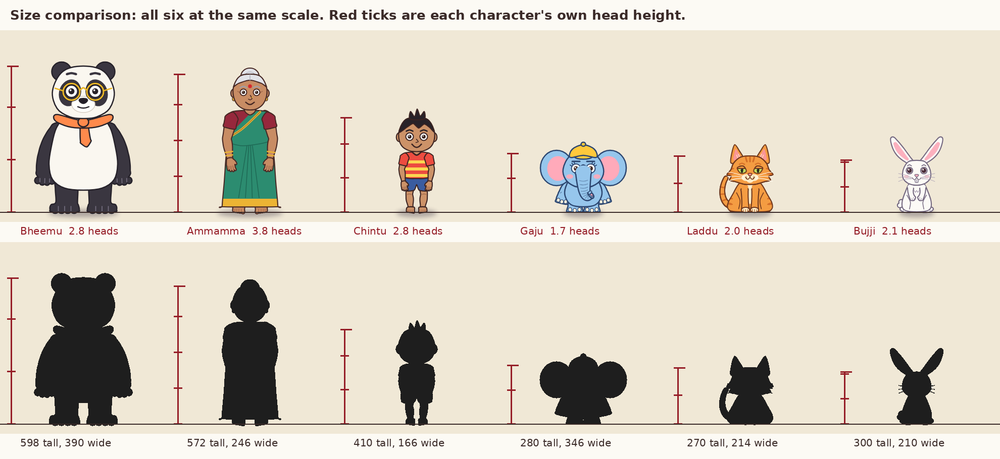
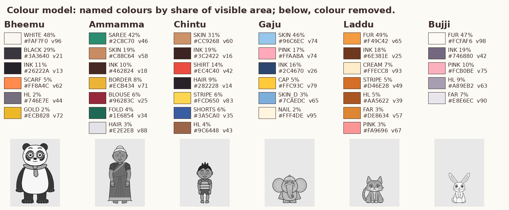
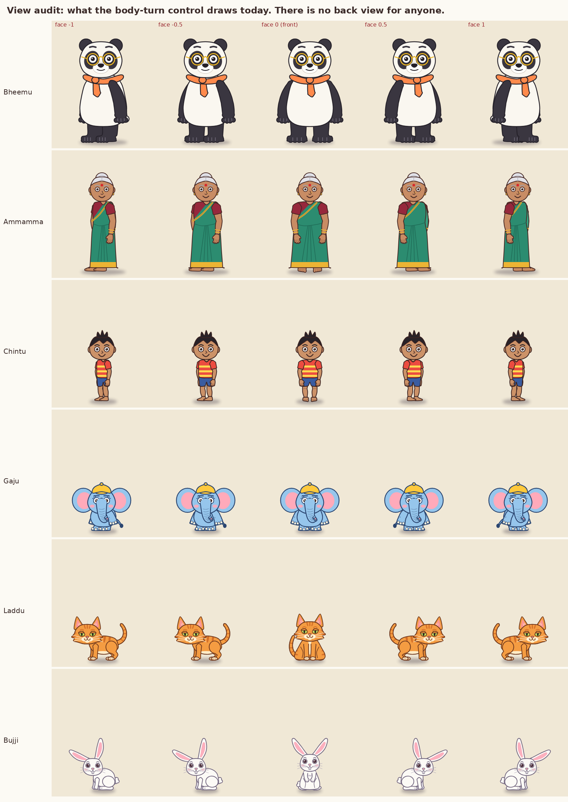
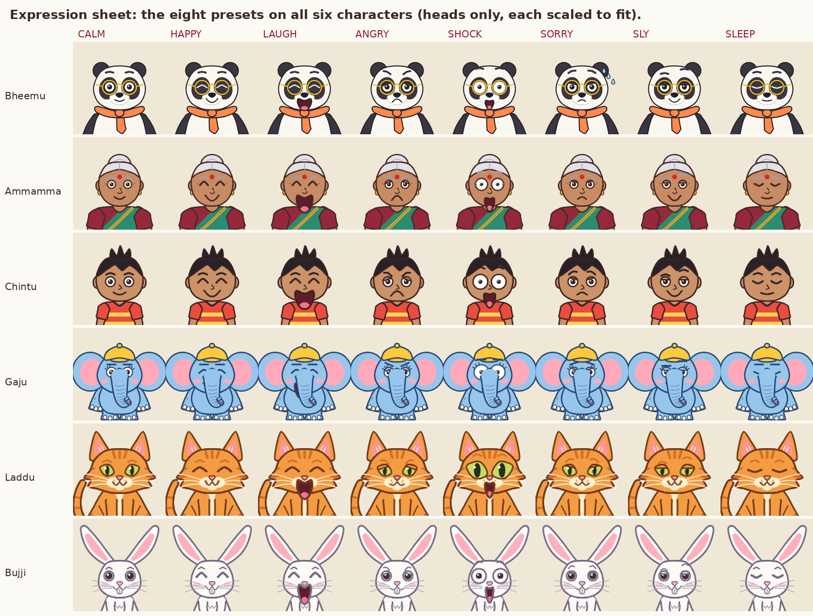
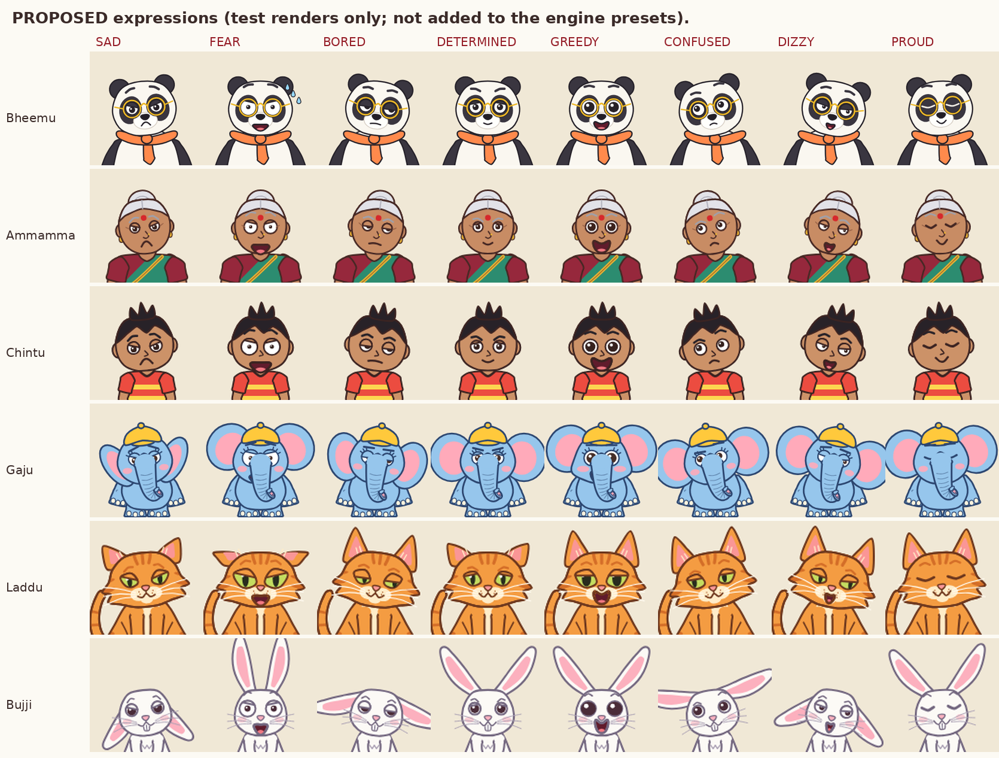
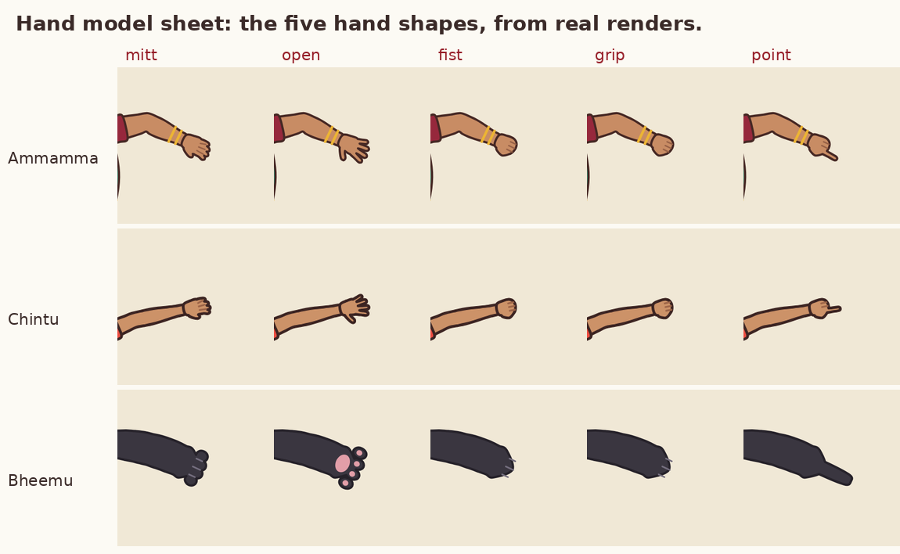

# Character Design Bible

**Knowledge base document 2 of the master mission (Phase 1).**
Version 1.4, 2026-11-11. Follows `Animation_Fundamentals.md`. Written for the Bheemu and Gaju series, usable for any original 2D cartoon cast.

This document does three jobs:

1. Teaches how a cartoon character is designed and documented so that it stays the same character in every drawing (sections 1 to 5).
2. Records our six characters as they are actually built today, with measurements taken from real renders (section 6 and the figures).
3. Gives the working method: pipeline steps, quality checks, exercises, mistakes, and the open design problems I found while measuring (sections 7 to 12).

## 0. How to read this document

### 0.1 Labels

Same labels as document 1.

| Label | Meaning |
|---|---|
| **[V]** | Verified: I read it in a source this session (section 14). |
| **[C]** | Craft convention attributed to a named book or widely taught, but I did not open the primary source. |
| **[R]** | My recommendation or estimate. Test it before trusting it. |
| **[M]** | Measured in our own project: printed by `figures/make_cd_figures.py` or seen by me in a rendered figure. |

### 0.2 What the figures are

Six figures, all generated from the engine's current character code, none drawn by hand:

| Figure | Shows |
|---|---|
| `CD_fig1_lineup.png` | All six at the same scale, in colour and as black silhouettes, with head-height rulers |
| `CD_fig2_views.png` | What each character looks like at five settings of the body-turn control |
| `CD_fig3_expressions.png` | The eight existing expression presets on all six |
| `CD_fig4_colour.png` | Named colours by share of area, and the cast with colour removed |
| `CD_fig5_hands.png` | The five hand shapes, enlarged |
| `CD_fig6_proposed_expressions.png` | Eight more expressions I tested. Proposals only; not added to the engine |

They are stills. A model sheet, a turnaround or an expression sheet is reference. None of it is animation, and none of it proves a character moves well.

### 0.3 Limits

- I cannot draw freehand and cannot generate images in this workspace. Every picture comes from code. Where a principle needs a new drawing (a back view, a real profile), I say so and do not pretend the engine has it.
- **Approved and frozen designs are not changed by this document.** Bheemu's face, and Bheemu's and Gaju's bodies and limbs, were approved earlier (lessons learned 3). Section 12 lists what I found. Section 13 records what Harshith decided on 2026-11-11 and what is still open. Approval to prepare a sheet is not approval to alter a production model.
- I am not a lawyer. Where I flag a resemblance to an existing character, it is a risk to look at, not a legal opinion.

---

## 1. What a character design bible is

In hand-drawn animation one character is drawn thousands of times, often by many artists. The **model sheet** is the reference that keeps those drawings the same: views from several angles, typical poses, and relative size **[V: Where Creativity Works, citing Stephen Cavalier's definition; BINUS turnaround article]**. A drawing that matches it is **on-model**; one that drifts is **off-model** **[V: same]**.

A full set normally has these sheets **[V: Clip Studio "Model Sheets for Character Designers"; Adobe character design guide; CG-Wire]**:

| Sheet | Purpose | Our status **[M]** |
|---|---|---|
| Construction sheet | Proportions and the simple forms the character is built from | Exists only as code, not as a drawing |
| Turnaround | Front, three-quarter, side, three-quarter back, back, at the same height | **Missing.** See 5.2 |
| Size comparison | Whole cast at one scale | Figure 1 |
| Expression sheet | The face across the main emotions | Figure 3: eight presets |
| Pose (attitude) sheet | Full-body poses that show how this character stands, sits, reacts | Missing. Lesson 1 attempt failed 7 of 12 |
| Hands, feet, special parts | The hard-to-draw parts, enlarged | Figure 5 for hands; none for feet, trunk, tail |
| Mouth chart | Mouth shapes for speech | None. Humans use a loudness-driven flap |
| Colour model | Every colour named, with values | Figure 4 |

A "bible" adds the non-visual facts: who the character is, how they move, what never changes, what they would never do.

**Why it matters for us.** Our characters are code, so they cannot drift by accident the way hand drawings do. They drift a different way: someone edits a function to fix an arm and the face changes with it. That has already happened (lessons learned 3). The bible plus the automatic check in section 8 is the guard.

---

## 2. Design principles

### 2.1 Personality first

A design is the outside of a personality. Write the brief before drawing.

**Brief template [R]:**

| Field | Question |
|---|---|
| Name, species, age | |
| Wants | What do they want in almost every story? |
| Flaw | What gets them into trouble? |
| Tempo | Fast or slow? Starts quickly or needs a wind-up? |
| Signature action | One thing only they do |
| Relationship | To each lead |
| Never | One thing they would never do |
| Three adjectives | These choose the shapes |

Our cast, from `series/bheemu-gaju.md` **[M]**, with tempo and "never" added by me **[R]**:

| Character | Wants | Flaw | Tempo | Never |
|---|---|---|---|---|
| Bheemu | Peace, a meal, a nap | Slow to notice; too proud of his work | Slow, heavy, long wind-ups | Starts the trouble |
| Gaju | Food | Cannot resist | Quick, bouncy, short wind-ups | Is cruel |
| Ammamma | A quiet clean house | Blames the wrong one first | Steady; sudden when angry | Loses for long |
| Chintu | To play now | No patience | Fastest human; restless | Stands still |
| Laddu | Milk, and to do nothing | Smug | Lazy, then a burst | Hurries without a reason |
| Bujji | Carrots, safety | Nervous | Freezes, then darts | Confronts anyone |

### 2.2 Shape language

Designers build a character on one dominant basic shape, because viewers read shapes before details **[V: BINUS shape-language articles; RocketBrush]**:

| Shape | Usually read as | Typical use |
|---|---|---|
| Circle, oval | Friendly, soft, safe | Likeable leads, children, comic relief **[V: BINUS, citing the Walt Disney Family Museum guide; Dream Farm Studios]** |
| Square, rectangle | Stable, solid, dependable, sometimes stubborn | Protectors, authority, heavy characters **[V: 3dsense; Skillshare class notes]** |
| Triangle, points | Dynamic, sharp, tense | Tricksters, antagonists, speed **[V: Skillshare class notes; Dream Farm Studios]** |

This is a convention that designers rely on, not a law of perception. Shapes can be mixed: a circle with a triangle gives "cheerful and energetic" **[V: Skillshare class notes]**.

**Our cast [R, from looking at figure 1]:**

| Character | Dominant | Secondary | Comment |
|---|---|---|---|
| Bheemu | Circle (head, ears, glasses) | Tall pear body | Soft and heavy. Correct for the calm one. |
| Gaju | Circle (three circles: head and two ears) | Small rounded body | Very round. Almost no straight or pointed element, so he reads as "baby", less as "mischief". |
| Ammamma | Tall rectangle (saree column) | Circle bun | Stable authority. Correct. |
| Chintu | Circle head on a small box | Triangle hair tuft | The tuft is his only pointed shape; it carries his restlessness. |
| Laddu | Triangle (ears, cheek fur, slanted eyes) | Round haunch | Reads sly. Correct. |
| Bujji | Long ovals (ears) | Small egg body | The ears are the character. |

Each character should repeat its shape in small parts: Bheemu's round glasses echo his round head. A design that mixes shapes with no plan looks like parts from different drawings.

### 2.3 Silhouette

Fill the character black. It should still be recognisable, and no two cast members should be confused.

I measured this. Each silhouette was scaled to the same height and overlaid on each other one; the number is how much of the combined shape they share **[M]**:

| | Bheemu | Ammamma | Chintu | Gaju | Laddu | Bujji |
|---|---|---|---|---|---|---|
| Bheemu | | 63% | 57% | 50% | 60% | 50% |
| Ammamma | 63% | | **72%** | 36% | 48% | 56% |
| Chintu | 57% | 72% | | 32% | 42% | 49% |
| Gaju | 50% | 36% | 32% | | 56% | 35% |
| Laddu | 60% | 48% | 42% | 56% | | 54% |
| Bujji | 50% | 56% | 49% | 35% | 54% | |

Reading it: the two humans are the most alike (72%), which is expected for two upright people and is rescued by their size difference (Chintu is 69% of Bheemu's height, Ammamma 96%). The two leads share only 50%. Nothing is dangerously close. **[R]** I would treat anything above 80% between two characters of similar size as a redesign trigger.

What the number cannot see **[M, from figure 1]**: in Gaju's front silhouette the **trunk disappears** inside the body. His most important feature does not show in his standing front pose. He reads as "round head with two discs". Stage him in three-quarter or profile, or with the trunk lifted clear, whenever the trunk matters.



### 2.4 Proportion in heads

Animators measure a character in units of its own head height, chin to top of skull **[C]**. General guide **[V: O'Reilly-hosted excerpt of *Cartooning: Character Design*]**: three heads or fewer looks young and cute; more than five looks grown-up; an average adult cartoon character is five or six; heroic types are eight or more. A classic short, comic adult can be about 2.5 heads; a classic lean cartoon rabbit about 4, or 5.5 counting ears **[V: Sal Goodsam cartooning notes]**.

Our cast, measured **[M]**. Head height comes from the head outline in the code; total height from the rendered silhouette:

| Character | Total height (units) | Width | Head height | Heads tall (to skull top) | Heads tall (with ears, cap, hair) | Height vs Bheemu |
|---|---|---|---|---|---|---|
| Bheemu | 598 | 390 | 208 | 2.8 | 2.9 | 100% |
| Ammamma | 572 | 246 | 142 | 3.8 | 4.0 | 96% |
| Chintu | 410 | 166 | 135 | 2.8 | 3.0 | 69% |
| Gaju | 280 | 346 | 134 | 1.7 | 2.1 | 47% |
| Laddu (sitting) | 270 | 214 | 114 | 2.0 | 2.4 | 45% |
| Bujji (sitting up) | 300 | 210 | 98 | 2.1 | 3.1 | 50% |

One unit is one pixel at 1080 × 1920.

What it tells us **[R]**:
- Everyone is under four heads. The whole cast is in "cute" proportion. That is consistent, and it suits a children-friendly slapstick.
- Ammamma is the only one near four heads, so she reads as the adult. Good.
- Bheemu and Chintu have the same head count (2.8). Bheemu reads older only through bulk and glasses.
- Gaju at 1.7 heads is close to a toddler or a toy. It makes him lovable and makes him hard to pose: there is very little body under that head for a line of action.

### 2.5 Why big heads read as cute

The ethologist Konrad Lorenz described a "baby schema": large head, high forehead, big eyes, chubby cheeks, small nose and mouth, short thick limbs, plump body. People rate faces with more of these features as cuter, which was confirmed experimentally with manipulated infant photographs in 2009 **[V: Glocker et al., *Ethology* 2009]**. Preston Blair's animation manual lists the cartoon version: head large for the body, eyes low on the head and wide apart, short fat legs tapering to small feet **[V: Cartoon Brew, quoting Blair's *Advanced Animation*]**.

Checklist against our leads **[M, by eye from figure 3]**: Gaju has the large head, round cheeks (blush marks) and short limbs, but his eyes sit in the upper half of the face, above the trunk root. Bheemu has the large head and low, wide eyes inside the patches. No change proposed; this is a note for any new young character: **eyes at or below the middle of the head**.

### 2.6 Contrast inside a cast

A pair works when they differ on several axes at once **[C]**:

| Axis | Bheemu | Gaju |
|---|---|---|
| Height | 598 | 280 |
| Aspect (height ÷ width) | 1.5, tall | 0.8, wider than tall |
| Value | White and near-black | Mid-light blue |
| Tempo | Slow | Quick |
| Signature part | Belly, glasses | Trunk, ears |

They are well separated. The weakest contrast in the cast is between the three small animals, Gaju, Laddu and Bujji, which are all 270 to 300 units tall. Colour and ears separate them; size does not.

### 2.7 Simplicity and animatability

Every line in a design is redrawn for every drawing, so classic designs drop detail that does not act. The best-known example is the hand: three fingers and a thumb. Animators give economy of line as the reason, and early characters built from circles had no room for more **[V: BBC interview reported by Yahoo News; Mental Floss]**. The pioneer animator Grim Natwick wrote that the full hand returned for the realistic heroine of the first Disney feature while the comic characters kept three fingers **[V: Comics Beat, quoting Natwick]**.

**Our decision [M].** Ammamma and Chintu have four fingers and a thumb, because Harshith asked for proper hands and fingers (lessons learned 2). The animals have paws. That is a legitimate choice. Its cost: a five-digit hand is harder to pose clearly and easier to get wrong, so it needs a hand sheet (5.6).

**Test for any detail [R]:** does it act, identify, or neither? Bheemu's glasses act (he cleans them) and identify. Gaju's trunk rings identify. A detail that does neither should go.

### 2.8 Colour

**Structure.** A common starting rule borrowed from interior design is 60-30-10: a dominant colour on about 60% of the area, a secondary on 30%, an accent on 10%. Sources that teach it also say it is a guide, not a formula **[V: LottieFiles colour guide]**.

Our cast, measured by counting pixels of each named colour **[M]**:

| Character | Largest | Second | Accent | Ink line |
|---|---|---|---|---|
| Bheemu | White 48% | Black fur 29% | Scarf orange 5%, gold 2% | 11% |
| Ammamma | Saree green 42% | Skin 19% | Border gold 8%, blouse maroon 6% | 10% |
| Chintu | Skin 31% | Shirt red 14% | Stripe yellow 6%, shorts blue 6% | 19% |
| Gaju | Skin blue 46% | Ear pink 17% | Cap yellow 5% | 16% |
| Laddu | Orange fur 49% | Cream 7% | Stripes 5%, pink 3% | 18% |
| Bujji | White fur 47% | Ear pink 10% | none | 19% |

Bheemu is a textbook case: two large neutral areas and one small warm accent at the neck, right under the face. Bujji has no accent colour at all.

**Value matters more than hue.** Value is how light or dark a colour is. A design that separates only by hue falls apart in dim scenes, small sizes and for colour-blind viewers. Test: remove the colour and see whether the design still reads **[V: BuzzFlick guide recommends the greyscale test; itch.io colour notes say to check the character against its background]**.



Findings from the greyscale strip and the numbers **[M]**:

1. **Bheemu** has the strongest value pattern in the cast: 96 against 21 on a 0 to 100 scale.
2. **Gaju's skin and ear-pink have the same value (74 and 74).** In grey his ears are flat discs; the inner ear vanishes.
3. **Gaju against the sky.** Our sky colour has value 75 and is also blue. Gaju's body is value 74. The difference is zero, and the hues are close: skin is RGB 150, 198, 236; sky is 132, 204, 244. In the garden, terrace and kite scenes only his dark outline separates him from the background.
4. **Ammamma's saree against bare earth** differs by 2 in value. Hue (green on brown) saves it, and her gold border helps.
5. **Bujji** is value 98. On any pale wall she is held by her outline alone.

| Main body colour minus background | Sky (v75) | Earth (v43) | Night (v10) |
|---|---|---|---|
| Bheemu (v96) | +21 | +53 | +85 |
| Ammamma (v46) | −29 | **+2** | +35 |
| Chintu (v60) | **−14** | +17 | +49 |
| Gaju (v74) | **0** | +31 | +63 |
| Laddu (v65) | **−9** | +22 | +55 |
| Bujji (v98) | +21 | +54 | +87 |

**[R]** A difference under 15 either way is a merge risk. Fix it in the staging first (put a darker tree, wall or cloud behind the character) before touching an approved palette.

**Ink colour.** Each character has its own tinted ink instead of pure black: Gaju's is dark blue, Laddu's brown, Bujji's grey-violet **[M]**. This is a recognised way to keep lines soft; the rule is that the ink must always be clearly darker than the fill it surrounds. Bujji's ink is value 42 against fur 98, which holds.

### 2.9 Originality and clearance

The master mission forbids copying existing characters, signature sequences or designs. Checks for every new character **[R]**:

1. Search the name with the species (we found an existing Indian animated elephant with a similar name earlier; Harshith chose to keep "Bheemu and Gaju").
2. List the three most famous characters of that species and write down their signature traits. Ours must not share the combination.
3. Describe our character in one sentence. If the sentence also describes a famous character, change something.

Two flags from doing this for our leads are in section 12 (items 2 and 3).

---

## 3. Real anatomy behind our animals

Cartoon animals are simplified from real ones. Know the real structure, then choose what to drop on purpose.

| Animal | Real anatomy | What our model does **[M]** | Status |
|---|---|---|---|
| **Giant panda** | Bears walk on the whole sole (plantigrade) **[V: Wikipedia, Plantigrade; LibreTexts veterinary anatomy]**. Five digits plus a "false thumb", an enlarged wrist bone used to hold bamboo; it gives a grip but does not rotate food like a true thumb **[V: Wang et al., *Scientific Reports* 2022; ASU News]** | Flat feet with toes: correct. Paws show four toes and no false thumb | Deliberate simplification. Keep four everywhere |
| **Asian elephant** | Trunk ends in one finger-like tip (African elephants have two), so it tends to wrap and squeeze more than pinch. Five nails on each forefoot, four on each hind foot. Two domes on the forehead. Ears smaller than African **[V: Wikipedia, Asian elephant]**. Elephants stand partly on their toes with a raised heel (semi-digitigrade) **[V: WorldAtlas; Wikipedia, Digitigrade]** | Trunk with rings and a nostril tip. Three nails per foot. Very large ears. Round column legs | Deliberate. Big ears are a cartoon choice. Gaju's trunk should **wrap** objects, which is both accurate and funnier |
| **Cat** | Walks on its toes (digitigrade) **[V: LibreTexts]**. Five toes on each front paw including a dewclaw that does not touch the ground, four on each hind paw **[V: Wikipedia, Cat anatomy]**. The "backward knee" on the hind leg is the ankle | Sitting front view and a side walking view; almond eyes with slit pupils. Every paw is drawn with three partings, so four toes, front and hind **[M, code and an enlarged render]** | Recommended: four toes on every paw, dewclaw not drawn. Matches what is visible on a real cat |
| **Rabbit** | Flat on the whole hind foot at rest, up on the toes when running **[V: Wikipedia, Rabbit, via a mirror]**. An older pair of sources disagreed only because each described one of those two states **[V: Wikipedia, Plantigrade; Britannica]**. Five toes on each front foot, one of them a much-reduced dewclaw; four on each hind foot. The soles are covered in fur, with no bare pads like a cat's **[V: Wikipedia, Rabbit; To Know the Land; Leporidae drawing guide]** | Sits up on long hind feet with front paws at the chest; hops in profile. Every paw is drawn with two partings, so three toes **[M, code and an enlarged render]** | Provisional: three toes as drawn. Never draw pink paw pads on Bujji |

**Rule [R]:** a simplification is fine if it is (a) chosen, (b) written here, (c) identical in every shot. A toe count that changes between shots is an error; a toe count that is "wrong" but constant is a design.

---

## 4. The pipeline for a new or changed character

Twelve steps, matching Phase 3 of the master mission. Each has an output and a gate. Do not start a step before the previous gate is passed.

| # | Step | Output | Gate (who checks) |
|---|---|---|---|
| 1 | **Brief** (2.1) | One filled template | Harshith agrees the personality |
| 2 | **Clearance** (2.9) | Three-line note | No shared signature combination |
| 3 | **Silhouette studies** | 6 to 10 black shapes | The chosen one is recognisable at 64 px tall; overlap with existing cast under 80% **[R]** |
| 4 | **Construction** | The shape rebuilt from ball, bean, cylinders, with centre line and eye line | Can be drawn from front and side without contradiction |
| 5 | **Proportion and anatomy guide** | Height in heads; joint positions; digit counts; real-animal notes | Numbers written into section 6 |
| 6 | **Final model sheet** | Clean front view | **Shown to Harshith before anything is animated** (lessons learned 4) |
| 7 | **Turnaround** | Front, three-quarter, side, back on shared guide lines | Features line up across views |
| 8 | **Expression sheet** | At least 12 expressions | Each named correctly by someone who was not told the names |
| 9 | **Mouths, eyes** | Mouth chart; eye shapes | Covers every sound or reaction the scripts need |
| 10 | **Hands, feet, special parts** | Enlarged sheet | Digit count right in every drawing |
| 11 | **Action poses** | Stand, walk, run, jump, sit, fall, reaction, sleep | Passes the Lesson 1 silhouette rubric, 10 of 12 |
| 12 | **Colour model and checklist** | Named palette, greyscale check, background check, baseline numbers | `make_cd_figures.py check` passes; checklist in 8.1 filled |

**Four reference views are not an animation.** New drawings are made whenever an action needs one.

---

## 5. The sheets in detail

### 5.1 Construction sheet

**What.** The character as simple solid forms. **Why.** Forms can be turned; flat outlines cannot. **How.** Work in this order (from document 1, section 7.5): line of action, head ball with centre line and eye line, body bean, limb cylinders, hand and foot wedges, details.

**Bheemu in forms [R, described from the model]:**
- Head: a slightly flattened ball, 208 high. Ears: two smaller balls set on the upper back corners.
- Eye patches: two tilted ovals that wrap around the ball. Glasses sit in front of them.
- Body: a tall pear, widest at the hips. The scarf rings the join between head and pear.
- Arms: thick tapered cylinders starting **behind** the shoulder line, ending in a broad paw.
- Legs: short straight cylinders; flat feet.

**Gaju in forms [R]:**
- Head: a ball 134 high. Ears: two large discs hinged at the sides of the ball.
- Trunk: a tapering tube from the centre of the face, thicker than an arm.
- Body: a small egg, less tall than the head.
- Legs: four short columns.

**Common mistake.** Designing only the front outline. **Detect:** try to describe the side view in words; if you cannot say where the ear attaches or how far the muzzle sticks out, the form is not designed yet.

### 5.2 Turnaround

**What.** The same character at the same height from front, three-quarter front, side, three-quarter back and back, with horizontal guide lines across all views (top of head, eye line, chin, shoulder, waist, knee, ground) **[V: BINUS turnaround article; Clip Studio]**. **Why.** It solves design questions before animation starts: what a flat cartoon eye does in profile, what the hair looks like from behind **[V: BINUS]**.

**Our audit [M].**



| Character | What the body-turn control actually gives |
|---|---|
| Bheemu, Ammamma, Chintu, Gaju | The body narrows a little and the arms shift. With the body-turn control alone the head stays facing the camera, which is what figure 2 shows. **Correction, 2026-11-11:** a separate head-turn control (`yaw`) already exists and gives a three-quarter head; I had not tested it in this audit. There is still no true profile and no back. Gaju shows a tail at the turned settings. |
| Laddu, Bujji | Two body drawings: front sitting, and side on four legs (mirrored for left and right). The head still faces the camera in the side view. |
| Everyone | No back view. |

This is the largest gap in the cast. It is why chases, sneaking, eating in profile and "looking at each other" have all been staged flat to camera, and it is part of why the motion looks like cut-outs.

**What a turnaround must settle for our cast [R]:**
- Bheemu in profile: how far the muzzle projects; whether one or both glasses lenses show; where the far ear sits.
- Gaju in profile: trunk root, one ear as a large flap hiding the neck, the cap peak direction.
- Ammamma: the bun from the side and back; the saree end (pallu) hanging behind the shoulder.
- Chintu: the hair tuft from the side.

**Asymmetric features must not flip.** When a side view is made by mirroring, anything one-sided swaps sides. List for our cast: Ammamma's saree drape over one shoulder, Bheemu's scarf tail, Chintu's tuft lean, Gaju's cap peak. I have not checked these pixel by pixel across mirrored views; it is on the checklist.

### 5.3 Size comparison

Figure 1. Rules **[R]**: all characters stand on one ground line at true scale; a head-unit ruler beside each; the sheet is regenerated whenever any character changes. Never rescale a character inside a shot to make a composition fit; move the camera instead.

### 5.4 Expression sheet

**What makes an expression.** Five controls on the face, plus the head and whatever else the species offers **[C for the breakdown; M for the engine names]**:

| Part | What it does | Engine parameter |
|---|---|---|
| Brows | The strongest signal. Inner ends down: anger. Inner ends up: sadness, worry. One up: doubt | `brow`, `brow_ang`, `brow_asym` |
| Upper lids | Low: sleepy, smug, bored. Gone: shock | `lid`, `eye_open` |
| Eye size, pupils | Wide eye with small pupil: fear or shock. Large pupil: delight, want | `eye_pop`, `pupil_s`, `pupil` |
| Mouth | Corners up or down, width, how open | `smile`, `mouth_w`, `mouth_open` |
| Cheeks | Push up under the eyes in a real smile | `cheeks`, `happy` |
| Head | Tilt, nod, turn. Tilt alone changes the meaning of the same face | `head_rot`, `pitch`, `yaw`, `head_dy` |
| Species extras | Ears, trunk, tail, whiskers work as a second pair of eyebrows | Gaju `ear`, `trunk_curl`; Bujji `ear`; Laddu `ear_back`, `tail` |

A good expression uses several of these together and is **asymmetric**. An expression made by changing only the mouth is the commonest beginner error.

**The eight we have [M].**



| Preset | Key values in `show.py` |
|---|---|
| CALM | `smile 0.4`, eyes open, brows level |
| HAPPY | `happy 1`, eyes closed into arcs, `smile 1`, `mouth_w 1.3` |
| LAUGH | HAPPY plus `mouth_open 0.9`, `mouth_w 1.4` |
| ANGRY | `brow_ang 24`, `lid 0.25`, `smile −0.8` |
| SHOCK | `eye_pop 1.5`, `pupil_s 0.55`, `brow 18`, `mouth_open 0.8` |
| SORRY | `brow_ang −18`, `smile −0.4`, `sweat 1` |
| SLY | `lid 0.3`, `brow_asym 1`, `smile 0.9` |
| SLEEP | eyes closed, `smile 0.2` |

**My inspection of figure 3.**

| Finding | Detail |
|---|---|
| Reads well | HAPPY, LAUGH and SHOCK on all six. ANGRY on Bheemu, the humans and Laddu |
| Weak | Bujji's ANGRY and SLY are almost the same as her CALM. Gaju's ANGRY is brows only |
| **Gaju's mouth is hidden** | The trunk covers it in every expression except LAUGH. His face has three working parts, not five. His ears and trunk must carry emotion, and none of the eight presets moves them |
| Sweat only shows on Bheemu | SORRY sets `sweat`; the other five do not draw it |
| **The head never moves** | All 48 faces are level and straight. No tilt, no nod |
| **The body never changes** | Emotion is in the face only. Shoulders, spine and arms are identical in all 48 |
| Too few | Eight. The pipeline asks for twelve or more. Missing: sad, afraid, bored, determined, greedy, confused, dizzy, proud, disgusted, in pain |

**Eight more, tested [M].**



| Proposal | Recipe (added to CALM) | My verdict on the render |
|---|---|---|
| SAD | `lid 0.35, brow_ang −22, smile −0.7, pupil (0, 0.5), head_rot −6`; Gaju `ear −0.8`, Bujji `ear −1` | Reads. Bujji with dropped ears is the best single drawing on either sheet |
| FEAR | `eye_pop 1.35, pupil_s 0.5, brow 14, brow_ang −16, mouth_open 0.45, smile −0.6, sweat 1` | Reads on Bheemu and Laddu (ears flat). **Fails on the humans**: they look stern, not scared. Needs raised shoulders and a pulled-back head |
| BORED | `lid 0.55, pupil (0.6, 0.1), head_rot 8` | Reads on all. The head tilt does most of the work |
| DETERMINED | `lid 0.2, brow_ang 14, smile 0.25, mouth_w 0.7` | Too close to a mild ANGRY. Needs a body pose |
| GREEDY | `eye_pop 1.25, pupil_s 1.35, brow 10, smile 1, mouth_open 0.35, cheeks 1` | Reads as "delighted". Good enough for food shots |
| CONFUSED | `brow_asym 1, smile −0.25, pupil (−0.5, −0.4), head_rot −10` | Reads on all |
| DIZZY | `lid 0.45, pupil_s 0.6, pupil (0.5, 0.3), mouth_open 0.3, head_rot 12` | Reads as groggy. Classic dizzy needs spiral or mismatched pupils, which the engine lacks |
| PROUD | eyes closed, `brow 8, smile 0.6, pitch −0.4, head_rot −4` | Fails. Looks like SLEEP. Pride is a chest-out body pose |

Lessons from the test **[M]**: a head tilt of 6 to 12 degrees improved every expression it was used on; ears are the strongest emotional part on Bujji and Gaju; and three of eight could not be made with the face alone. Bujji's `ear` scale is not intuitive: −1 is drooped, 0 is flat sideways, 1 is upright, so mid values give "aeroplane ears".

### 5.5 Mouth chart

A mouth chart is a small set of mouth drawings, each standing for a group of speech sounds that look alike on the lips. Sets derived from Preston Blair's are the usual starting point; sources describe them with anywhere from eight to twelve shapes, and simpler styles use five or six **[V: Frameo guide; High on Films; a UAL student research post; these disagree on the exact count]**. One group that every version keeps: closed lips for M, B, P; teeth on lip for F, V; a round shape for O and U **[V: same]**.

Charts built for English do not map cleanly onto other languages **[V: UAL research post on Chinese lip-sync]**. **[R]** Treat that as a warning for Telugu, which has sounds and vowel lengths an English chart does not separate.

**Our situation [M].** Animals never speak (lessons learned 9). Ammamma and Chintu speak short Telugu lines from generated voice; their mouths open and close with loudness (`voice.speak`). That is a flap, not lip-sync.

**Recommended minimum for the two humans [R, not built]:**

| Shape | For |
|---|---|
| Closed | Rest; మ, బ, ప (m, b, p) |
| Small open | Most consonants |
| Wide open | ఆ (aa) |
| Wide smile | ఇ, ఈ, ఎ (i, ee, e) |
| Round | ఉ, ఊ, ఒ, ఓ (u, oo, o) |
| Teeth | స, శ (s, sh), and shouted lines |

Six shapes, chosen by vowel, changed on twos, would already look far more like speech than a flap. Whether it is worth building depends on how much the humans speak; in a silent comedy it is low priority.

### 5.6 Hands, feet and special parts



**What exists [M]:** five hand shapes selected by `handL` / `handR`: `mitt` (relaxed), `open`, `fist`, `grip`, `point`. Humans have a palm, four fingers and a thumb. Bheemu has a paw with four toes; `open` shows a palm pad and four toe pads.

**My inspection of figure 5.**
- Human `fist` and `grip` are nearly the same drawing. `grip` should be open enough to show the held object's thickness.
- Human `point` is clear.
- **Bheemu's `point` is a single long stump.** It does not look like a paw pointing. Either draw one toe extended from a visible paw, or have him point with the whole arm.
- The wrist is always in line with the forearm. Hands never bend back or droop, so they cannot show weight (a carried pot) or attitude (a limp wrist).
- Missing shapes: pinch, flat palm up (holding a plate), flat palm toward camera (stop), two hands together.

**Required on a full sheet [R]:** each shape from palm side, back side and edge; a relaxed hand hanging; a hand resting on a surface; feet from front and side, flat and on toes; for Gaju the trunk in five positions (hanging, curled up, reaching, wrapped around an object, raised in alarm); for Laddu and Bujji tail and ears in three positions each.

**Drawing hands, the short method [C: taught in Blair and most drawing courses]:** draw the palm as a soft box first; mark the knuckle line as an arc, not a straight row; fingers taper and are different lengths; the thumb starts low on the palm, near the wrist, from the side. Keep the fingers grouped: two together and one apart reads better than all spread evenly.

### 5.7 Pose (attitude) sheet

Full-body drawings that show character: how Bheemu sits down heavily, how Gaju sneaks, how Ammamma stands with a hand on her hip. Minimum set: neutral, proud, defeated, sneaking, startled, walking, running, sitting, sleeping, signature action.

**Our status [M]:** Lesson 1 attempted six Bheemu poses and scored 7 of 12. Causes recorded there: the torso cannot bend, sitting was made by hiding the legs, poses were mirrored, the run was a blur. Until those are fixed in the model there is no honest pose sheet to publish. It is exercise 6 below.

### 5.8 Colour model

**What.** One reference drawing with every colour area named and its exact value written down. Studio software keeps this as a "colour model" that painters pick colours from so nobody mixes their own **[V: Toon Boom Harmony documentation, Colour Models]**.

**Ours [M]:** colours are named constants on each class (`Bheemu.WHITE`, `Gaju.SKIN`, `Ammamma.SAREE` …). Figure 4 prints them with hex values. Rules **[R]**:
1. No colour is typed as a number inside drawing code; it is always a named constant.
2. Night and shadow versions are made by one shared tint over the whole character, never by editing individual colours.
3. Any new colour is added to the constants and the baseline is regenerated.

### 5.9 Costume, props and continuity

| Character | Fixed items **[M]** | Continuity traps **[R]** |
|---|---|---|
| Bheemu | Round gold glasses, orange scarf | Glasses must come back after being knocked off; scarf tail side |
| Gaju | Yellow cap | Cap on in every shot unless the gag removes it, then it returns |
| Ammamma | Green saree, gold border, maroon blouse, silver bun, red bindi, bangles, earrings | Drape side; bangles on both wrists; bindi centred |
| Chintu | Red shirt with yellow stripes, blue shorts, bare feet, tuft | Stripe count |
| Laddu | Stripes, cream bib and muzzle | Stripe positions on tail and forehead |
| Bujji | Pink inner ears, pink nose | None yet |

If a prop changes state in a shot (wet, dirty, broken), write it on the x-sheet so the next shot matches.

---

## 6. Cast pages

Short, fixed-format pages. Numbers are from section 2.

### Bheemu
- **Is:** big calm panda; the one things happen to.
- **Shape:** circles on a tall pear. **Size:** 598 tall, 2.8 heads. **Value:** highest contrast in the cast.
- **Frozen:** face, eye patches, glasses, scarf, body, limbs.
- **Moves:** slow starts, 6 to 8 frames to get going; lands heavy; the floor reacts.
- **Signature:** cleans his glasses slowly before losing his temper; sits down like a real panda.
- **Do:** let the belly and cheeks squash; keep glasses rigid. **Do not:** quick twitchy acting.
- **Never (approved written constraint, D12):** martial arts or fighting moves of any kind.
- **Gaps:** no profile or back; torso cannot bend; `point` paw.

### Gaju
- **Is:** hungry baby elephant; starts the trouble; never mean.
- **Shape:** three circles. **Size:** 280 tall, 1.7 heads, wider than tall.
- **Frozen:** body and limbs.
- **Moves:** quick, bouncy, 2 to 3 frames to start; ears and trunk always a few frames behind the body.
- **Signature:** the trunk as hand, straw, hose, periscope.
- **Do:** act with ears and trunk; wrap objects with the trunk. **Do not:** rely on his mouth, which is hidden.
- **Movement style:** to be his own. Ear-flap flying is retired as a signature; ears as fan, parachute or sail, plus small hops, are being explored. **Not final until Harshith reviews the reference sheet** (decision D2).
- **Gaps:** trunk lost in front silhouette; merges with sky; no profile.

### Ammamma
- **Is:** the grandmother; final authority; always knows who did it.
- **Shape:** tall rectangle. **Size:** 572 tall, 3.8 heads, the only adult proportion.
- **Moves:** steady, upright; sudden and exact when angry.
- **Signature:** appears with the ladle in the last five seconds.
- **Gaps:** FEAR fails on her face; no hand-on-hip or bending poses; drape side unchecked in mirrored views.

### Chintu
- **Is:** the boy next door, about seven; Gaju's partner.
- **Shape:** round head, small box body, pointed tuft. **Size:** 410 tall, 2.8 heads.
- **Moves:** fastest of the humans; never quite still.
- **Gaps:** same head count as Bheemu; no run poses.

### Laddu
- **Is:** fat orange cat; smug; lets others take the blame.
- **Shape:** triangles on a round haunch. **Size:** 270 sitting, 2.0 heads.
- **Moves:** nothing, then a burst. Tail tip keeps flicking in holds.
- **Gaps:** head faces camera in the side view; paw sheet not made; head separates from the body at large head offsets (found in the milk test).

### Bujji
- **Is:** small white rabbit; nervous; fastest of all.
- **Shape:** long ear ovals on an egg. **Size:** 300 with ears, 2.1 heads to the skull.
- **Moves:** freeze, then dart. Ears lead every reaction.
- **Gaps:** no accent colour; ANGRY and SLY do not read; value 98 merges with pale walls; `ear` scale unintuitive.

---

## 7. Implementation steps

### 7.1 Adding or changing a character in our engine

1. Write the brief and get the silhouette chosen (pipeline steps 1 to 3).
2. Create the class with named colour constants at the top and a `POSE` dictionary listing every control. Nothing is drawn with a colour typed inline.
3. Draw order, back to front: far limbs, tail, body, near limbs, head, face, accessories. Each limb is one outline with the hand or paw unioned into it (lessons learned 2).
4. Set `self.anchors` for at least `head`, `mouth`, `handL`, `handR`, `belly` so props and other actors can attach.
5. Add a row to `CAST` in `figures/make_cd_figures.py` with the skull top, head height and head centre read from the head outline.
6. Run `python3 make_cd_figures.py`, look at all six figures, and show them to Harshith **before animating**.
7. After approval run `python3 make_cd_figures.py baseline` to record the numbers.

### 7.2 Changing an approved character

1. State the single thing being changed.
2. Make the change.
3. Run `python3 make_cd_figures.py check`. Anything reported outside the intended change is an accident: undo it.
4. Show before and after sheets side by side.
5. On approval, rewrite the baseline.

### 7.3 Hand-drawn route (Krita, OpenToonz, Toon Boom)

For views the engine cannot make. Draw the turnaround on one canvas with horizontal guide lines; keep the colour model as a separate reference layer or file and pick colours from it. Toon Boom Harmony has a dedicated Model view for this **[V: Toon Boom documentation]**. I have not confirmed an equivalent named feature in Krita or OpenToonz; in those, a locked reference layer does the same job **[R]**.

### 7.4 With an image-generation tool

Not available in this workspace. If Harshith generates references elsewhere, inspect every sheet for: digit counts, duplicated or missing limbs, glasses or cap changing shape between views, markings moving, proportions changing between views, mirrored asymmetric features. Reject and regenerate; do not "fix it in animation". A generated sheet is still only reference, and the engine model would have to be rebuilt by hand to match it.

---

## 8. Quality checks

### 8.1 Manual checklist, per new pose or shot

- [ ] Height in heads matches section 2.4.
- [ ] Eyes on the eye line; ears, patches, stripes where the model has them.
- [ ] Glasses, scarf, cap, bindi, bangles present and on the correct side.
- [ ] Digit and nail counts correct on every visible hand, paw and foot.
- [ ] Limbs attach where the model says; no gaps at shoulders, wrists, neck.
- [ ] Colours from named constants only.
- [ ] Value difference from the background behind the character is 15 or more, or a darker or lighter shape has been placed behind them.
- [ ] Silhouette shows the acting part (trunk, hand, prop) outside the body.
- [ ] Left and right are not mirror copies.
- [ ] Expression uses at least three face parts and a head tilt.

### 8.2 Automatic check

```
python3 knowledge/figures/make_cd_figures.py check
```

Re-renders all six characters, measures height, width, head count and colour shares, and compares them with `knowledge/model_baseline.json`. It fails when a size moves more than 2% or a colour share more than 3 points **[R for the thresholds]**.

Tested **[M]**: passes on the current models. With the baseline deliberately altered (Gaju's height by 6%, Bheemu's scarf share from 5% to 12%) it reported exactly those two as FAIL and the other four as PASS.

**What it catches:** accidental resizing, a lost or recoloured accessory, a changed body shape. **What it cannot catch:** a face that changed while keeping the same area and colours, wrong digit counts, bad poses, anything in motion. Those need eyes on the figures.

### 8.3 Who can check what

| Check | Claude | Script | Harshith |
|---|---|---|---|
| Sizes, colour shares | | Yes | |
| Silhouette overlap, value against background | | Yes | |
| Digit counts, attachments, expression reads | On stills | | Final say |
| Appeal, "does this feel like the character" | Opinion only | | **Yes** |
| Anything in motion | Frame by frame only | | **Yes, on playback** |

---

## 9. Exercises

An exercise is passed only after the output has been made and inspected. I have not attempted any of these except as noted.

| # | Exercise | Objective | Output | Pass when | If it fails |
|---|---|---|---|---|---|
| 1 | Shape swap | Feel shape language | One character redrawn on a circle, a square and a triangle base | A viewer gives three different personality words | Push the base shape into hands, feet and hair too |
| 2 | Silhouette line-up | Distinct cast | Six silhouettes at thumbnail size | All six named correctly with no colour; overlap table under 80% | Change the part that overlaps most |
| 3 | Heads ruler | Proportion control | One character at 2, 3, 4 and 6 heads | Apparent age changes in the right order | Keep head size fixed, change only the body |
| 4 | Forms | Solid construction | Bheemu and Gaju as balls, beans and cylinders, front and side | Side view agrees with front on every guide line | Draw guide lines first |
| 5 | Turnaround | Views | Five views of one lead, drawn by hand (needs a person or a drawing tool) | Features line up; asymmetric items on the correct side | Start from front and side only |
| 6 | Pose sheet (Lesson 1 retry) | Body acting | Ten poses, colour and black | 10 of 12 on the Lesson 1 rubric; no twins | Needs the spine-bend and sitting-pose fixes first |
| 7 | Expression test | Readable faces | 16 expressions, unlabelled | Harshith names at least 13 of 16 correctly | Add head tilt and body before touching the face again |
| 8 | Ears and trunk only | Acting without a mouth | Gaju showing six emotions with the face covered below the eyes | Four of six named correctly | Exaggerate ear angle; add trunk curl |
| 9 | Hand sheet | Hands | Eight hand shapes × three angles for Chintu | Digit count right in all 24; each shape named correctly | Draw the palm box first |
| 10 | Greyscale and background | Value control | Each character on sky, earth, night, in grey | Every character separates with outline hidden | Stage a contrasting shape behind, then consider palette |
| 11 | Drift drill | Use the checker | Make a small deliberate change, run `check`, read the report, revert | Report names the change and nothing else | Find what else moved |
| 12 | New character | Whole pipeline | One new neighbour or animal through all 12 steps | Every gate in section 4 passed in order | Go back to the first failed gate |

Attempted so far **[M]**: exercise 6 once (failed, 7 of 12). Exercise 7 partly: figures 3 and 6 are made, but nobody other than me has tried to name the expressions. Exercise 11: done once as the checker test in 8.2.

---

## 10. Common mistakes

| Mistake | How it shows | How to detect | Correction |
|---|---|---|---|
| Design starts from details | Busy, forgettable | Thumbnail test: nothing reads at 64 px | Start from silhouette and one shape |
| Front view only | Character cannot turn; everything staged flat | Ask for the side view in words | Construction sheet, then turnaround |
| Same-face cast | Characters differ only in colour | Silhouette overlap above 80% | Change proportion and dominant shape |
| Hue-only palette | Character vanishes in grey or against a similar background | Greyscale strip; value table | Separate values; stage contrast behind |
| Mouth-only expressions | Face looks pasted on | Cover the mouth: emotion gone | Brows, lids and head tilt first |
| Level head in every expression | Stiff, doll-like | All heads on a sheet are upright | Tilt 6 to 12 degrees |
| Symmetric everything | Lifeless | Flip test | Raise one brow, drop one shoulder |
| Limbs stuck on the outside | Toy look | Arms begin at the widest point of the torso | Start behind the shoulder; overlap the body |
| Digit counts change | Viewers notice at once | Count on every close-up | One number per species, written here |
| Fixing one part changes another | Approved face altered | `check`, and before/after sheets | Change one thing; revert the rest |
| Sitting or lying made by squashing the standing pose | Deflated | Silhouette reads as short standing | Draw a dedicated pose |
| Borrowed signature trait | Looks like someone else's character | One-sentence test (2.9) | Change the trait |
| Mirrored side views flip one-sided items | Scarf or drape swaps sides | Compare left and right views | Draw the item per side, not mirrored |

---

## 11. What this means for the engine

| Need | Today | To build |
|---|---|---|
| Three-quarter head | Yes, with the `yaw` control (corrected 2026-11-11) | Use it |
| True profile head | No | New head drawings per character **(model change; frozen designs need approval)** |
| Back views | No | New drawings |
| Body joins the emotion | No | Spine bend, shoulder lift, chest-out controls |
| Head tilt in presets | No | Add `head_rot` and `pitch` to presets |
| Species parts in presets | No | Per-character preset additions (ears, trunk, tail) |
| Sweat, spiral eyes, tears on all | Sweat on Bheemu only | Shared face effects |
| Wrist bend | No | A wrist angle control |
| Mouth shapes for speech | Flap only | Six-shape chart for the humans |
| Model drift check | **Yes, built and tested this session** | Run it before every commit that touches `chars.py` or `cast.py` |

---

## 12. Findings from measuring (2026-11-11)

Ordered by how much they affect what is on screen. Decisions taken on these are in section 13.

1. **No true profile or back view for any character.** A three-quarter head exists through the `yaw` control (corrected 2026-11-11; I first reported that heads always face the camera). Profile staging is still not possible.
2. **Gaju flying by flapping his ears.** The series notes give him this as a running gag and it is used in at least two episodes. A baby elephant with oversized ears who flies by flapping them is the signature trait of a very famous existing animated elephant. Under the mission's own rule against copying signature traits, I recommend replacing it (for example: he only ever gets a few centimetres off the ground and falls; or he uses his ears as a fan, parachute or sail without flying). Your decision.
3. **Keep Bheemu away from martial arts.** A food-loving panda is common; a food-loving panda who fights is one specific famous character. Ours has glasses, a scarf and a calm temper. No change needed, just a "never" on his page.
4. **Gaju merges with the sky** (value difference 0, similar hue). Options: stage him against trees, walls or clouds outdoors; or shift the sky; or shift his skin. The first costs nothing.
5. **Gaju's mouth is hidden and his trunk is lost in the front silhouette.** His acting has to come from ears, trunk and brows, and he should be staged turned or with the trunk raised.
6. **Emotion is face-only.** No head tilt or body change in any preset. The tests show tilt alone is a large gain.
7. **Only eight expressions; three weak ones** (Bujji ANGRY and SLY, Gaju ANGRY). Eight more were tested; five read, three need body acting.
8. **Bheemu's pointing paw** looks like a stump.
9. **Human `fist` and `grip` are nearly identical;** no wrist bend anywhere.
10. **Simplified counts to confirm as official:** Bheemu four toes; Gaju three nails per foot; humans five digits.
11. **Bujji has no accent colour.** A small one (a collar is wrong for a wild rabbit; a carrot-orange tail tuft or darker ear tips are options) would help at small sizes. Low priority.

---

## 13. Decision register

Decided by Harshith on 2026-11-11 after the readiness review. This section is the record. Nothing in it has been built yet.

### 13.1 Standing restrictions

1. Approval to prepare a sheet is **not** approval to alter the production model.
2. No edit to character code, no change to an approved design, no merge, and no baseline rewrite without Harshith's explicit approval.
3. A record of approved decisions and unresolved items is kept here and updated with every decision.
4. Animation is not blocked on references a shot does not need. The reference package is defined per shot, by the action and the characters in it (13.5).

### 13.2 Approved skill rules

| # | Rule, in the approved wording |
|---|---|
| R1 | Show reference sheets for review before changing an approved character design. |
| R2 | Run the drift check before commits that touch character code. Never rewrite the baseline without explicit approval. |
| R3 | Add improved expression presets without deleting or changing existing presets. |
| R4 | Check character contrast against backgrounds through staging and lighting before considering any design change. |
| R5 | Enforce consistent digit counts according to the approved character model. |
| R6 | Avoid copying another famous character's distinctive signature traits. Gaju must have his own original movement style. |
| R7 | Store palette colours as named constants and validate them consistently. |

### 13.3 Decisions

Status words: **Approved** (settled). **Provisional** (in force until reviewed). **Prepare sheet** (I may make a proposal sheet for review; the production model stays untouched). **Investigate** (I may test and show results; nothing is implemented). **Deferred**.

| ID | Subject | Decision | Status | What happens next |
|---|---|---|---|---|
| D1 | Digit counts | Bheemu four toes per paw; Gaju three nails per foot; humans four fingers and one thumb per hand; Laddu four visible toes per paw with no visible dewclaw in the standard model; Bujji three visible toes per paw, preserving the existing design, and no visible pink paw pads | Provisional, approved 2026-11-11 (humans: Approved) | Enforced by rule R5 |
| D2 | Gaju's movement | **Small hops are the preferred concept to develop. Fan is kept for further testing, feet grounded, no lift from flapping. Parachute and sail are deferred as standard abilities. No permanent ear enlargement and no new movement controls yet.** Ear-flap flying is not his signature | Stage 1 reviewed 2026-11-11; Stage 2 sheet prepared; nothing canonical until Harshith approves | Movement reference sheet for review. Not final until reviewed |
| D3 | Side and back views | Prepare reference sheets, Bheemu and Gaju first | Prepare sheet | Frozen designs are not modified without approval |
| D4 | Body acting | Investigate spine bend, shoulder lift, sitting pose, running poses | Investigate | Show proposed results before any implementation |
| D5 | Expressions | Keep all eight existing presets unchanged. Prepare improvements and a 16-expression review sheet | Prepare sheet | No expression is called "passing" until tested and evaluated by Harshith |
| D6 | Gaju against the sky | Solve by staging. His approved colours do not change | Approved | Applied shot by shot |
| D7 | Gaju's mouth and trunk visibility | Test alternative poses and staging | Stage 1 sheets prepared (profile, trunk positions, hiding); awaiting review | Review |
| D8 | Bheemu's pointing paw | Prepare a proposed reference sheet | Prepare sheet | Review before any model change |
| D9 | Human hands | Prepare improved grip, fist and wrist-bend references | Prepare sheet | Review before any model change |
| D10 | Laddu's head separating from the body | Fix as a bug, preserving the approved design | Approved to fix; **not to merge** | Show the result before merging |
| D11 | Mirrored views | Audit costume and accessory orientation | Approved (audit only) | Report findings |
| D12 | Bheemu never does martial arts | Kept as a written character constraint | Approved | On his cast page |
| D13 | Mouth charts for humans; Bujji's accent colour | Deferred until needed | Deferred | None |
| D14 | Laddu must act, not only stay on-model | Laddu currently feels lifeless, like a toy. Investigate as a character-acting and animation problem before considering any redesign. A REVIEW-ONLY Character Life Test of five acting studies (curiosity, greed, suspicion, sudden shock, satisfaction) is required before Laddu is treated as ready for production | Stage 2 video reviewed 2026-11-11: more alive than the model sheets, **not yet convincing enough for production approval**. Keep the design direction, improve the acting; no redesign and no engine change yet. Per study: curiosity revise; greed, suspicion, sudden shock, satisfaction keep the concept and refine. These are direction decisions, not animation approvals. Revised in Stage 3; awaiting review | Harshith judges the revised animation test |
| D15 | Laddu profile head | Direction kept. Head stays a separate component; the neck is not merged with the body outline; both ears in the approved main fur colour; match the approved head's silhouette, proportions, colours and line | Revised in Stage 2; awaiting review | Review |
| D16 | Gaju profile | Recognisable. Near ear must show a subtle pink inner edge at rest without enlarging the ear; both ears' outer surfaces in the approved main skin colour; no new permanent colour | Revised in Stage 2; awaiting review | Review |
| D17 | Gaju hiding | Pose B is the starting point; refine the staging while keeping the approved upright posture, proportions and existing controls. Not to be implemented yet | Refined in Stage 2; awaiting review | Review |
| D18 | Stage 1 expressions | Harshith's label-free reading: Laddu bliss, suspicion, slow burn, take; Gaju sneaky, frozen, take or surprise, guilty. All eight matched the intent. **This is a visual review, not a viewer-test pass.** Existing presets stay untouched | Recorded | A blind viewer test is still needed before any claim |

### 13.4 Digit counts: models inspected, recommendation for the two open ones

Inspected on 2026-11-11 by reading the drawing code and an enlarged temporary render. No file was changed.

| Character | As drawn today **[M]** | Real animal **[V]** | Recommendation **[R]** | Status |
|---|---|---|---|---|
| Bheemu | Four toes per paw | Five digits plus a false thumb | Four | Provisional |
| Gaju | Three nails per foot | Five front, four hind | Three | Provisional |
| Ammamma, Chintu | Four fingers and a thumb; five toes per bare foot | Same | As drawn | Approved (hands) |
| Laddu | Four toes on every paw, front and hind | Five front including a dewclaw that stays off the ground; four hind | Four visible toes on every paw, no visible dewclaw in the standard model. No code change | **Provisional, approved 2026-11-11** |
| Bujji | Three toes on every paw. No paw pads are drawn | Five front including a reduced dewclaw; four hind; furred soles | Three visible toes per paw, preserving the existing design. No visible pink paw pads | **Provisional, approved 2026-11-11** |

### 13.5 Minimum reference package, defined per shot

**Base package.** Needed for every character in every shot. All of it exists today: front model, colour model, size line-up, written digit count.

**Add only what the shot's action needs:**

| If the shot contains | Add for that character | Exists today? |
|---|---|---|
| A reaction or acting to camera | The expressions used, from a reviewed expression sheet | Eight unreviewed presets |
| Hand, paw or trunk business (grab, hold, point, eat, wrap) | The specific hand, paw or trunk shapes, enlarged | Five hand shapes; Bheemu's point is weak; no trunk sheet |
| Action in profile (walk or run across, chase, eat or drink side-on, two characters facing each other) | Side view of head and body; key poses for the walk or run | Laddu and Bujji bodies only; no profile heads |
| A head or body turn inside the shot | Front, three-quarter and side | No |
| Seen from behind, or leaving into the distance | Back view | No |
| Sitting, lying, crouching, falling, climbing, hiding | That pose, drawn for the purpose | Laddu and Bujji sitting only |
| A human speaking | Mouth shapes | Loudness flap only (deferred) |
| An outdoor or strongly coloured background | Value check against that background, solved by staging | Method exists (2.8) |
| Gaju's ear gag | The reviewed movement sheet (D2) | No |

**Rule.** Package for a shot = base + the rows that match its actions, only for the characters who perform them. A character who only stands in the background needs the base package.

**What can be animated today with no new reference:** shots where the characters face the camera, stand, and use the existing expressions and hand shapes. For example reactions, takes, front-facing hops, simple holding.

**What cannot yet:** anything in profile, turns, Bheemu sitting or running, pointing with Bheemu's paw, Gaju's ear movement.

**The pilot, "The Milk Bowl", against this table.** It is staged in profile on the floor, so it needs: Laddu's profile head, his crouch-and-lap pose, his paw shapes and the D10 fix; Gaju's trunk shapes (creep, dip, freeze, sneeze), his hiding pose and a three-quarter or profile view; the expressions for bliss, suspicion, slow burn and the take. Bheemu appears only as a shadow and needs nothing new. Ammamma, Chintu and Bujji are not in it.

### 13.6 Unresolved items

| Item | Waiting on |
|---|---|
| Stage 3 revised Laddu life test (13.7); the Part A items from Stage 2 (profile heads, hiding B, hops, fan) | Harshith's review |
| Final digit counts, all characters | Provisional until Harshith finalises |
| Gaju's movement style (D2) | Sheet, then review |
| Side, three-quarter and back views (D3) | Sheets, then review, then separate approval to build |
| Body acting controls (D4) | Test results, then approval to implement |
| 16-expression sheet (D5) | Sheet, then Harshith's naming test |
| Gaju mouth and trunk staging (D7) | Tests |
| Bheemu's point (D8), human hands (D9) | Sheets, then review |
| Laddu head fix (D10) | Result shown, then approval to merge |
| Mirror audit (D11) | Not started |
| Views for Bheemu, Ammamma, Chintu, Bujji; the 16-expression sheet; Bheemu's point; human hands; body-acting tests; mirror audit | Later stages, each on Harshith's approval |
| Saving the approved rules into Harshith's installed skill | His go-ahead to propose the skill update |

Stages 1 to 3 (13.7) have been prepared as review material only. Nothing has been implemented. Every later step waits for Harshith's approval.

### 13.7 Review stages

Review sheets are temporary images. They live in `cartoon-animation-director/review/`, outside the production engine, and carry a red REVIEW ONLY banner. Green frames on a sheet show the approved model; orange frames show proposals. No production file, preset or baseline is changed by preparing them.

| Stage | Contents | Prepared | Status |
|---|---|---|---|
| 1 | Laddu: profile head, crouch-and-lap, paw shapes. Gaju: turned views, trunk positions, hiding pose, movement concepts (fan, parachute, sail, small hops). Four pilot expressions for Laddu, four pilot beats for Gaju | 2026-11-11, eight sheets in `review/stage1/` | **Reviewed by Harshith 2026-11-11.** Outcomes are decisions D2 and D14 to D18. Nothing approved for implementation |
| 2 | Revised Laddu profile head (separate head and body); revised Gaju profile (pink ear rim); hiding pose B refined; small hops and fan; trunk alignment check; the Laddu Character Life Test (five studies: key poses, timing plans, and a rendered animation test); remaining inconsistencies and engine limitations | 2026-11-11, ten sheets and one video in `review/stage2/` | **Awaiting Harshith's review.** Details in `review/stage2/README.md` |
| 3 | Laddu Character Life Test revised after Harshith watched the Stage 2 video: all five studies re-timed with added notice, pause, hesitation and recovery beats; acting rig rebuilt on the approved body outline (98% overlap at rest, was 86%); sitting forelegs corrected (97% of natural length, was 133%); current-versus-revised sheets and a side-by-side animation test; table of what needs existing controls and what needs an engine change | 2026-11-11, six sheets and two videos in `review/stage3/` | **Awaiting Harshith's review.** Details in `review/stage3/README.md` |
| 4 onward | Not defined | | Waits for approval after Stage 3 |

Main inconsistencies found in Stage 1: Gaju's pink falls from 17% of his area to 1% in the proposed profile; far-side ears are drawn in the darker tone, which the approved models do not do; Laddu's neck is drawn as one outline with the body; no expression has been tested on a viewer.

---

## 14. References

Tags: **[read]** opened this session. **[book]** copyrighted book not opened; cited for attribution.

**Model sheets and turnarounds**
- Where Creativity Works, "Model Sheets" (quotes Stephen Cavalier, *The World History of Animation*): https://wherecreativityworks.com/model-sheets/ **[read]**
- Clip Studio, "Model Sheets for Character Designers": https://www.clipstudio.net/how-to-draw/archives/164740 **[read]**
- BINUS University, "Character Turnarounds: Understanding Form in 2D Space": https://binus.ac.id/bandung/dkv/2025/11/04/character-turnarounds-understanding-form-in-2d-space/ **[read]**
- Adobe, character design and model sheets: https://www.adobe.com/uk/creativecloud/illustration/discover/character-design.html **[read]**
- CG-Wire, "Character Sheets": https://blog.cg-wire.com/character-sheet-animation **[read]**
- Toon Boom Harmony, "About Colour Models": https://docs.toonboom.com/help/harmony-20/paint/colour/about-colour-model.html **[read]**

**Shape, proportion, cuteness**
- BINUS University, "Character Design 101: Turning Simple Shapes into Personality": https://binus.ac.id/bandung/dkv/2025/11/04/character-design-101-turning-simple-shapes-into-personality/ **[read]**
- Skillshare, "Designing Quirky Characters" class notes (shape meanings): https://www.skillshare.com/en/classes/art-school-boot-camp-designing-quirky-characters/1442509121 **[read]**
- Dream Farm Studios, shape language: https://dreamfarmstudios.com/blog/shape-language-in-character-design/ **[read]**
- 3dsense, shape language: https://3dsense.net/blogs/shape-language-in-character-design-communicating-through-geometry **[read]**
- RocketBrush, shape language and readability: https://rocketbrush.com/blog/shape-language-in-game-character-design-how-to-make-characters-readable-and-consistent **[read]**
- *Cartooning: Character Design*, chapter excerpt on head heights: https://www.oreilly.com/library/view/cartooning-character-design/9781560109679/xhtml/ch09.html **[read]**
- Sal Goodsam, cartooning proportions: https://salgoodsam.com/mc/cartooning/ **[read]**
- Glocker et al., "Baby Schema in Infant Faces Induces Cuteness Perception and Motivation for Caretaking in Adults", *Ethology* 115 (2009): https://pmc.ncbi.nlm.nih.gov/articles/PMC3260535 **[read]**
- Cartoon Brew, on cute characters, quoting Preston Blair: https://www.cartoonbrew.com/ideas-commentary/why-is-it-so-difficult-to-make-cute-characters-81160.html **[read]**
- Preston Blair, *Advanced Animation* (1947) and *Cartoon Animation* **[book]**

**Hands**
- Yahoo News, reporting a BBC interview with animators on three-fingered hands: https://sg.news.yahoo.com/why-cartoon-characters-often-only-091744891.html **[read]**
- Mental Floss, four-fingered characters: https://www.mentalfloss.com/entertainment/why-cartoon-characters-have-four-fingers **[read]**
- Comics Beat, "Natwick and the three-fingered hand": https://www.comicsbeat.com/natwick-and-the-three-fingered-hand **[read]**

**Animal anatomy**
- Wikipedia, Plantigrade: https://en.wikipedia.org/wiki/Plantigrade **[read]**
- Wikipedia, Digitigrade: https://en.wikipedia.org/wiki/Digitigrade **[read]**
- LibreTexts, *Anatomy and Physiology of Animals*, Locomotion: https://med.libretexts.org/Bookshelves/Veterinary_Medicine/Anatomy_and_Physiology_of_Animals_(Lawson)/06%3A_The_Skeleton/6.16%3A_Locomotion **[read]**
- Britannica, digitigrade posture: https://www.britannica.com/topic/digitigrade-posture **[read]**
- WorldAtlas, "What Is a Digitigrade?": https://www.worldatlas.com/articles/what-is-a-digitigrade.html **[read]**
- Wang et al., "Earliest giant panda false thumb suggests conflicting demands for locomotion and feeding", *Scientific Reports* (2022), abstract: https://doaj.org/article/2b81df1d81664cd4821fb8d8808c4d4e **[read]**
- ASU News, on the panda's false thumb: https://news.asu.edu/20220630-giant-pandas-show-evolutionary-turn-wrist **[read]**
- Wikipedia, Asian elephant: https://en.wikipedia.org/wiki/Asian_elephant **[read]**
- Wikipedia, Cat anatomy: https://en.wikipedia.org/wiki/Cat_anatomy **[read, via a mirror]**
- Wikipedia, Rabbit: https://en.wikipedia.org/wiki/Rabbit **[read, via a mirror]**
- To Know the Land, "A Closer Look at Rabbit Tracks": https://www.toknowtheland.com/blog/acloserlookatrabbittracks **[read]**
- Leporidae drawing guide (dewclaws, furred soles): https://classic.leporidae.org/howtodraw.php **[read]**

**Colour**
- LottieFiles, "A Guide to Color Theory for Motion Design": https://lottiefiles.com/blog/tips-and-tutorials/color-theory-for-motion-design **[read]**
- BuzzFlick, colour in character design: https://buzzflick.com/color-palette-theory-for-character-design **[read]**
- itch.io blog, colour theory in character design: https://itch.io/blog/970807/color-theory-in-character-design **[read]**

**Mouth charts**
- Frameo, animation mouth chart: https://frameo.ai/en/learn/animation-mouth-chart **[read]**
- High on Films, lip-sync techniques: https://www.highonfilms.com/lip-sync-animation-techniques-every-character-animator-should-know/ **[read]**
- UAL student research, lip-sync and non-English speech: https://24011504hong.myblog.arts.ac.uk/?p=35 **[read]**

Source quality note: the studio blogs and course notes above are secondary teaching material. I used them for conventions that many of them agree on. The scientific papers, software manuals and encyclopaedia entries are the stronger sources.

**Our own material**
- `figures/make_cd_figures.py` (every table and figure here), `model_baseline.json`
- `references/03-character-handbook.md`, `references/09-lessons-learned.md`
- `lessons/L01-silhouettes/report_attempt1.md`
- `toon-slapstick/series/bheemu-gaju.md`

---

## 15. Change log

| Date | Change |
|---|---|
| 2026-11-11 | Version 1.4. Stage 2 video verdict recorded under D14; Stage 3 recorded in 13.7. No character code, design, preset or baseline was changed. |
| 2026-11-11 | Version 1.3. Stage 1 review decisions recorded (D2 updated, D14 to D18 added). Stage 2 review package recorded in 13.7. No character code, design, preset or baseline was changed. |
| 2026-11-11 | Version 1.2. Digit counts for Laddu and Bujji approved as provisional. View audit corrected: a three-quarter head exists through `yaw`; true profile and back are what is missing. Stage 1 review recorded in 13.7. No character code, design, preset or baseline was changed. |
| 2026-11-11 | Version 1.1. Readiness review. Section 13 replaced by the decision register: seven approved skill rules in Harshith's wording, decisions D1 to D13 with status, standing restrictions, digit-count inspection of Laddu and Bujji with recommendations, per-shot minimum reference packages, unresolved items. Rabbit and cat anatomy rows updated with verified toe counts. No character code, design, figure or baseline was changed. |
| 2026-11-11 | Version 1.0. Six generated figures, measured size, silhouette, colour and value tables, drift checker built and tested, eight proposed expressions test-rendered. No approved design was changed. Not yet reviewed by Harshith. |
