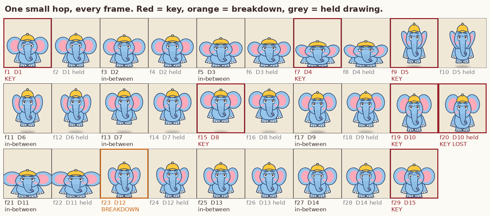
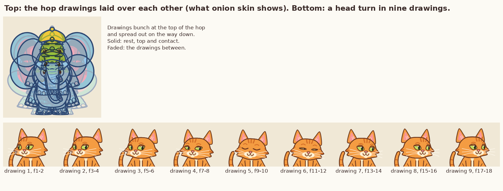

# Frame-by-Frame Animation

**Knowledge base document 3 of the master mission (Phase 1).**
Version 1.2, 2026-11-11. Follows `Animation_Fundamentals.md` and `Character_Design_Bible.md`.

Document 1 explained the principles. This document is the working method: how one action is planned, timed, posed, broken down, in-betweened, checked and cleaned up, one drawing at a time. It follows the eight-step workflow (A to H) that the master mission requires for every action.

## 0. How to read this document

### 0.1 Labels

| Label | Meaning |
|---|---|
| **[V]** | Verified: read in a source this session or an earlier one (section 20). |
| **[C]** | Craft convention attributed to a named book or widely taught; primary source not opened. |
| **[R]** | My recommendation or estimate. Test before trusting. |
| **[M]** | Measured in our own project: printed by `figures/make_fb_figures.py` or seen in a rendered frame. |

### 0.2 Three kinds of evidence

Kept apart everywhere in this document (lessons learned 24):

| Kind | Example here | What it proves |
|---|---|---|
| Key poses and drawings | The frames in figures 1 and 2 | That a pose reads. Nothing about motion |
| Timing plans | The x-sheets in sections 6 and 7 | Nothing until played |
| Tested animation | None in this document | |

Nothing in this document has been judged in motion by a person. The figures are frames and tables.

### 0.3 What the figures use

Both figures use **only the approved production models and their existing controls**. Nothing from the character review branch appears here. Where I refer to the Laddu Character Life Test, it is as a development direction that Harshith approved on 2026-11-11, not as an approved asset.

### 0.4 Limits

I cannot draw freehand. Our engine does not make drawings one at a time; it interpolates pose values (section 1.2). So this document teaches the hand-drawn method as the standard, and for each step says what our engine can do today and what would need a person, another tool, or an engine change that is not approved.

---

## 1. What "frame by frame" means

### 1.1 The method

Each picture is made as its own drawing, in a chosen order, and exposed for a chosen number of frames. The animator decides every drawing: what it is, where it sits between its neighbours, and how long it stays on screen. Document 1 covered exposure (ones, twos, threes) and the three kinds of drawing (keys, breakdowns, in-betweens).

### 1.2 Three ways of producing motion, and where we are

| Method | How a new frame comes about | Strength | Weakness |
|---|---|---|---|
| Full hand-drawn | A person draws it | Any pose, any shape, any angle | Slow; needs drawing skill on every frame |
| Cut-out or rigged | Pre-drawn parts are moved and swapped | Fast; stays on-model | Only the poses the parts allow |
| Parametric (our engine) | Shapes are redrawn from pose numbers that are eased between keys | Fast; exact; repeatable | Only what the controls allow; in-betweens are averages unless breakdowns are keyed |

Our engine is the third kind. It behaves like a careful in-betweener who never has an idea of their own: give it two keys and it produces the average. Everything in this document about **breakdowns** is therefore the most important part for us, because a breakdown is exactly the thing an averaging machine does not supply.

### 1.3 A fact about our engine that changes how we plan

Characters are held on twos by default. On every second frame the engine re-uses the previous frame's pose, unless the character moved more than 26 px since then, in which case it draws a new pose (`Actor.twos` in `toon.py`) **[M]**. Section 6.3 shows a real consequence: a one-frame accent can vanish.

---

## 2. The stages of a hand-drawn scene

Studios split the work into stages so that expensive drawing is never done on top of an unsolved problem. The usual order **[V: Brian Lemay's production notes; Toon Boom Harmony documentation; several pipeline guides, which agree on the order]**:

| Stage | What is made | What it settles | Never move on until |
|---|---|---|---|
| 1. Thumbnails | Tiny rough poses, several alternatives | Which poses tell it | The idea reads in the thumbnails |
| 2. Timing | Frame numbers per pose; a timing chart beside each key | How long each part takes | The beats have been acted out and counted |
| 3. Key poses (rough) | The storytelling drawings, loosely drawn | The action | A pencil test of the keys alone reads |
| 4. Breakdowns | The main drawing between each pair of keys | *How* it moves: arcs, what leads | A second pencil test reads |
| 5. In-betweens (rough) | The remaining drawings | Smoothness and speed | A third pencil test is right |
| 6. Tie-down | The roughs put on-model, details added | Character consistency | Every drawing matches the model sheet |
| 7. Clean-up | One clean line over each tied-down drawing | Final line | Volumes and arcs survived the cleaning |
| 8. Colour | Flat colour from the colour model | Final look | Colours match the model |

Studios vary the order slightly: Lemay cleans up the keys and breakdowns before in-betweening, others in-between in rough first **[V]**. What they share is that motion is tested before line is finished.

Three points from the sources:

- **Rough animation solves motion; clean-up solves clarity.** Timing problems are fixed in the rough, where a change costs one sketch **[V: DigiCel]**.
- **Tie-down** is the name for putting a rough drawing on-model before the clean line **[V: Toon Boom Harmony, "Creating the Tie Down Animation"]**.
- **Clean-up is not tracing.** The clean-up artist must keep volume, arcs and construction while making the line final; smoothing away the asymmetry of the rough can kill the drawing **[V: DigiCel]**.

**Why the order matters to us.** Our first ten episodes skipped stages 1 to 5 and went straight to finished, coloured, on-model frames. They were clean and lifeless. The Laddu life test went the other way: timing and beats first.

---

## 3. The action workflow, A to H

The master mission's eight steps, each with its output and its check. Section 6 runs one action through all of them.

| Step | Question | Output | Check before the next step |
|---|---|---|---|
| **A. Action analysis** | What is he doing, why, with what mechanics and feeling? | One paragraph: intent, physics, contact points, balance, direction, reaction | Someone else can act it out from the paragraph |
| **B. Timing plan** | How long, at what frame rate, with which beats and holds? | Beat list with frame counts; where it speeds up, slows, hits, recovers | Acted out against a count or a metronome |
| **C. Key poses** | Which drawings tell it? | Numbered keys, each described: body, line of action, head, eyes, face, hands and feet, weight | Keys alone, held for their time, read as the action |
| **D. Breakdowns** | How does he get from key to key? | One breakdown per gap: arc, what leads, what drags, silhouette change | Not the average of its two keys |
| **E. In-betweens** | How many more drawings, and where? | Timing chart per gap; drawing count chosen for the speed | Spacing matches the intended speed |
| **F. Clean-up and consistency** | Is it still the character? | On-model drawings | Volume, proportions, face, line, colours checked |
| **G. Effects and secondary motion** | What else reacts? | Ears, tail, cloth, dust, impact lines, shadows | Each supports the action; none competes |
| **H. Compositing and review** | Does it work in the shot? | Shot with background, camera, shadow, effects, sound | Watched at full speed and stepped frame by frame |

Rule from the mission: **the number of drawings is a decision, not a formula.** Section 14 gives the questions that decide it.

---

## 4. The timing plan and the exposure sheet

### 4.1 Finding the timing

1. **Act it.** Do the action yourself and count, or time it with a stopwatch, several times **[C]**.
2. **Convert to frames.** One second is 24 frames. A quarter of a second is 6.
3. **Write the beats.** A beat is one idea: sees it, decides, goes, lands, recovers.
4. **Exaggerate the contrast.** Real timing is too even for a cartoon. Make fast parts faster and holds longer (document 1, section 5.9).
5. **Put it on the sheet before drawing.**

### 4.2 The exposure sheet

One row per frame. For a single character: frame, action note, drawing number, exposure. Example layout (the full hop sheet is in section 6):

| Frame | Action | Drawing | Note |
|---|---|---|---|
| 1 | rest | D1 | key |
| 2 | | D1 | held |
| 3 | starts down | D2 | |
| 4 | | D2 | held |

Our template is `templates/xsheet.csv`.

### 4.3 Mixing ones and twos inside one action

| Use | When |
|---|---|
| Twos | Acting, walks, anything moderate **[V: Brian Lemay; Wikipedia, Inbetweening]** |
| Ones | Fast moves, where on twos the gap between drawings would be large enough to strobe; and anything that must stay in step with a moving camera **[V: Wikipedia, Inbetweening]** |
| Threes and longer | Slow drifts and holds **[C]** |

**Rule for accents [R, from the measurement in 6.3]:** a drawing that must be seen for exactly one frame (a contact squash, a smear) has to be on ones. On twos it is either doubled or lost.

---

## 5. Keys, breakdowns and in-betweens in practice

### 5.1 Choosing keys

A key is a drawing where the action **changes direction, speed or meaning**. Tests **[R]**:

- Remove the drawing. Does the story of the action change? Then it is a key.
- Is it the furthest point of a move (an extreme)? Key.
- Is it a contact (foot meets floor, paw meets object)? Key.
- Is it merely on the way? Not a key.

Describe each key with the mission's list: body position, line of action, head direction, eye direction, expression, hands and feet, where the weight is.

### 5.2 Designing a breakdown

The breakdown answers "how". Decide four things:

| Decision | Options | Example |
|---|---|---|
| **What leads** | One part goes first | Eyes, then head, then chest |
| **The arc** | Which way the path bows | A head turn dips in the middle |
| **Favouring** | Is it nearer key A or key B in time? | Stay near the crouch, then snap up |
| **What drags** | Which parts are still where they were | Ears and tail behind the body |

A breakdown that is the plain average of its keys contributes nothing; the computer makes that for free. Make it wrong on purpose in a useful direction.

### 5.3 Placing in-betweens

In-betweens are placed by the timing chart (document 1, section 2.2). The classic working unit is the **half**: a drawing exactly between two others, because it is the easiest to draw accurately. Slow-ins and slow-outs are built by repeated halves towards the key **[C]**.

| Wanted | Chart |
|---|---|
| Even speed | Equal steps |
| Slow out of A | Halves bunched near A |
| Slow in to B | Halves bunched near B |
| A hit | No slow-in at all: the largest gap is the last one |

**In-betweening a drawing by hand [C]:** lay both neighbours on the light box. In-between the big forms first (head ball, body mass), on an arc, not on the straight line between them. Then the limbs from the joints outward. Then details. Flip the three drawings to check.

### 5.4 The same thing in our engine

| Hand-drawn | Engine equivalent **[M]** |
|---|---|
| Key | `actor.move(start, end, ease, **pose)`: the pose is reached at `end` |
| Hold | Any gap between the end of one move and the start of the next |
| Breakdown | An extra `move` between two keys, offset in the direction wanted |
| Timing chart | The ease name: `out` bunches at the end, `in` at the start, `io` both |
| Lead and follow | Separate `move` calls for different controls, starting on different frames |
| In-betweens | Computed |

---

## 6. Worked example 1: one small hop, every frame

Gaju's small hop is the movement concept Harshith marked as preferred to develop. This example uses the approved model and existing controls only.

### 6.1 Steps A to E

**A. Action analysis.** He wants to be a little higher for a moment. A baby elephant is heavy for his legs: he must load them first, cannot go high, and lands hard. Feet leave together and land together. Weight goes down, up, down past rest, and back. The ears and trunk are loose and follow late.

**B. Timing plan.** 29 frames at 24 fps, about 1.2 seconds **[R]**.

| Beat | Frames | Count | Speed |
|---|---|---|---|
| Crouch | 1-7 | 6 | Slows into the bottom |
| Push off | 7-9 | 2 | Fast |
| Rise | 9-15 | 6 | Slowing |
| Fall | 15-19 | 4 | Speeding up |
| Contact | 20 | 1 | A single frame |
| Rebound | 20-23 | 3 | |
| Settle | 23-29 | 6 | Slow |

**C. Key poses.**

| Key | Frame | Body | Weight | Ears | Face |
|---|---|---|---|---|---|
| Rest | 1 | Upright, normal shape | Even | Neutral | Calm |
| Crouch | 7 | 0.78 tall, 1.28 wide | Low, loaded | Folded back | Eyes up at where he is going |
| Push off | 9 | 1.20 tall, 0.83 wide, 30 px up | Leaving the ground | Trailing down | |
| Top | 15 | Normal shape, 80 px up | Weightless | Lifted | Pleased, mouth open |
| Falling | 19 | 1.12 tall, 6 px up | Coming down | Trailing up | |
| Contact | 20 | 0.72 tall, 1.39 wide | All of it, at once | Still up | |
| Rest | 29 | Normal | Even | Neutral | Calm |

Squash and stretch keep volume: 0.78 × 1.28 = 1.00, 0.72 × 1.39 = 1.00.

**D. Breakdown.** One, at frame 23: the rebound goes **past** rest (1.06 tall) before settling. Without it he would simply inflate back to normal.

**E. In-betweens.** Spacing by ease: slow into the crouch, fast out, slowing to the top, accelerating down, no cushion before contact, soft settle.

### 6.2 The exposure sheet, as the engine actually produced it

Printed from the engine **[M]**. "Held" means the frame shows the same drawing as the frame before.

| Frame | Height (px) | Tall × wide | Drawing | Role |
|---|---|---|---|---|
| 1 | 0 | 1.00 × 1.00 | D1 | KEY rest |
| 2 | 0 | 1.00 × 1.00 | D1 | held |
| 3 | 0 | 0.96 × 1.06 | D2 | in-between |
| 4 | 0 | 0.96 × 1.06 | D2 | held |
| 5 | 0 | 0.87 × 1.17 | D3 | in-between |
| 6 | 0 | 0.87 × 1.17 | D3 | held |
| 7 | 0 | 0.78 × 1.28 | D4 | KEY crouch |
| 8 | 0 | 0.78 × 1.28 | D4 | held |
| 9 | 30 | 1.20 × 0.83 | D5 | KEY push off |
| 10 | 30 | 1.20 × 0.83 | D5 | held |
| 11 | 47 | 1.13 × 0.89 | D6 | in-between |
| 12 | 47 | 1.13 × 0.89 | D6 | held |
| 13 | 63 | 1.07 × 0.94 | D7 | in-between |
| 14 | 63 | 1.07 × 0.94 | D7 | held |
| 15 | 80 | 1.00 × 1.00 | D8 | KEY top |
| 16 | 80 | 1.00 × 1.00 | D8 | held |
| 17 | 43 | 1.06 × 0.95 | D9 | in-between |
| 18 | 43 | 1.06 × 0.95 | D9 | held |
| 19 | 6 | 1.12 × 0.89 | D10 | KEY falling |
| **20** | **6** | **1.12 × 0.89** | **D10** | **held. The contact key is lost** |
| 21 | 0 | 0.83 × 1.24 | D11 | in-between |
| 22 | 0 | 0.83 × 1.24 | D11 | held |
| 23 | 0 | 1.06 × 0.94 | D12 | BREAKDOWN rebound |
| 24 | 0 | 1.06 × 0.94 | D12 | held |
| 25 | 0 | 1.04 × 0.96 | D13 | in-between |
| 26 | 0 | 1.04 × 0.96 | D13 | held |
| 27 | 0 | 1.02 × 0.98 | D14 | in-between |
| 28 | 0 | 1.02 × 0.98 | D14 | held |
| 29 | 0 | 1.00 × 1.00 | D15 | KEY rest |

29 frames, 15 different drawings, 14 held.

Reading the rise: the gaps are 30, 17, 16, 17 px per drawing going up and 37, 37 coming down. The drawings are closer together near the top, which is what makes the top feel slow.

### 6.3 What went wrong, and what it teaches

I planned a one-frame contact squash on frame 20. **It never appears.** Frame 20 fell on a held frame, so the engine re-used the falling drawing, and by frame 21 the pose was already on its way to the rebound.

| Frame | On twos (default): height, tall | On ones: height, tall |
|---|---|---|
| 17 | 43, 1.06 | 43, 1.06 |
| 18 | 43, 1.06 | 24, 1.09 |
| 19 | 6, 1.12 | 6, 1.12 |
| 20 | 6, 1.12 | **0, 0.72** |
| 21 | 0, 0.83 | 0, 0.83 |
| 22 | 0, 0.83 | 0, 0.95 |
| 23 | 0, 1.06 | 0, 1.06 |

On twos the flattest he gets is 0.83; the key asked for 0.72 **[M]**. The landing loses most of its hit.

This also corrects something I showed earlier: the Stage 2 hop sheet listed "land, frame 19, one frame". Played through the engine on twos, that frame would not have been seen as drawn.

Three ways to fix it, all with existing controls **[R; none tested in motion]**:

1. Play the fall and landing on ones (`actor.twos = False` for the shot).
2. Put the contact on a frame the engine will draw, and accept that on twos it lasts two frames.
3. Make the fall faster. The engine switches to ones by itself above 26 px per frame; this fall is 18 px per frame.

For a hand animator the lesson is the same: **an accent that must be one frame long goes on ones, and you check the sheet, not the plan.**

### 6.4 Steps F to H for the hop

- **F.** Volume checked (products of 1.00). On-model: it is the approved model. The cap and eyes squash with the body in the crouch and contact; in hand-drawn work hard things like a cap brim would stay rigid.
- **G.** Planned, not shown: ears follow two frames late and overshoot; trunk tip swings; a dust puff and a shadow that shrinks as he rises. The figure has a shadow only.
- **H.** Not done. No background, no sound, and nobody has watched it play.

---

## 7. Worked examples 2 and 3

### 7.1 A head turn in nine drawings

The approved Laddu head, turned with its existing `yaw` control, on twos **[M]**:

| Drawing | Frames | Turn | Dip (px) | Eyes |
|---|---|---|---|---|
| 1 | 1-2 | −0.90 | 0 | Open, looking left |
| 2 | 3-4 | −0.90 | 0 | **Pupils already across: the eyes lead** |
| 3 | 5-6 | −0.80 | 4 | Open |
| 4 | 7-8 | −0.54 | 8 | Half shut |
| 5 | 9-10 | −0.19 | 12 | Shut |
| 6 | 11-12 | +0.19 | 13 | Shut |
| 7 | 13-14 | +0.54 | 8 | Open |
| 8 | 15-16 | +0.80 | 3 | Open |
| 9 | 17-18 | +0.90 | 0 | Open, looking right |

Three things are keyed separately and start on different frames: the pupils (frame 1), the head turn (frame 3), the dip and the blink (frames 3 and 6). That is lead-and-follow done with existing controls. The turn steps are 0.10, 0.26, 0.35, 0.38, 0.35, 0.26, 0.10: slow out, fast middle, slow in.

Limit: this is a front-facing head with its features slid across. It reaches a three-quarter view at each end, not a profile (Character Design Bible, 5.2).

### 7.2 A thinking beat: "notice"

From the Laddu life test, as a development direction only. No review asset is reproduced here; this is the timing idea, which needs only existing controls.

| Frames | What moves | What does not |
|---|---|---|
| 1-12 | Idle: tail sways | |
| 13-14 | **Eyes only** flick to the side, on ones | Head, body |
| 15-18 | Body stops; weight rocks back slightly | |
| 19-28 | **Nothing.** A ten-frame pause | Everything |
| 29-34 | Head turns | Body |
| 35-46 | Head tilts | Body |
| 47-64 | Chest and one paw creep forward | Hind feet |

The structure is: a small fast move, a stop, a hold, then parts joining in one at a time. The hold is the thinking. Eyes, head, pauses and timing work with today's engine; the weight rocking back and the creep need separate chest and hip control, which is a documented engine limitation and not approved for implementation.

---

## 8. Holds

A hold is a pose kept on screen so the audience can read it or feel a pause.

| Kind | What it is | Use | Risk |
|---|---|---|---|
| **Dead hold** | The same drawing, unchanged | A deliberate freeze; a shock; comedy stillness | Past about 8 frames the character looks switched off **[R]** |
| **Moving hold** | The pose kept, with small life: a drift of 1 to 2%, breathing, a blink, a tail tip | Almost every hold | Too much movement and it stops being a hold |
| **Traceback** | In hand-drawn work, the held drawing is traced again so the line shimmers slightly | Keeps a hold from looking frozen **[C; the technique is listed in *Animation from Pencils to Pixels*, whose text I did not open]** | |

How long **[R]**: a pose needs at least 8 frames to be read; a gag pose 12 to 24; a pause before a big hit 6 to 12 of near stillness.

**In our engine:** a gap between moves is a dead hold. The line boil redraws the ink every third frame, which is the traceback idea **[M]**; it is off unless a stage sets `boil`, and no episode sets it. The helpers `acting.blink` and `acting.bob` write small keyed motions that keep a hold alive **[M]**. Breathing and tail-tip sway do not exist on the approved models.

**Mistake we made.** Our episodes were full of long dead holds between symmetrical moves. An earlier automatic count of "still frames" tried to measure this, but I have since found that count depends heavily on how much of the frame the character fills, so I no longer use it as evidence. Holds have to be judged by eye.

---

## 9. Fast action

When a move is too fast even for ones, the gap between two drawings is so large the eye sees two separate objects. Classic solutions **[V: TraditionalAnimation.com; Wikipedia, Smear frame; CG-Wire]**:

| Device | What is drawn | Notes |
|---|---|---|
| **Smear** (elongated in-between) | The object stretched along its path, across the whole gap | Used between keys for one or two frames; in use since the 1940s **[V: Wikipedia]** |
| **Multiples** | Several copies of the limb or object in one drawing | Good for rapid repeated movement **[V: AnimSchool]** |
| **Dry brush / speed lines** | Streaks trailing the object | Often combined with the others |

Rules **[V for the first two; R for the third]**:

1. A smear should never be noticed as a drawing. Its job is to carry the eye from one pose to the next.
2. Judge it in playback. A smear that looks wrong as a still can be right at speed, and the reverse.
3. Use it only when the gap is too big for ones. A smear on a slow move is just a deformed drawing.

**In our engine [M]:** a character moving faster than 46 px per frame is stretched along its direction of travel automatically (`smear_from` in `chars.py`), with speed lines. Running legs can be replaced by a spinning blur (`wheel`). There are no hand-drawn smears or multiples.

---

## 10. Checking the work

### 10.1 The traditional checks

| Check | What it is | Finds |
|---|---|---|
| **Flipping** | Flicking between two or more drawings held in the hand | Whether an in-between sits right between its neighbours **[V: Brian Lemay]** |
| **Rolling** | Drawings left on the pegs and rolled between the fingers, usually five at a time | The flow across several drawings **[V: animation studio notes citing Williams]** |
| **Pencil test (line test)** | The rough drawings shot or scanned and played at real speed | Timing and spacing, before any clean-up **[V: Brian Lemay; DigiCel]** |

Lemay's order of work has a pencil test after the keys, another after the breakdowns, and another after the in-betweens, with clean-up only once the rough is right **[V]**. A pencil test is ready for clean-up when the performance reads every time, the timing supports the beat, and the main motion problems are solved **[V: DigiCel]**.

### 10.2 Digital equivalents

| Traditional | Digital |
|---|---|
| Light box | Onion skin: neighbouring frames shown tinted behind the current one |
| Flipping | Stepping one frame back and forward with keys |
| Pencil test | Playback of the rough at full speed |

Krita has an Onion Skins docker and a timeline; OpenToonz has onion-skin handles on the frame strip and an Xsheet **[V: their manuals and user forums, from document 1]**. The top half of figure 2 shows what onion skin gives: the hop drawings laid over each other, bunched at the top and spread on the way down.

### 10.3 In our project

| Need | Tool | Limit |
|---|---|---|
| See chosen frames together | `stage.sheet(frames, path)` contact sheet | Stills |
| See every frame of an action | `figures/make_fb_figures.py` pattern | Stills |
| Print the real exposure sheet | Same script: reads each frame's pose and marks held drawings | |
| Check size, rate, missing frames | `tools/qc_frames.py video` | Its still-frame figure is unreliable (section 8) |
| Judge motion | **A person watching playback** | I cannot do this |

**New rule from this document [R]:** before calling an action done, print its exposure sheet from the engine and read it against the plan. That is how the lost contact in 6.3 was found.

---

## 11. Clean-up and consistency (step F)

Checklist per drawing:

- **Volume.** The character has not grown or shrunk. Squash × stretch stays at 1.
- **Proportions.** Height in heads as in the Character Design Bible, section 2.4.
- **Face.** Features on the eye line; eyes the same size as the model.
- **Markings and props.** Stripes, patches, cap, glasses, scarf present and on the correct side.
- **Digits.** The approved counts.
- **Line.** Same weight as neighbouring drawings; no wobble that is not intended.
- **Arcs survived.** After cleaning, track one point across the drawings again.

For our models, on-model is guaranteed by construction, and `figures/make_cd_figures.py check` guards against accidental changes to the model itself. It does not check poses.

---

## 12. Effects and secondary motion (step G)

Add only what supports the action:

| Element | When it helps | Timing |
|---|---|---|
| Ears, tail, trunk tip, scarf | Always, on any move | 2 to 4 frames behind the body; overshoot; settle |
| Dust puff | Takeoff, landing, skid | Starts on the contact frame, grows 4 to 6 frames, fades |
| Impact lines or star | A hit | 1 to 3 frames, on the contact |
| Speed lines | Very fast travel | During the fast frames only |
| Shadow | Jumps | Shrinks and lightens as he rises; makes the height readable |
| Camera shake | Heavy landing | 4 to 8 frames after contact |
| The world reacting | Heavy character | Table jumps, cup rattles, one beat after |

**Mistake to avoid.** Effects used to hide weak animation. If the action does not read without them, fix the action.

---

## 13. Reuse: what can be held, cycled or repeated

| Can be reused | Condition |
|---|---|
| A held drawing | It is a deliberate hold, with life in it if longer than about 8 frames |
| A cycle (walk, run, flapping ears) | The character's mood is not changing during it |
| A blink | Almost always |
| A background element's loop | It is not the subject |

| Needs unique drawings | Why |
|---|---|
| Any change of thought or feeling | That is the acting |
| Starts and stops | Weight is different every time |
| Contacts | The pose depends on what is touched |
| The first and last step of a walk | Entering and leaving a cycle |

A cycle repeated more than three or four times is noticed **[R]**. Break it with a head move, a stumble or a change of speed.

---

## 14. How many drawings?

There is no fixed number. Decide with these questions **[R]**:

| Question | Pushes the count |
|---|---|
| How fast is it? | Fast: fewer drawings, further apart, on ones. Slow: more, closer, on twos |
| How far does it travel? | Further: more |
| Does it change shape on the way (a turn, a twist)? | Yes: more, or the form will pop |
| Is it the subject of the shot? | Yes: more |
| How long is it on screen? | A few frames: do not polish what cannot be seen |
| What is the style? | Snappy cartoon: few in-betweens, strong keys, long holds |

Worked check on the hop: 29 frames, 15 drawings on twos, 29 on ones. The crouch (slow, readable) is fine on twos. The fall and contact (fast, an accent) need ones.

---

## 15. Implementation steps

### 15.1 In our engine, for one action

1. Write step A as a paragraph and step B as a beat table.
2. Convert beats to frames. Write the planned exposure sheet.
3. Key the poses with `move(start, end, ease, **pose)`. Body first.
4. Add at least one breakdown per move longer than 6 frames.
5. Key the loose parts (ears, tail, trunk) on later frames with `over` or `elastic`.
6. Decide ones or twos for the shot or for the fast part.
7. **Print the real exposure sheet and compare it with the plan.**
8. Render a contact sheet of the keys and one of every frame for the fast part. Inspect.
9. Render the clip. Send it for a person to watch.
10. Report separately: key poses, timing plan, tested animation.

### 15.2 Hand-drawn, in Krita or OpenToonz

1. Thumbnail the keys on paper or a scratch layer.
2. Set the document to 24 fps. Draw rough keys on their frames.
3. Play it. Fix timing by moving keys, not by redrawing.
4. Add breakdowns; play; add in-betweens with onion skin on; play.
5. New layer for tie-down over the rough; then a clean-up layer; then colour from the colour model.

OpenToonz's manual describes this key, breakdown, in-between order, and its level settings include a step value for twos **[V, document 1]**. I have not confirmed exact menu names for either program in their current versions.

### 15.3 What this needs that we do not have

A person who draws, for any pose the models cannot make. Body acting controls on the models (spine, chest and hip, side-view sit, tail shape): documented in the character review, **not approved for implementation**.

---

## 16. Exercises

Passed only when made, the exposure sheet printed, and the result watched by a person. None has been passed.

| # | Exercise | Objective | Output | Pass when | If it fails |
|---|---|---|---|---|---|
| 1 | Beat sheet | Step B | Act three actions, time them, write beats in frames | Another person can clap the rhythm from the sheet | Fewer, clearer beats |
| 2 | Keys only | Step C | The hop as 6 held keys, no in-betweens | A viewer says "a jump" | Stronger crouch and top |
| 3 | One breakdown | Step D | Same two keys, three different breakdowns | Three visibly different motions | Move the breakdown further off the average |
| 4 | Timing chart | Step E | One move in-betweened evenly, slow-out, slow-in | The three are told apart unlabelled | Bunch harder |
| 5 | Hop on twos and on ones | Exposure | The hop of section 6 both ways, sheets printed | The contact squash is visible in one and its absence explained in the other | Read the sheet frame by frame |
| 6 | Lost accent hunt | Checking | Put a one-frame accent on three different frames | You can predict from the sheet which survive | Section 6.3 |
| 7 | Lead and follow | Overlap | Head turn with eyes 2 frames early, ears 2 frames late | Start frames differ for all three on the sheet | Separate the `move` calls |
| 8 | Moving hold | Holds | A 24-frame hold, dead and alive, side by side | The viewer prefers the second and cannot say exactly why | Reduce the movement until it is nearly invisible |
| 9 | Notice and pause | Thinking | The beat of 7.2 with existing controls | The viewer says he "saw something" | Lengthen the pause |
| 10 | Whole action, A to H | The workflow | One 3-second action with all eight steps written down | QC rubric 20 of 26 | Go back to the first step that was skipped |

Attempted **[M]**: 5 and 6 in part, as the measurement in section 6.3. Not watched by anyone.

---

## 17. Common mistakes

| Mistake | How it shows | How to detect | Correction |
|---|---|---|---|
| No timing plan | Everything the same length | Beat table is missing | Step B before any pose |
| Keys are not extremes | Mushy action | Remove a key; nothing changes | Push keys to the furthest point |
| No breakdowns | Mechanical, straight paths | Every drawing is an average | One designed breakdown per move |
| Everything moves together | Stiff | Start frames identical on the sheet | Stagger parts |
| Accent on a held frame | The hit is soft | Printed sheet shows the key missing | Ones for accents |
| Even in-betweens | Floaty | Equal gaps | Use the chart |
| Cushion before a hit | No impact | Small gap just before contact | Largest gap last |
| Dead holds | Character switches off | Identical frames in a long run | Moving hold |
| Cleaning too early | Good line on bad motion | No pencil test exists | Test the rough first |
| Clean-up kills the rough | Stiff, symmetrical | Compare rough and clean | Keep the asymmetry |
| Fixed drawing count | Too many or too few | Same count for every action | Section 14 |
| Effects as a crutch | Busy but weak | Hide the effects layer | Fix the action |
| Trusting the plan | Says "done" without looking | No printed sheet, no playback | Print, look, and have it watched |

---

## 18. Quality checklist for one action

1. Steps A and B exist in writing.
2. Keys read when shown alone.
3. Each move over 6 frames has a breakdown that is not an average.
4. The real exposure sheet has been printed and matches the plan, or the difference is explained.
5. Every one-frame accent is on a frame that is actually drawn.
6. Loose parts start later and overshoot.
7. No dead hold over 8 frames unless it is a deliberate freeze.
8. Volume kept.
9. On-model: checklist of section 11.
10. Effects support, not replace.
11. Watched at full speed by a person, and stepped frame by frame.
12. The report separates key poses, timing plan and tested animation.

---

## 19. Engine limitations and open questions

**Limitations relevant to this document [M]:**

- In-betweens are computed averages; there is no way to draw one.
- Twos are all-or-nothing per character per shot, with an automatic switch to ones above 26 px per frame. There is no per-frame exposure control.
- A key that falls on a held frame is skipped without warning.
- No breathing and no automatic moving hold. Line boil is opt-in and unused in the episodes; `acting.blink` and `acting.bob` write keyed motions for holds (corrected in version 1.2).
- No drawn smears or multiples; only an automatic stretch.
- Body acting controls are missing (see the character review). Not approved for implementation.

**Decisions on the four open questions (Harshith, 2026-11-11).** Document accepted on `main` with these limits: the two-frame default and all existing engine behaviour stay as they are, and no hop timing or exercise is claimed as passed until it has been watched in motion.

| Question | Decision | Where it is recorded |
|---|---|---|
| Warn when a key lands on a held frame? | Not implemented. The lost landing squash is a **known, unresolved engine limitation**. The smallest safe change is proposed separately | `Engine_Change_Proposals.md`, P1; Bible D19 |
| Hop: ones for the fall and landing, or a two-frame contact on twos? | Not chosen. Stills cannot decide it. Both stay as alternatives that need a playback comparison | Bible D20 |
| Per-frame exposure control? | Not implemented. Requirement and minimum design documented, with compatibility | `Engine_Change_Proposals.md`, P2; Bible D21 |
| Hand-drawn tests? | Keep the model-based workflow. A small, labelled hand-drawn study only when it answers a specific question a model cannot. No new drawing pipeline without approval | Bible D22 |

---

## 20. References

Tags: **[read]** opened this session or for an earlier document. **[book]** not opened.

**Method and stages**
- Brian Lemay, "Getting the Best Out of Your Animation" (order of work, pencil tests, flipping): https://www.brianlemay.com/Pages/animationschool/animation/lipsyncbook/gettingthebest.html **[read]**
- Brian Lemay, flipping and pencil testing: https://brianlemay.com/Pages/animationschool/animation/lipsyncbook/flipping.html and https://brianlemay.com/Pages/animationschool/animation/lipsyncbook/penciltesting.html **[read]**
- Toon Boom Harmony, "Creating the Tie Down Animation": https://docs.toonboom.com/help/harmony-24/premium/paperless-animation/create-tie-down-animation.html **[read]**
- DigiCel, professional 2D pipeline and pencil-test guides: https://digicel.net/professional-2d-animation-pipeline-guide/ and https://digicel.net/pencil-test/ **[read]**
- iD Tech, animation pipeline (rough, then clean-up): https://www.idtech.com/blog/what-is-the-animation-pipeline **[read]**
- Animation studio notes on flipping and rolling, citing *The Animator's Survival Kit* pp. 80-83: https://animation-studio-stuff.blogspot.com/2009/04 **[read; secondary]**
- Tony White, *How to Make Animated Films*, chapter "Rolling, Flipping, and Pencil Testing": https://www.oreilly.com/library/view/how-to-make/9780240810331/part2-chapter15.xhtml **[read, excerpt]**
- Tony White, *Animation from Pencils to Pixels* (tracebacks, staggers; table of contents only) **[book]**
- Richard Williams, *The Animator's Survival Kit*; Frank Thomas and Ollie Johnston, *The Illusion of Life*; Preston Blair, *Cartoon Animation* **[book]**

**Fast action**
- TraditionalAnimation.com, smears, multiples and dry brush: https://www.traditionalanimation.com/?p=4846 **[read]**
- Wikipedia, Smear frame: https://en.wikipedia.org/wiki/Smear_frame **[read]**
- CG-Wire, smear frames: https://blog.cg-wire.com/smear-frames/ **[read]**
- RebusFarm, smear frames (judge in playback): https://rebusfarm.net/blog/smear-frames-in-animation-how-animators-create-fast-and-dynamic-motion **[read]**
- AnimSchool blog, multiples: https://blog.animschool.edu/?p=608 **[read]**

**Exposure and software** (from document 1)
- Wikipedia, Inbetweening: https://en.wikipedia.org/wiki/Inbetweening **[read]**
- Krita animation manual: https://docs.krita.org/en/user_manual/animation.html **[read]**
- OpenToonz manual: https://opentoonz.readthedocs.io/en/latest/drawing_animation_levels.html **[read]**

**Our own material**
- `figures/make_fb_figures.py` (every table and both figures)
- `Animation_Fundamentals.md`, `Character_Design_Bible.md`
- `references/04-frame-by-frame-handbook.md`, `references/09-lessons-learned.md`
- `toon-slapstick/engine/toon.py` (`Actor.twos`, `Timeline.move`), `chars.py` (`smear_from`)

---

## 21. Change log

| Date | Change |
|---|---|
| 2026-11-11 | Version 1.2. Correction: line boil is opt-in, and the hold helpers `blink` and `bob` exist (sections 8 and 19). Nothing else changed. |
| 2026-11-11 | Version 1.1. Harshith's review decisions recorded in section 19. No content of the method changed. Still nothing judged in motion. |
| 2026-11-11 | Version 1.0. Two figures and three tables generated from the approved models. Finding: a one-frame key on a held frame is skipped by the engine. Not reviewed by Harshith. No exercise passed. Nothing judged in motion. |
