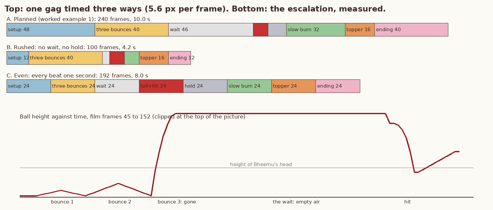
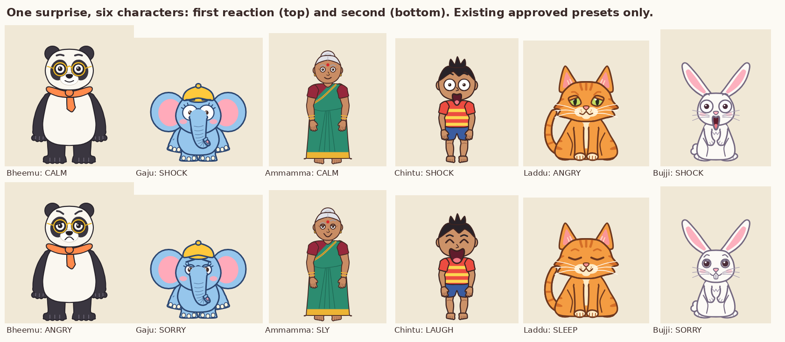
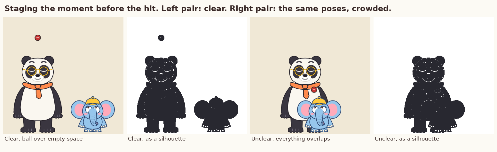
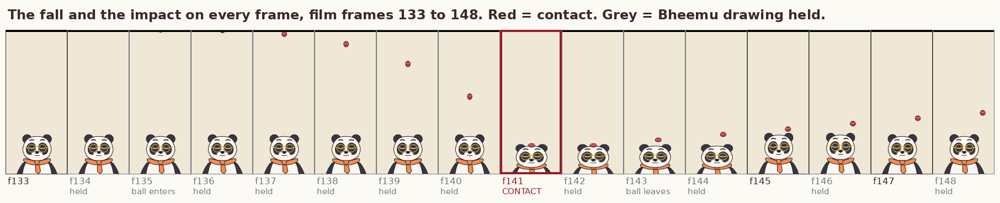
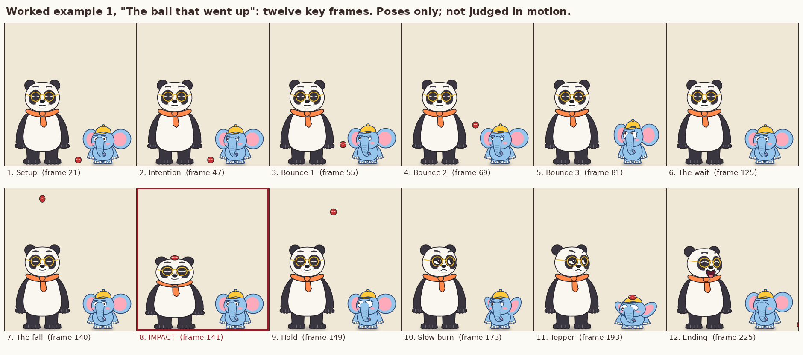

# Slapstick Comedy

**Knowledge base document 4 of the master mission (Phase 1).**
Version 1.0, 2026-11-11. Follows `Animation_Fundamentals.md`, `Character_Design_Bible.md` and `Frame_By_Frame_Animation.md`.

Documents 1 to 3 explained how a character moves. This document is about what the movement is for: building a physical joke that a first-time viewer understands without a word, laughs at, and is not harmed by. It covers construction, anticipation, cause and effect, readable action, timing and pauses, escalation, reversals, reactions by character, staging, impact and recovery, sound, safety limits, failure modes, worked examples, exercises and a production checklist.

## 0. How to read this document

### 0.1 Labels

| Label | Meaning |
|---|---|
| **[V]** | Verified: read this session in the source named in section 21, in most cases as an excerpt returned by a search, not the whole work. |
| **[C]** | Craft convention that is widely taught; I have not opened a primary source for it. |
| **[R]** | My recommendation or estimate. Test before trusting. |
| **[M]** | Measured in our own project: printed by `figures/make_sc_figures.py` or read from the engine code. |

### 0.2 Three kinds of evidence

| Kind | Example here | What it proves |
|---|---|---|
| Key poses and drawings | Figures 1, 2, 4 and 5 | That a pose can be read. Nothing about whether it is funny |
| Timing plans | Every beat sheet and cue sheet | Nothing until played |
| Tested animation | None in this document | |

**Nothing in this document has been watched in motion or heard by anyone. No gag here has been shown to a viewer. Whether any of it is funny is unknown.** I can check that a pose reads and that numbers match; I cannot laugh, and I cannot hear.

### 0.3 What the figures use

All five figures use **only the approved production models, the existing presets in `show.py` and existing engine controls**. Nothing from the character review branch appears. No production file was changed to make them.

### 0.4 Originality

Every example is an original situation written for our own cast. No scene, gag, signature movement or character behaviour is taken from an existing cartoon (lessons learned 32). Section 14 gives the test I apply. Older films and cartoons are named in the references only as places where a general principle was described.

---

## 1. What slapstick is

Slapstick is comedy made from bodies and objects: a fall, a bump, a chase, a thing that will not do what it should. It needs no language, which is why it suits a silent series whose animals never speak.

Three ideas explain why a bump can be funny. None is settled science; each is useful as a design check.

**Rigidity where there should be flexibility [V].** Henri Bergson's 1900 essay *Laughter* argues that we laugh when a living being behaves like a machine: it carries on in a straight line when the situation asked it to adapt. His own summary is "something mechanical encrusted on the living". The man who trips is funny in this view because he kept walking as if the ground were still flat. Bergson also names three toy-like devices for building comic situations: the jack-in-the-box (a thing pushed down that springs back), the dancing-jack (a character moved by strings he cannot see) and the snowball (a small cause that grows). Critics find the single formula too narrow, so I use it as one lens. *Design check: what is the character doing on autopilot?*

**A violation that is also harmless [V].** McGraw and Warren (2010) propose that amusement comes when something is seen as wrong and as acceptable at the same moment. Their paper lists three things that make a violation benign: another norm that says it is fine, weak commitment to the norm that was broken, and psychological distance. A cartoon supplies distance, and a character who is plainly unhurt supplies the "fine". *Design check: is it clear, within a second of the hit, that nobody is hurt?* This is also the safety rule of section 13, arrived at from the comedy side.

**The audience is ahead, or behind [C].** Either the audience knows something the character does not (and waits for it), or both are surprised together. Noël Carroll's essay on the sight gag calls the first family the mutual interference of two readings of one event: the character's and the viewer's [V, via a secondary summary]. Almost every gag in this document is one of these two.

Bergson adds one condition that matters for our series: laughter and strong feeling do not mix [V]. If the audience pities the victim, the joke is over. So the victim must be unhurt, must have some dignity left, and should usually have brought it on himself.

---

## 2. The anatomy of a gag

A gag is a small story with a wrong turn in it. `references/05-slapstick-chase-handbook.md` lists nine beats. Here they are again with the question each one must answer for the viewer.

| # | Beat | The viewer must be able to answer | Typical length at 24 fps [R] |
|---|---|---|---|
| 1 | Setup | Where are we, who is here, what is normal? | 36 to 72 frames |
| 2 | Intention | Who wants what? | 12 to 24 |
| 3 | Anticipation | What is about to happen? | 8 to 24 |
| 4 | The wrong turn | (nothing yet; it is too fast) | 2 to 6 |
| 5 | Impact | What went wrong? One clear drawing | 1 or 2, then a hold of 4 to 12 |
| 6 | Reaction | How does he feel about it? | 12 to 36 |
| 7 | Recovery or reversal | Is he all right? What now? | 24 to 48 |
| 8 | Escalation | Is it getting worse? | repeats 2 to 7 |
| 9 | Ending | Are they still friends? | 48 to 96 |

Three rules follow from the table.

1. **The laugh is in beat 6, not beat 5 [C].** The hit is information. The reaction is the joke. Moving on before the reaction has been held is the most common way to kill a gag.
2. **Everything before beat 4 is longer than beat 4.** A study of comic timing in recent slapstick films describes the standard rhythm as a setup that lasts longer than its payoff [V, abstract only]. In worked example 1 the setup and the wait take 134 frames and the fall and hit take 8 [M].
3. **Beats 1 to 3 are promises.** Anything shown in them must be used. Anything used in beats 4 to 9 must have been shown in them. A prop that appears at the moment it is needed is a cheat.

**The one-sentence test [R].** Before any timing, write the gag as one sentence of the form *"X wants A, does B, and gets C instead."* If it needs "and then" twice, it is two gags.

---

## 3. Anticipation

Document 1 treated anticipation as a body principle: move back before moving forward. In comedy it has three layers, and a gag usually uses all three.

| Layer | What it is | Who feels it | Example with our cast |
|---|---|---|---|
| Physical | The wind-up before a move | The eye | Gaju crouches before the hard bounce (frames 73 to 76 in example 1) |
| Dramatic | The audience can see what is coming | The mind | The ball has gone up; it must come down; Bheemu is asleep underneath |
| False | The character prepares for one thing and another happens | Both | Gaju braces and looks up; nothing comes; he relaxes; then it lands |

**Rules.**

- **Bigger action, longer wind-up [C].** A wind-up of 4 frames suits a small hop. The big bounce in example 1 gets 4 frames of crouch after two bounces that already taught the motion. Without those bounces it would need 8 to 12 [R].
- **Dramatic anticipation needs time to be enjoyed.** If the audience is ahead of the character, give them at least a second (24 frames) of being ahead [R]. That waiting is the pleasure. Example 1 gives them 46 frames.
- **False anticipation needs the relaxation.** The character must visibly stop expecting it. If he is still braced when it lands, it is a hit, not a joke.
- **Do not anticipate a surprise that is meant to surprise the audience too.** If both character and audience are to be caught out, the cause must be established (rule 3 of section 2) but not pointed at.
- **The eyes go first.** A look at the object, 4 to 8 frames before the body commits, tells the audience where to look (document 3, section 7).

**How to detect a missing anticipation.** Cover the frames before the action and ask someone what will happen next. If they cannot say, the anticipation is missing or is pointing at the wrong thing.

---

## 4. Cause and effect

A slapstick world is strict. The audience accepts a ball that flies out of the picture, but only if the same push would always do the same thing.

**The rules of a readable chain [R].**

1. **Every effect has a cause the audience saw.** Not necessarily one the character saw.
2. **One cause, one effect, in that order, on screen.** If the cause happens off screen, show it first or show its shadow, sound or approach.
3. **The effect is in proportion or absurdly out of proportion, never slightly off.** A tap that makes something wobble is physics. A tap that brings down the whole clothesline is a joke. A tap that makes it fall a bit too far is a mistake.
4. **The world's rules do not change inside one gag.** If the cot tips when Bheemu sits on the end, it tips every time he sits on the end.
5. **The character's own choice starts the chain.** A character struck by pure bad luck gets sympathy; one caught by his own plan gets a laugh. Chuck Jones's published rules for one of his series make the same point in their own terms: harm comes from the character's own failings, not from an outside force [V; a colleague later said he had not heard of the rules, so treat them as Jones's summary]. I take the principle and none of the content.
6. **Three links is plenty.** In a 10 second gag the viewer can follow about three cause and effect steps [R]. Longer chains belong in a longer scene with a wide shot.

**Chain types.**

| Type | Shape | Our example |
|---|---|---|
| Direct | A causes B | Ball lands on head |
| Delayed | A, pause, B | Ball goes up; the wait; ball comes down |
| Snowball | A causes a slightly bigger B, which causes a bigger C | Example 3: sit, tip, slide |
| Boomerang | A's action returns to A | The topper in example 1 |
| Crossed | Two separate plans collide | Example 2: Gaju's pump and Bujji's hop |

**How to check a chain.** Write it as arrows on one line, then delete any link. If the gag still makes sense, that link was decoration. If the audience could not predict the *kind* of result from the cause (something will fall; something will get wet), the cause was not established.

---

## 5. Readable action

A viewer on a phone sees each drawing for a twelfth of a second or less. The action has to be simple enough to survive that.

- **One idea at a time [C].** While one character acts, the other holds still or moves very little. In example 1, Bheemu does not move at all for the first 140 frames. Stillness is his job in the setup.
- **The silhouette carries the pose** (document 2). At every key pose of a gag the two characters and the prop should be separate shapes. Figure 5 shows the same poses read clearly and not at all.
- **The important object crosses empty background.** A red ball in front of an orange scarf is lost. Above the heads there is only wall or sky.
- **An approaching danger must be visible for long enough.** My first version of example 1 dropped the ball in 4 frames with a slow-in. Rendering every frame showed the ball inside the picture on only one of them before the hit [M]. I lengthened the fall to 6 frames starting at the top edge, which puts the ball partly in the picture from frame 135 and fully in it for the four frames before contact (figure 2). **Rule [R]: an object the audience must see coming is inside the picture for at least 4 frames before it arrives.**
- **Fast action needs a clean start and a clean end.** The move itself may be a smear (document 3, section 9); the pose before and the pose after must be sharp and held.
- **Vertical picture.** Our frame is 1080 by 1920. Falls, drops, things flying up and tall-against-short contrasts suit it. Wide chases do not; they need the camera to travel or the action to come towards us. Example 1 is built on the vertical: the ball leaves through the top and returns through it.
- **No text needed.** Standing rule: no captions, boards or bubbles. If a gag needs a label to be understood, it is not readable yet.

**The freeze-frame test [R].** Pull the stills at intention, anticipation, impact and reaction. Show them in order to someone who has not seen the gag. If they can tell the story from four stills, the staging is readable. That tests the poses only; the timing still has to be watched.

---

## 6. Timing and pauses

Slapstick timing is contrast: very fast against very still. The handbook records our own frame study of classic chase cartoons as fast moves of 1 to 5 frames and holds of 8 to 20, with little in between. Mid-speed everything is what makes a gag soft.

### 6.1 The pauses

| Pause | Where | Length at 24 fps [R] | What it does |
|---|---|---|---|
| The calm | Before anything starts | 24 to 48 | Makes "normal" so that it can be broken |
| The wait | After the cause, before the effect | 24 to 60 | Lets the audience get ahead and enjoy it |
| The beat before the hit | Last frames before impact | 4 to 12, with sound dropped | Tightens attention |
| The hold after the hit | On or just after the impact drawing | 4 to 12 | Lets the eye read what happened |
| The delayed reaction | Victim carries on as if nothing happened | 8 to 24 | The mechanical-behaviour joke of section 1 |
| The slow burn | Victim works out who did it | 24 to 48 | Turns a hit into a relationship |
| The look | One flat look at the audience | 8 to 12; once per episode | Shares the joke |
| The breather | Middle of a chase or an escalation | 24 to 36 | Resets the energy so the next rise can be felt |

A pause is not a dead frame. Something small stays alive in it: a blink, an ear, a breath, a drifting pupil (document 3, section 8). The engine has no breathing and no moving hold except line boil [M], so in our tool a pause needs at least one keyed small motion, or it reads as a frozen picture. Lessons learned records that an automatic check found about 58% of the frames of episode 7 still; that was too many dead holds, not too many pauses.

### 6.2 One gag, three timings

Figure 3 (top) and this table show worked example 1 timed three ways. The numbers are plans [M for the arithmetic, R for the judgement].

| Version | Total | Before the fall | Fall and hit | Stillness around the hit (wait + hold) | Reaction (slow burn) | Shortest and longest beat |
|---|---|---|---|---|---|---|
| A. Planned (worked example 1) | 240 | 134 | 8 | 56 | 32 | 8 and 48 |
| B. Rushed: no wait, no hold | 100 | 56 | 8 | 4 | 8 | 4 and 40 |
| C. Even: every beat one second | 192 | 72 | 24 | 48 | 24 | 24 and 24 |

*Figure 3. Top: the same eight beats in three timings. Bottom: the height of the ball through the three bounces, the wait and the hit, read from the timeline. Plans and measurements; none of the three has been played.*

- **A** has 56 frames of stillness around a hit of 8, and beats from 8 to 48 frames long.
- **B** keeps every event and removes the waiting. Nothing is missing from the story and I expect nothing to land, because the audience never gets ahead and the victim never gets to react.
- **C** gives every beat one second. The fall takes as long as the wait. It is the "even" timing that document 1 warned about.

Which of the three is funniest has to be decided by watching them (lessons learned 29). My expectation is A. I have not tested it.

### 6.3 Timing rules

1. **Count in frames, plan on a grid.** Our engine's `Score.BEAT` is 12 frames [M]. Putting the main beats on multiples of 12 makes the music fit without forcing it.
2. **The fast thing is faster than feels safe, and the hold is longer than feels safe [C].**
3. **Shorten the action before shortening the reaction.**
4. **The second time is quicker.** A repeated action can lose a third of its frames, because the audience already knows it [R].
5. **A hit that must be read lands on a drawn frame** (section 11.2).
6. **Never decide between two timings from stills** (lessons learned 29).

---

## 7. Escalation

One bump is an accident. A second, bigger one is a pattern. The audience now predicts a third, and the third either pays that prediction off far beyond expectation or breaks it.

**The rule of three [C].** Establish, confirm, break. Two is the fewest repetitions that make a pattern; a fourth is the audience waiting for you to finish.

**Measured in example 1 [M]:**

| Bounce | Frames | Peak height (px) | Compared with the one before |
|---|---|---|---|
| 1 | 49-60 | 134 |  |
| 2 | 61-76 | 274 | x 2.0 |
| 3 | 77-88 | 1880 (leaves the picture at 1480) | x 6.9 |

The second bounce is twice the first, which confirms "each one is bigger". The third is nearly seven times the second and leaves the picture, which breaks "each one comes back".

**What can escalate.**

| Dimension | From | To |
|---|---|---|
| Size | A small bounce | Out of the picture |
| Speed | 16 frames | 6 frames |
| Number | One papad | The whole clothesline |
| Stakes | His own snack | Ammamma's kitchen |
| People | One victim | Both, then a bystander |
| Effort | A tap | A full wind-up with a run |
| Confidence | Careful | Showing off |

**Rules [R].**

- Change **one** dimension per step. If size and speed and number all rise together, the audience cannot tell what the pattern is.
- Each step is clearly bigger: at least half as much again. A step of 10% reads as a repeat.
- The steps get **shorter** as they get bigger (timing rule 4).
- Put a breather before the biggest step.
- The top of the escalation is the last big thing. After it comes one small topper and the ending. A second climax weakens the first.
- **The topper is small and quick**: 12 to 24 frames, a boomerang or an echo of the main gag at smaller scale. In example 1 the same ball lands on Gaju from a lower height.

**When to stop.** When the next step would need real harm to top the last one. That is the ceiling for our series (section 13), and reaching it is the cue to reverse instead.

---

## 8. Reversals

A reversal swaps something the audience took as fixed. It refreshes a gag that has escalated as far as it safely can.

| Reversal | What swaps | Our example |
|---|---|---|
| Of roles | The one who caused it becomes the one who gets it | Example 1's topper; example 2's ending |
| Of expectation | The prepared-for thing does not happen; another does | The wait in example 1 |
| Of the tool | The clever device works against its user | Example 2: Gaju's own trunkful of water |
| Of status | The big one is helpless; the small one is in charge | Example 3: Laddu, asleep, wins the cot |
| Of knowledge | The one who seemed not to notice knew all along | Ammamma, in any scene |
| Of the chase | The chased turns round | Chase handbook, section 5 |

**Rules [R].**

- **Plant the reversal's cause early.** The ball bouncing away after the first hit (frames 142 to 160) is what makes its return legal.
- **A reversal needs its own reaction beat.** The new victim gets a take, shorter than the first.
- **One major reversal per short gag.** Two cancel out.
- **In our series the reversal usually restores balance.** The confirmed series rule is that Gaju starts the trouble, Bheemu pays, and they end together. A reversal near the end, where a little of it comes back on Gaju, is what lets Bheemu laugh and the two finish as friends. Gaju being caught must be small and harmless; he is never punished.

---

## 9. Character-specific reactions

The same ball on six different heads should give six different jokes. The reaction is where character shows, and it is the cheapest way to make a generic gag ours.

**A reaction has a ladder [C]:** not noticing → noticing → understanding → feeling → deciding. Each character climbs it at a different speed and stops on a different rung.

| Character | Speed up the ladder | First reaction | Then | Comes from (Bible) | Never |
|---|---|---|---|---|---|
| **Bheemu** | Slow. The delay is his joke | Nothing: carries on, eyes still shut | Slow burn; mild, dignified annoyance; forgives quickly | Big, calm, bookish, proud of his work | Rage; hitting back |
| **Gaju** | Instant | Full-body take, ears out | Guilt (ears down), then a new idea within a second | Cheeky, hungry, never mean; trunk and ears do the acting | Malice; enjoying someone's distress |
| **Ammamma** | Already at the top | No surprise at all | A knowing look; one small gesture settles it | Runs the house; always knows | Being the butt of a physical gag |
| **Chintu** | Fast | Big open-mouthed take | Laughs at it, including at himself | About seven; Gaju's partner in mischief | Any risky act a child could copy (section 13) |
| **Laddu** | Refuses to climb | Irritation at being disturbed | Goes back to sleep, or relocates with dignity | Smug; the house is his | Panic, unless milk is involved |
| **Bujji** | Instant, and overshoots | Freeze, ears straight up | Worry; hides; peeps out | Nervous, quick, devoted to carrots | Boldness without a carrot in view |

*Figure 4. First and second reaction for each character, using only the existing approved presets (`CALM`, `SHOCK`, `ANGRY`, `SORRY`, `SLY`, `LAUGH`, `SLEEP`). The pairing of preset to character is my choice from the table above [R]; it is not a test result. No expression here has been named by a blind viewer.*

**What figure 4 shows about our present limits [M].** With eight shared presets, Gaju, Chintu and Bujji all have the same first reaction (`SHOCK`). They differ only by their designs. The table asks for a freeze for Bujji and a full-body take for Gaju, and the presets cannot tell those apart. The differences have to come from **timing and body** today: how many frames before the reaction starts, how long it is held, and squash, ears and head. The Bible's 16-expression sheet (D5) and body-acting controls (D4) are both still open, and nothing here assumes them.

**Reaction timing by character [R].** Frames from the hit to the first visible change:

| Bheemu | Gaju | Ammamma | Chintu | Laddu | Bujji |
|---|---|---|---|---|---|
| 12 to 24 | 0 to 2 | none (she was already looking) | 2 to 4 | 8 to 12 (one eye) | 0, then a 12-frame freeze |

**The take.** The standard surprise reaction (document 1): anticipation down, stretch up with eyes wide, hold, settle. Scale it to the surprise and to the character. Bheemu's largest take is smaller than Gaju's smallest. A take on every beat means none of them registers; one full take per gag is a good ceiling [R].

---

## 10. Staging

Staging decides where everything is at the moment the joke happens.

*Figure 5. The same two poses and the same ball, laid out twice. Stills only.*

| Layout | Gap between figures (px) | Ball against | Reads in silhouette? |
|---|---|---|---|
| Clear | 62 | empty background above Bheemu | my judgement: yes |
| Unclear | 0 | Gaju and Bheemu overlapping | my judgement: no |

In the clear layout the ball sits over empty background and the two figures are separate shapes. In the crowded one the ball is in front of Bheemu's scarf, Gaju overlaps Bheemu, and the silhouette is one lump. The gap figure is a crude measure; whether a layout reads is a judgement, and it is mine, not a viewer's.

**Rules [C] unless marked.**

- **Show the geography once**, wide, before the gag depends on it: where the shelf is, where the door is, what is above.
- **Cause and victim in the same picture at the moment of impact.** Then, if wanted, cut or push in for the reaction.
- **The camera holds still during a gag.** Camera moves are for following travel and for reveals. A move during the hit hides the hit.
- **Keep screen direction.** If the ball leaves by the top it returns by the top. If Gaju exits right he comes back from the right unless we saw him go round.
- **Profile for action, front for feeling.** A push, a pull or a throw reads best side-on. A reaction reads best facing us. Our models have a three-quarter head through `yaw` but no true profile and no back view [M, Bible section 12], so side-on action is limited today; I stage actions across the picture plane with the heads turned as far as `yaw` allows.
- **Leave room for the action.** If something will fly up, the top third of the picture is empty beforehand. In example 1 the characters occupy the bottom half so the ball owns the top.
- **Put the victim where the eye already is.** The viewer looks at whoever moved last. Before the hit, the last thing to move should lead the eye to the place of impact: Gaju looking up, then relaxing, with the ball entering directly above Bheemu.
- **Height contrast is free comedy in a vertical picture [R].** Bheemu is 580 px tall and Gaju 250 [M, Bible]. The big one being the victim of the small one's game is already a status reversal.
- **Hide and reveal.** What the picture's edge hides is as useful as what it shows. Off-screen space is where the ball waits.

---

## 11. Impact and recovery

### 11.1 The anatomy of a hit

| Phase | Frames [R] | Drawing | Sound |
|---|---|---|---|
| Approach | 4 to 8, speeding up | Object stretched along its path | Falling slide, or silence |
| Contact | 1 (or 2 on twos) | Object and victim both squashed; the clearest drawing in the gag | The hit, alone |
| Hold | 4 to 12 | The contact pose, or one step out of it | Ring-out only |
| Rebound | 4 to 8 | Victim overshoots past rest; object leaves | Small secondary sound |
| Settle | 6 to 12 | Back to rest; loose parts arrive last | |
| Reaction | section 9 | | |

Squash keeps volume: what a shape loses in height it gains in width (document 1). The victim squashes less than the object if the victim is heavier. In example 1 the ball goes to 0.70 of its height and Bheemu to 0.88 [M].

**How hard is the hit?** In our series it is a bonk. The cues that keep it one: a light, round object; a squash that springs straight back; a pitched, hollow sound (`bonk`), not a crack; no marks, lumps, stars or bandages afterwards; and the victim's first expression is confusion, never pain.

### 11.2 The hit on every frame, and a finding

*Figure 2. Film frames 133 to 148 of example 1, cropped to Bheemu. Sixteen consecutive frames, not a tested animation.*

| Frame | Ball height (px) | Ball tall | Bheemu tall | Bheemu drawing | Note |
|---|---|---|---|---|---|
| 133 | 1880 | 1.00 | 1.00 | new |  |
| 134 | 1880 | 1.00 | 1.00 | held |  |
| 135 | 1500 | 1.00 | 1.00 | held | ball enters |
| 136 | 1495 | 1.03 | 1.00 | held |  |
| 137 | 1463 | 1.06 | 1.00 | held |  |
| 138 | 1375 | 1.09 | 1.00 | held |  |
| 139 | 1204 | 1.12 | 1.00 | held |  |
| 140 | 922 | 1.14 | 1.00 | held |  |
| 141 | 501 | 0.70 | 0.88 | new | CONTACT |
| 142 | 501 | 0.70 | 0.88 | held |  |
| 143 | 548 | 0.79 | 0.88 | held | ball leaves |
| 144 | 595 | 0.86 | 0.88 | held |  |
| 145 | 641 | 0.91 | 1.02 | new |  |
| 146 | 688 | 0.95 | 1.02 | held |  |
| 147 | 735 | 0.97 | 1.00 | new |  |
| 148 | 781 | 0.99 | 1.00 | held |  |

Reading the table: the top of the picture is at a height of 1480, so the ball edges in on frames 135 and 136, is fully visible and accelerating on frames 137 to 140, and on frame 141 both ball and Bheemu are on their contact drawings. Bheemu holds that squash for four frames (141 to 144) because of the hold on twos and my two-frame hold, then springs past rest (1.02) and settles by frame 147.

**Finding [M]: a contact between a prop and a character must be keyed on an even engine frame.** Props run on ones (`Prop.twos = False`); characters run on twos. I keyed the same contact on engine frame 140 and on 141 and printed the result:

| Contact keyed on engine frame | Bheemu on | Flattest drawing shown | Bheemu tall, frames c-1..c+2 | Ball height, frames c-1..c+2 | Result |
|---|---|---|---|---|---|
| 140 (even) | twos | 0.88 | [1.0, 0.88, 0.88, 0.88] | [922, 501, 501, 548] | squash shown on the contact frame |
| 141 (odd) | twos | 0.88 | [1.0, 1.0, 0.88, 0.88] | [922, 501, 501, 548] | ball lands on a HELD drawing: head not squashed on the contact frame |
| 141 (odd) | ones | 0.88 | [1.0, 0.88, 0.88, 0.88] | [922, 501, 501, 548] | squash shown on the contact frame |

With the contact on an odd frame and Bheemu on twos, the ball arrives while Bheemu still shows the drawing from the frame before. For one frame the ball is at its contact height, which is 87 px below where a ball rests on his unsquashed head [M], so it sits inside his outline, and the squash appears a frame late. This is the same engine behaviour as the lost landing squash in document 3, seen from a second direction. It is a **known, unresolved engine limitation** (Bible D19, D23).

**What can be done today without changing the engine.** Key every contact on an even engine frame (an odd film frame, since film frame 1 is engine frame 0). Or set `twos = False` on the character for that shot, which changes the look of the whole shot. Neither has been judged in motion. What might be done later is in `Engine_Change_Proposals.md` (P1, P2, P3); none of it is approved.

### 11.3 Recovery

The recovery tells the audience the victim is fine, which is what permits the laugh (section 1).

| Recovery | What happens | Use for |
|---|---|---|
| Spring back | Overshoot and settle in under half a second | Small bonks; Gaju |
| Delayed | Stays squashed or still for a beat, then pops back | Bheemu; adds a second laugh |
| Shake-off | A quick head shake, blink, carry on | Any; reads as "unhurt" |
| Dignified | Straightens scarf or glasses, pretends nothing happened | Bheemu, Laddu |
| Denial | Looks round to check nobody saw | Laddu |
| Bounce into the next idea | The recovery is the anticipation of the next attempt | Gaju; keeps pace up in an escalation |

**Rules [R].**

- Recovery starts within 12 frames of the end of the hold unless the delay is itself the joke.
- The character is back to full size, full colour and normal expression before the next gag starts. No damage carries over.
- Glasses, scarf and cap stay on or are put back on screen. They are part of the approved models, and a missing accessory reads as a design error.
- The last recovery of the episode ends in the warm final pose.

---

## 12. Sound coordination

Sound tells the audience how hard the hit was and that it did not hurt. In slapstick, sound is close to half the joke [C]. **I cannot hear. Every statement in this section about how something will sound is a plan that Harshith must judge by ear.**

### 12.1 What the engine does [M]

- `Score.hit(f, name)` places an effect at frame `f`. The sample position is computed directly from the frame number, so an effect keyed on the contact frame starts on that frame.
- Effects available: `bonk`, `boing`, `crash`, `whoosh`, `zip`, `pop`, `skid`, `flap`, `sniff`, `munch`, `gulp`, `wah`, `tada`, `timp`, `cymbal`, and the Indian percussion `tihai`, `manjira`, `ghatam`. `Show.tap(f, stroke)` plays a tabla stroke.
- `Score.note` and `Score.slide` place single notes and pitch slides (bansuri, veena, xylophone and others).
- `Score.music(f0, f1, mood)` lays a bed: `calm`, `sneak`, `chase`, `sweet`. `Score.raga` is the Indian-scale equivalent.
- `Score.duck(f0, f1, amount)` pulls the music down between two frames, for the silence before a hit.
- One musical beat is 12 frames.

### 12.2 Rules

1. **The hit sound starts on the contact frame, never before it.** Broadcast tests summarised in ITU-R BT.1359-1 put the point where viewers start to notice at about 45 ms when sound is early and about 125 ms when it is late [V]. One frame at 24 fps is 41.7 ms. So a sound one frame early is already at the edge of noticeable, while up to about three frames late is tolerated. Those tests used speech; a sharp hit is likely to be less forgiving [R]. The QC rubric's "within one frame" stays our bar, with "never early" added.
2. **Because of section 11.2, key the sound to the frame where the squash is drawn**, not to the frame where the prop arrives, if the two ever differ.
3. **Silence before the biggest hit [C].** Duck the music 6 to 12 frames before contact. Example 1 ducks through the whole wait.
4. **One sound on the hit frame.** No music accent, footstep or second effect on the same frame.
5. **Pitch follows height and size [C].** A rising slide as something goes up, a falling one as it comes down. Bigger character, lower note.
6. **Every step, rise, fall and hit can have a note** ("mickey-mousing", the convention our `sound.py` is built on [M]). It is the right default for a wordless cartoon and it becomes tiring if every tiny move is scored, so score the actions that matter to the gag and let the holds breathe [R].
7. **The reaction has its own sound, after a gap.** A small, dry sound for the blink or the eyes sliding over (`ghatam`, a soft tabla stroke) [R].
8. **The second hit sounds smaller than the first** unless it is the climax. The topper in example 1 uses a higher, quieter `bonk`.
9. **Animals never talk.** Laughs and grunts are instruments (the bansuri giggle in `show.laugh`), not voices. Humans speak only through TTS, and no example here needs speech.
10. **Our palette is Indian** (handbook, section 4): tabla for steps and hits, bansuri for giggles and falls, veena for surprise, ghatam for ticks, manjira for sparkle.

### 12.3 Cue sheet for example 1 (a plan; not rendered, not heard)

| Film frame | Picture | Sound | Engine call that would do it |
|---|---|---|---|
| 1 to 88 | Setup and bounces | Calm bed | `music(0, 88, 'calm')` |
| 49, 61 | Trunk taps the ball | Light tabla stroke each | `tap(48)`, `tap(60)` |
| 55, 69 | Top of bounces 1 and 2 | Short rising bansuri note, second one higher | `note(...)` |
| 77 | The big bounce | `boing`, then a long rising slide that fades out as the ball leaves | `hit(76, 'boing')`, `slide(76, ...)` |
| 89 to 140 | The wait and the fall | Music ducked to near silence; one ghatam tick when Gaju relaxes (frame 121) | `duck(88, 140)`, `hit(120, 'ghatam')` |
| 135 to 140 | Ball falling | Nothing, or a very quiet falling slide: to be decided by ear | |
| **141** | **Contact** | **`bonk`, alone** | `hit(140, 'bonk')` |
| 143 to 152 | Hold | Ring-out only | |
| 153, 159, 167 | Eyes open; pupils slide; head turns | Three dry ticks, slowing | `hit(..., 'ghatam')` |
| 165 | Gaju's guilt | Small falling bansuri note | `note(...)` |
| 193 | Topper | `bonk`, higher and quieter | `hit(192, 'bonk', v=0.6, note=84)` |
| 203 onward | Laughing | Bansuri giggles; `sweet` bed returns | `show.laugh`, `music(200, 240, 'sweet')` |

The contact frames are engine frames 140 and 192, both even, so sound, prop and squash agree (section 11.2).

---

## 13. Safety boundaries

A family cartoon is watched by small children, often alone and often repeatedly. Slapstick is the genre in which characters do things that would injure a real child, with no consequence shown. That needs rules.

### 13.1 What published standards say

I am not a lawyer and this is not legal or compliance advice. These are benchmarks, and the rules that actually bind the series depend on where it is published (section 20, unresolved).

- **Ofcom Broadcasting Code (UK), section one [V].** Violence that children could easily imitate in a harmful or dangerous way must not appear in programmes made mainly for children unless there is strong editorial justification (rule 1.12). A parallel rule covers dangerous behaviour that is easy to imitate (rule 1.13). Ofcom's guidance adds that children may copy what they see, and may fail to recognise dangerous play, especially where no serious outcome is shown [V]. That last point is the central problem for slapstick: the harmlessness that makes a gag funny is also what can make a copyable act look safe.
- **BBFC (UK film classification) [V].** Dangerous behaviour that children and young people are likely to copy is a classification issue, and uncritical portrayal of anti-social behaviour such as bullying pushes a rating up.
- **YouTube [V].** The child safety policy does not allow family-targeted cartoons that contain violence or other mature themes, and restricts content showing harmful or dangerous acts that minors could imitate. The YouTube Kids content policy lists non-graphic slapstick cartoon violence among what one of its age settings permits. The exact wording and which setting should be checked on the current pages before publishing; policies change.

So the genre is accepted, and the tests applied to it are: is it graphic, is it imitable in a harmful way, is it cruel, and is it presented as fine?

### 13.2 The imitation test [R]

For every physical gag, ask: **could a five-year-old copy this at home with things in the house, and would it hurt them or someone else?**

| Answer | Action |
|---|---|
| Cannot be copied (a ball flies to the sky; a trunk sprays; an elephant hovers on his ears) | Fine |
| Can be copied, harmless (bouncing a soft ball; hiding; a water splash outdoors) | Fine |
| Can be copied, could hurt (hitting someone on the head with a hard object; pulling a chair away; pushing; tripping; climbing furniture or shelves; jumping from a height; covering a face; anything round the neck; hot stoves, oil or water; fire; electricity; sharp tools; swallowing non-food; shutting someone in) | Do not show. Redesign so the cause is an accident of the world and the object is plainly soft, or drop the gag |

Fantasy is the safest tool we have. The more impossible the mechanism, the less there is to copy. Gaju's trunk and ears are worth more than any household object for this reason.

### 13.3 Series rules

Confirmed by Harshith earlier: less violence than classic chase cartoons; bonks, splashes and falls; never weapons or cruelty; the two leads are friends and end together. Proposed here to make that operational [R, for review]:

| Area | Rule |
|---|---|
| Intent | No character sets out to hurt another. Trouble comes from wanting something (food, a nap, a game), from showing off, or from accident |
| Objects | Things that strike are soft, round and light: a ball, a cushion, a papad, water, flour, a mango leaf. No hard, sharp or heavy thing lands on a body |
| Head | Bonks to the top of the head only, from a soft object, falling. Nobody swings anything at anybody |
| Consequence | No blood, wounds, lumps, bandages, lost teeth or dizzy-star injury effects. Recovery within seconds, on screen |
| Kitchen and festival | The stove, hot oil, boiling liquid, knives, fire, diyas and fireworks are never the mechanism of a gag. They may be scenery, and are then treated with visible care |
| Chintu | The human child never does anything risky that a child could copy, and is never hit. His comedy is reaction and scheming |
| Ammamma | Never the victim of physical comedy. Never threatens or strikes. Her authority is a look |
| Fear | Characters may be startled, not terrified. No sustained fear, no trapped or abandoned character |
| Humiliation | The victim keeps some dignity and gets the last smile. Nobody is laughed at for size, shape, age, speech or ability. Bheemu's size is a source of physics, not of mockery |
| Animals | No cruelty to any animal, including background ones. Laddu and Bujji are never grabbed by tail or ears |
| Food | Food may be stolen, dropped or shared. Not thrown at faces in quantity, not wasted as the point of a gag, and nobody is force-fed |
| Flashing | No rapid full-screen flashes on impacts. A hit is drawn, not strobed. (Broadcast codes carry photosensitive-epilepsy rules; I have not read them, so the working rule is none at all) |
| Endings | Every episode ends with the cast reconciled |

### 13.4 When a gag fails the test

Change the **mechanism**, keep the **structure**. The beats of example 1 would work with a flowerpot, and that version fails every rule above. A soft ball passes. The comedy lives in the wait and the slow burn, not in the object.

---

## 14. Originality boundaries

The instruction is to copy no recognisable scene, gag, signature movement or character behaviour. General craft is free; specific expression is not. I am not a lawyer, so the working line is deliberately conservative.

| Free to use (general principle) | Not to be used (somebody's specific expression) |
|---|---|
| Setup, anticipation, payoff, reaction, topper | A known sequence of beats from a known short |
| The rule of three | A specific famous triple |
| Something goes up and comes down on the wrong person | A recognisable staging of that from a particular cartoon |
| The slow burn, the take, the delayed reaction, as timing devices | One famous character's way of doing them: a signature pose, walk, laugh, catchphrase or look |
| A big calm character and a small cheeky one | A pair whose designs, relationship beats and running gags track an existing pair |
| A falling slide; a hit sound on the contact frame | A recognisable sound effect, musical sting or theme |
| Indian domestic settings and festivals | Characters or scenes from existing Indian children's series |

**The check I run on each example [R].**

1. Can I name a specific existing cartoon scene this reminds me of? If yes, change the mechanism, the object or the setting until I cannot.
2. Does the gag depend on something only our characters have: a trunk, ears that fan, round gold glasses, a cat who owns the house, a grandmother who always knows?
3. Is the setting ours: a Telugu home, its food, its garden?

A gag that passes 2 and 3 is unlikely to fail 1. The three worked examples pass my own check. My check is limited to what I can recall; a person who knows cartoons well should make the final call.

---

## 15. Worked examples

All three are original. Example 1 was posed in the engine with the approved models and measured. Examples 2 and 3 are **written plans only**: no frame of them exists.

### 15.1 Example 1: "The ball that went up" (posed and measured; not watched)

**One sentence.** Gaju wants to show off with a ball, bounces it too hard, and it comes down on sleeping Bheemu instead.

**Chain.** Bounce too hard → ball leaves → (wait) → ball lands on Bheemu → ball bounces on → lands on Gaju. Delayed, then boomerang.

**Why it is ours.** The big one dozing on his feet and the small one unable to leave a ball alone are the two characters. The vertical picture is the staging. The object is soft, the mechanism is impossible (a ball gone for two seconds), and nobody intends anything.

*Figure 1. Twelve key frames. Approved models and presets, existing controls. These are poses; the gag has not been played.*

| Beat | Frames | Length (frames) | Seconds | What must read |
|---|---|---|---|---|
| Setup | 1-36 | 36 | 1.50 | Bheemu dozes on his feet. Gaju has a ball. All calm |
| Intention | 37-48 | 12 | 0.50 | Gaju looks at the ball, then at Bheemu. Sly |
| Bounce 1 | 49-60 | 12 | 0.50 | Small bounce. Pattern starts |
| Bounce 2 | 61-76 | 16 | 0.67 | Bigger bounce. Pattern confirmed |
| Bounce 3 | 77-88 | 12 | 0.50 | Far too hard. The ball leaves the top of the picture |
| The wait | 89-134 | 46 | 1.92 | Gaju looks up. Nothing. He relaxes. Silence |
| The fall | 135-140 | 6 | 0.25 | The ball comes back, over the wrong head. Fully in the picture for the last four frames |
| Impact | 141-142 | 2 | 0.08 | Bonk on Bheemu. One clear drawing |
| Hold | 143-152 | 10 | 0.42 | Nobody moves. Bheemu has not understood yet |
| Slow burn | 153-176 | 24 | 1.00 | Eyes open, slide to Gaju, then the head follows |
| Guilt | 165-184 | 20 | 0.83 | Gaju: sorry face, ears down |
| Topper | 185-200 | 16 | 0.67 | The ball comes down once more, on Gaju |
| Ending | 201-240 | 40 | 1.67 | Bheemu laughs. Gaju joins in. Friends |

Totals [M]: before the fall: 134 frames = 5.6 s; the fall and impact: 8 frames = 0.33 s; after the hit: 98 frames = 4.1 s.

**Where each section's rule is applied.**

| Section | In this example |
|---|---|
| 3 Anticipation | Physical: crouch at 73 to 76. Dramatic: the wait. False: Gaju relaxes at 109 to 126 |
| 4 Cause and effect | Three links, all on screen; the ball's exit over Bheemu (it drifts left as it leaves) plants the landing |
| 5 Readable action | Bheemu still for 140 frames; ball fully visible for 4 frames before contact; ball crosses empty background |
| 6 Timing | 134 frames before the fall, 8 for fall and hit, 56 of stillness around it |
| 7 Escalation | Bounces of 134, 274 and off the top; topper from a lower height |
| 8 Reversal | The ball comes back on its owner |
| 9 Reactions | Bheemu: 12 frames of nothing, then the slow burn. Gaju: instant take, then guilt |
| 11 Impact | Contact on engine frame 140 (even); squash 0.88; spring back by 147 |
| 13 Safety | Soft ball, falling, top of head, no intent, recovery on screen, friends at the end |

**Known weaknesses [M, from my own stills].**

- With the existing presets Bheemu's "has not understood yet" is the `SLEEP` face held; there is no drawn "dawning" expression.
- Gaju's guilt is the shared `SORRY` preset plus ears down; his body cannot slump (no spine control).
- Bheemu's head turn in the slow burn is `yaw` to 0.7, a three-quarter view, not a full look across.
- The wait has only Gaju's eyes and smile moving. It may read as frozen. It needs watching.
- The ball has no trunk contact drawn on the bounces; the trunk does not reach for it.

### 15.2 Example 2: "The hand pump" (plan only)

**One sentence.** Gaju wants a drink from the garden hand pump, pumps harder and harder for nothing, and gets all of it at once when Bujji lands on the handle.

**Cast and place.** Gaju, Bujji, Ammamma (walks through at the end). The garden set already has a hand pump [M, `sets.garden`].

| Beat | Frames | What happens |
|---|---|---|
| Setup | 1-36 | Hot afternoon. Gaju, tongue out, sees the pump. Bujji nibbles in the background |
| Attempt 1 | 37-60 | He works the handle with his trunk. One drop. He watches it fall |
| Attempt 2 | 61-80 | Faster, both front feet. Two drops. Quicker than attempt 1 (rule 6.3.4) |
| Attempt 3: the wind-up | 81-104 | He looks up the spout. The audience now knows where the water will go |
| The crossed plan | 105-112 | Bujji, startled by a leaf, hops, and lands on the handle |
| Impact | 113-114 | Water. Gaju is a wet shape with a cap |
| Hold | 115-126 | He does not move. The cap drips once |
| Reaction | 127-150 | Blink. He looks at Bujji, who freezes, ears straight up |
| Reversal sets up | 151-180 | A sly look. He fills his trunk from the puddle and takes aim. Bujji shrinks |
| Reversal of the reversal | 181-200 | Ammamma walks into the picture behind Bujji with the washing. Gaju sees her. He swallows the lot |
| Topper | 201-216 | A small jet escapes from his ear. Ammamma has not turned round. She smiles anyway |
| Ending | 217-264 | Bujji hops on the handle on purpose. All three drink |

**What it demonstrates.** Rule of three with a break; dramatic anticipation (looking up the spout); a crossed chain; a reversal of the tool; character reactions (Bujji's freeze, Ammamma's knowing). The mechanism is a trunk, so there is nothing for a child to copy.

**What the engine cannot do today [M].** There is a `splash` effect and a `gulp` sound, but no water stream, no wet version of Gaju, no pump with a moving handle, and no control for a trunk reaching to a specific point. Each needs a prop or effect to be written, which is new code and therefore needs approval before it is started. A "wet Gaju" is a change to an approved character's look and falls under the character rules.

### 15.3 Example 3: "The cot" (plan only)

**One sentence.** Bheemu wants to sit on the cot where Laddu is asleep, and every way he sits delivers the cat somewhere worse.

**Cast and place.** Bheemu, Laddu. The `cot` prop exists [M, `show.cot`].

| Beat | Frames | What happens |
|---|---|---|
| Setup | 1-48 | Laddu asleep on the far end of the cot. Bheemu arrives with a book, looks at the cat, looks at the empty end |
| Sit 1 | 49-72 | He lowers himself with care on to the near end. The cot tips. Laddu slides down the slope, still asleep, into his lap |
| Reaction 1 | 73-96 | Bheemu, hands up, not daring to move. Laddu purrs |
| Stand | 97-120 | He stands by millimetres. The cot tips back. Laddu slides back to where he was |
| Sit 2 | 121-136 | The middle this time. The cot sags. Laddu rolls into the dip against his hip. Shorter than sit 1 |
| Sit 3 | 137-168 | He lifts the cat with enormous care, places him at the far end, and sits at the near end holding the frame down with both hands. It holds. He breathes out, opens his book... |
| The break | 169-176 | ...and Laddu, in his sleep, stretches. The slope does the rest |
| Impact | 177-178 | Laddu arrives on the open book |
| Slow burn | 179-216 | Bheemu looks at the cat on the book. The cat opens one eye, closes it |
| Ending | 217-264 | Bheemu reads the half-page still showing, turning his head sideways to do it |

**What it demonstrates.** A snowball chain with a fixed physical rule (the cot always tips towards weight); escalation of effort, not of violence; a status reversal; a gag with no hit at all. It is included because slapstick in our series should not always mean a bonk.

**What the engine cannot do today [M].** Laddu has no lying or sliding pose, Bheemu has no sitting pose that reads in silhouette (lessons learned, lesson 1), and the cot prop does not tilt. This example cannot be built from existing controls. It would need either new approved poses or a small, labelled hand-drawn study, and under decision D22 a study is proposed only when it answers a specific question. The question here would be: *does a sleeping-cat slide read at Laddu's size?* I am not proposing it now.

---

## 16. Implementation steps

For building one gag with the present engine and the approved models.

1. **Write the sentence** (section 2). X wants A, does B, gets C.
2. **Write the chain as arrows** (section 4). Three links or fewer.
3. **Run the two boundary checks**: imitation (13.2) and originality (14). If either fails, change the mechanism now, before any timing.
4. **List the minimum references** for the characters and actions involved (Bible 13.5). If the gag needs a pose the approved models cannot make, stop and say so; do not approximate it silently.
5. **Write the beat sheet** with frame ranges on a 12-frame grid (section 6). Mark the wait, the hold and the reaction first and give them their length; fit the action into what is left.
6. **Assign reactions by character** (section 9): frames of delay, which rung of the ladder, how big.
7. **Stage it** (section 10): thumbnail the impact and the reaction as silhouettes. Empty space where the action will go.
8. **Key the poses** with `Timeline.move` and `set`, the approved presets and props. Put every contact on an even engine frame (11.2).
9. **Print the per-frame table** for the impact (as `make_sc_figures.py` does) and confirm that the contact drawing is shown, the approaching object is in the picture for 4 frames or more, and no key is lost.
10. **Render a contact sheet** of the key frames and look at it. Fix staging here.
11. **Add the cue sheet** (section 12): the hit on the contact frame alone, the duck before it, a separate sound for the reaction.
12. **Render a preview** and send it for viewing and listening. This is the first point at which anything can be called tested.
13. **Record what the viewer said**, including the one-sentence retelling (handbook, section 7). Corrections become rules in `references/09-lessons-learned.md`.

Steps 1 to 11 produce plans and stills. Only step 12 produces evidence.

---

## 17. Exercises

Original situations with our cast. Each is scored with `references/07-qc-rubric.md`, plus three questions: can a first-time viewer retell it in one sentence, did they smile at the reaction, and does it pass 13.2? **None has been done or passed.**

| # | Exercise | Length | Trains | Buildable with today's models? |
|---|---|---|---|---|
| 1 | **One bonk.** A soft ball lands on Bheemu; nothing else. Five versions with the hold at 0, 4, 8, 12 and 24 frames | 3 s each | The hold after the hit | Yes |
| 2 | **Three reactions.** The same bonk on Bheemu, Gaju and Bujji, changing only delay, size and recovery | 3 s each | Character-specific reaction | Yes, within the preset limits of section 9 |
| 3 | **The wait.** Example 1 with the wait at 12, 24, 46 and 72 frames | 10 s each | Dramatic anticipation | Yes |
| 4 | **Rule of three.** Gaju tries three times to stack three laddus; each attempt differs in one dimension only | 8 s | Escalation | Partly (prop stacking needs writing) |
| 5 | **Even against contrast.** Example 1 in timings A, B and C of section 6.2, shown side by side | 10 s | Timing contrast | Yes |
| 6 | **Sound only.** Example 1's picture with three sound treatments: hit one frame early, on the frame, two frames late | 10 s | Sound sync (by ear) | Yes |
| 7 | **Silhouette pass.** Any gag's four key stills as silhouettes; restage until all four read | stills | Staging | Yes |
| 8 | **No-hit gag.** A full gag in which nothing strikes anybody: a hiccup, a too-small hiding place, a papad that will not stay on the line | 10 s | Slapstick without impact | Partly |
| 9 | **Reversal.** Take exercise 1 and add one reversal and one topper without adding a new prop | 8 s | Reversals | Yes |
| 10 | **Safety rewrite.** Take a gag idea that fails 13.2 (the list in 13.2 supplies several) and rewrite the mechanism three ways so that it passes and keeps its structure | on paper | Safety and invention | Yes |

Exercises 1, 3 and 5 are the cheapest way to answer this document's main open question: do our timings work when watched?

---

## 18. Common mistakes

| Mistake | How to detect | Fix |
|---|---|---|
| No calm before the gag | The first second has movement in it | Add a still setup of 24 frames or more |
| The audience cannot see it coming, or cannot see it at all | Approaching object in the picture for under 4 frames | Lengthen or flatten the approach; clear the background |
| Reaction cut short | Under 12 frames on the reaction pose | Hold it; add a blink or slow turn |
| Everything at one speed | No move under 6 frames, no hold over 8 | Re-time to fast and still |
| Dead hold | Nothing at all changes for 12 frames or more | Key one small motion: a blink, an ear, a pupil |
| The prop was never shown | The object first appears at the moment of use | Establish it in the setup |
| Hit with no hold | The contact drawing is on screen for one frame, and the next move starts at once | Hold 4 to 12 frames |
| Contact on a held frame | Per-frame table shows the prop arriving on a held character drawing | Key the contact on an even engine frame |
| Sound early, or sharing its frame | A sound on the frame before contact; two effects on one frame | Move it to the contact frame; clear the frame |
| Escalating everything at once | Cannot say which one dimension grew | Change one dimension per step |
| A fourth repeat | Four similar attempts | Cut to three, or break on the third |
| Two climaxes | A second big hit after the main one | Make the second a small topper |
| The victim is hurt or scared | Pain expression, lingering damage, sustained fear | Soften the object, quicken the recovery, change the first reaction to confusion |
| The aggressor is mean | The one who caused it enjoys the other's distress | Make it an accident of wanting something; add guilt |
| Imitable harm | Fails 13.2 | Change the mechanism to something impossible or soft |
| Generic reaction | Swap the victim for another character and nothing changes | Rewrite the reaction from section 9 |
| A borrowed gag | Fails section 14, check 1 | Change mechanism, object or setting |
| Explained by text | A caption, sign or bubble tells the joke | Remove it; fix the staging |
| Camera moves on the hit | A pan or zoom spans the contact frame | Lock the camera from anticipation to the end of the hold |
| Too many ideas | The retelling needs "and then" twice | Split it into two gags or cut one |

---

## 19. Production checklist for one gag

Tick each line. Lines marked (eyes), (ears) or (viewer) cannot be ticked by me.

**Idea**
- [ ] One sentence: X wants A, does B, gets C
- [ ] Chain written as arrows; three links or fewer; every cause is shown
- [ ] Comes from who the characters are; fails the "swap the victim" test (section 9)
- [ ] Passes the imitation test (13.2) and every series rule (13.3)
- [ ] Passes the originality check (14)
- [ ] Minimum reference package listed; no pose needed that the approved models lack, or the limitation is stated

**Plan**
- [ ] Beat sheet in frames; main beats on the 12-frame grid
- [ ] Setup of 24 frames or more with nothing happening
- [ ] The wait, the hold and the reaction each have a stated length
- [ ] Before-the-hit is longer than the hit
- [ ] One dimension escalates per step; three steps; steps get shorter
- [ ] At most one major reversal; one small topper; a reconciled ending
- [ ] Reaction delay and size chosen per character

**Picture**
- [ ] Impact and reaction stills read as silhouettes (eyes)
- [ ] The important object crosses empty background
- [ ] Approaching object in the picture for 4 frames or more [M check]
- [ ] Every contact keyed on an even engine frame; per-frame table printed; contact drawing confirmed shown [M check]
- [ ] Camera locked from anticipation to the end of the hold
- [ ] Each hold has one small living motion
- [ ] Victim back to full size and normal look before the next gag; accessories in place
- [ ] No captions, boards or bubbles; any Telugu text is scenery

**Sound**
- [ ] Hit sound on the contact frame, never earlier, and alone on its frame
- [ ] Music ducked before the biggest hit
- [ ] Reaction has its own, later, smaller sound
- [ ] No animal speaks
- [ ] The mix has been listened to (ears)

**Evidence**
- [ ] Preview watched at full speed (eyes)
- [ ] A first-time viewer retold it in one sentence (viewer)
- [ ] The viewer's reaction came at the reaction beat (viewer)
- [ ] Nothing is described as passed that was only planned or posed

---

## 20. Engine limitations, proposed changes and unresolved issues

### 20.1 Limitations that affect slapstick [M]

- A contact keyed on an odd engine frame is shown a frame late on a character running on twos, while props on ones are on time (11.2). Known and unresolved.
- No moving hold and no breathing; every pause needs a keyed motion or it is a frozen picture.
- Eight shared expression presets; Gaju, Chintu and Bujji share one surprise face (section 9).
- No body acting: no spine, slump, lean or weight shift. Guilt, effort and dignity have to be shown with squash, head, ears and face.
- No true profile or back view; side-on actions are limited to `yaw`.
- No sitting pose for Bheemu that reads; no lying or sliding pose for Laddu; props do not tilt or deform (example 3 cannot be built).
- No water stream, wet look or moving-handle pump (example 2 cannot be built).
- Trunk and hands cannot be aimed at a point; contact between a hand or trunk and a prop is approximate.

### 20.2 Proposed engine changes

Kept in a separate file, `Engine_Change_Proposals.md`, as instructed. **None is approved and none is implemented.**

| ID | Proposal | Needed by this document for |
|---|---|---|
| P1 | A separate read-only checker that reports keys falling on held frames | Catching lost contact drawings without reading tables by hand |
| P2 | Per-frame exposure control (`ones` ranges), identical behaviour when unused | Putting an impact on ones while the acting stays on twos |
| P3 | The same checker reporting prop-against-character contacts on odd frames | The finding in 11.2 |

This document proposes no engine change beyond those three. The missing poses, props and effects listed in 20.1 are noted as limitations only.

### 20.3 Unresolved issues

1. **Nothing here has been watched or heard.** Whether example 1 is funny, whether the wait is too long, and whether timing A beats B and C are all unknown. Exercises 1, 3 and 5 would answer it.
2. **Which platform and territory rules apply.** Section 13 uses UK broadcast and YouTube policy as benchmarks. I have not researched Indian broadcast or certification rules. Which apply depends on where the series is published.
3. **The series safety rules in 13.3** are my proposal built on the earlier confirmed rule. They need Harshith's review, especially: head bonks from soft objects allowed at all? Chintu never hit? Kitchen and festival fire never a mechanism?
4. **Reaction assignments in section 9** are my reading of the Bible. Harshith should confirm or correct them per character.
5. **Whether a quiet falling sound or silence comes before the hit** (cue sheet). By ear only.
6. **Contact convention.** Until P2 is reviewed, the working rule is "contacts on even engine frames". Harshith may prefer `twos = False` on impact shots; that needs a playback comparison.
7. **Examples 2 and 3 need assets that do not exist.** Building either means new props, effects or poses, each needing approval.

---

## 21. References

Tags: **[excerpt]** read this session as an excerpt returned by a search; the full work was not opened. **[book]** not opened. **[own]** our own material.

**Why things are funny**
- Henri Bergson, *Laughter: An Essay on the Meaning of the Comic* (1900). **[book]** Summarised from: Emily Herring, "Henri Bergson and why vanity makes us laugh", The New World, https://www.thenewworld.co.uk/emily-herring-henri-bergson-and-why-vanity-makes-us-laugh/ ; Epoché Magazine, "Bergson: Daydreamers and Sticklers", https://epochemagazine.org/25/bergson-daydreamers-and-sticklers-seeking-individuation-in-laughter ; Laughter in digital media (the three devices), https://laughterdm.cargo.site/Laughter-non-human **[excerpt]**
- A. Peter McGraw and Caleb Warren, "Benign Violations: Making Immoral Behavior Funny", *Psychological Science* 21(8), 2010, 1141-1149. Abstract: https://iris.unibocconi.it/handle/11565/3735443 ; paper: https://leeds-faculty.colorado.edu/mcgrawp/pdf/mcgraw.warren.2010.pdf **[excerpt]**
- Noël Carroll, "Notes on the Sight Gag" (1991), in *Theorizing the Moving Image* (Cambridge University Press, 1996). **[book]** Taxonomy as summarised at https://en.wikipedia.org/wiki/Visual_gag **[excerpt]**
- "Comic timing in contemporary slapstick films" (journal article; setup longer than payoff as the standard rhythm). Abstract only, author not confirmed: https://www.ebsco.com/articles/film/235887bb-4bfe-5d20-ac38-214066830948/comic-timing-in-contemporary-slapstick-films/ **[excerpt]**

**Craft**
- Chuck Jones, *Chuck Amuck* (autobiography; the series rules are widely reproduced). **[book]** As reported, with Michael Maltese's disagreement, at https://www.mentalfloss.com/entertainment/tv/chuck-jones-rules-writing-road-runner-cartoons and https://metvtoons.com/lists/chuck-jones-rules-of-the-road-runner **[excerpt]** Used for one general principle only.
- Fiveable study guides on comedy direction and writing (setup and payoff, rule of three, silence): https://fiveable.me/directing/unit-9/comedy-direction-timing-pacing-visual-gags/study-guide/A8eV02diI4fgIt9g **[excerpt]**
- Writer's Digest, "Comedy Writing Secrets: Triple the Funny": https://writersdigest.com/there-are-no-rules/comedy-writing-secrets-triples **[excerpt]**
- Richard Williams, *The Animator's Survival Kit*; Frank Thomas and Ollie Johnston, *The Illusion of Life*; Preston Blair, *Cartoon Animation*; Walter Kerr, *The Silent Clowns* **[book]**

**Sound**
- ITU-R BT.1359-1, "Relative timing of sound and vision for broadcasting" (1998). **[book]** Thresholds as reported at https://en.wikipedia.org/wiki/Audio-to-video_synchronization and https://www.tvtechnology.com/opinions/av-synchronization-how-bad-is-bad **[excerpt]**

**Safety**
- Ofcom Broadcasting Code, section one, rules 1.11 to 1.13: https://www.ofcom.org.uk/tv-radio-and-on-demand/broadcast-codes/broadcast-code/section-one-protecting-under-eighteens ; guidance notes: https://www.ofcom.org.uk/__data/assets/pdf_file/0017/24704/section1.pdf **[excerpt; the page itself could not be opened this session]**
- BBFC, imitable behaviour: https://bbfc.co.uk/education/issues/imitable-behaviour **[excerpt]**
- YouTube child safety policy: https://support.google.com/youtube/answer/2801999 ; harmful or dangerous content policy: https://support.google.com/youtube/answer/2801964 ; YouTube Kids content policies: https://support.google.com/youtube/answer/10938174 **[excerpt]**

**Our own material [own]**
- `figures/make_sc_figures.py` (all five figures and every [M] table)
- `Animation_Fundamentals.md`, `Character_Design_Bible.md`, `Frame_By_Frame_Animation.md`, `Engine_Change_Proposals.md`
- `references/05-slapstick-chase-handbook.md`, `07-qc-rubric.md`, `09-lessons-learned.md`
- `toon-slapstick/engine/toon.py` (`Actor.twos`, `frame_pose`), `scene.py` (`Prop`), `show.py` (presets, props, `splash`), `sound.py` (`Score`), `sets.py` (`garden`)

---

## 22. Change log

| Date | Change |
|---|---|
| 2026-11-11 | Version 1.0. Five figures and six tables generated from the approved models and presets. Finding: a prop-against-character contact keyed on an odd engine frame shows the squash a frame late. Example 1 posed and measured; examples 2 and 3 are plans. Not reviewed by Harshith. Nothing watched, nothing heard, no exercise done. |
